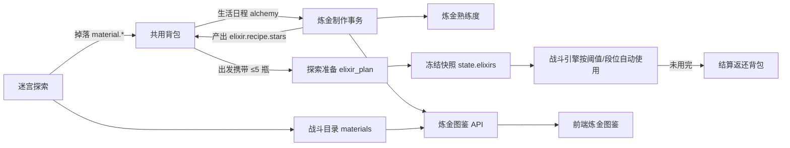

## Product Overview
在 Agent 世界新增"炼金"玩法：居民把迷宫探索掉落、目前只能卖店的素材，炼制成商店买不到的一次性药水。炼金接入日常生活日程由 Agent 自主规划制作，形成"探索掉素材 → 炼金制药 → 探索携带消耗"的闭环，并新增炼金图鉴，让素材拥有制作价值。

## Core Features

### 炼金制作
- 10 种固定配方，素材来自 7 个迷宫的 28 种掉落物。
- 配方炼金等级要求统一收敛到 1～10 级，与美食食谱的等级跨度一致，避免"练到 88 级才能做"的断层；高阶配方的实际门槛由深层迷宫的素材掉落决定。
- 每瓶产出 1～5 星药水；炼金熟练度越高、素材品阶越高，高星概率越大；星级放大药效并影响回收价。
- 新增炼金熟练度成长：制作积累经验，等级影响高星概率并解锁配方，图鉴显示等级与经验条（等级上限仍为 99，但配方只要求 1～10 级）。
- 由生活日程自动执行：每轮最多 3 个配方、每个 1～5 瓶，总量不超过 15 瓶；每瓶消耗体力与素材，不可手动点击"立即制作"。

### 药水清单与效果（1★基准，2～5★按 1.15/1.3/1.5/1.75 放大）

| 药水 | 配方素材 | 炼金等级 | 效果 | 战斗触发 |
| --- | --- | --- | --- | --- |
| 愈合药剂 | 黏液×2、绒耳兔毛×1 | 1 | 立即恢复 22% 最大生命 | 生命低于治疗阈值 |
| 灵思药剂 | 蝠翼×2、晨光粉尘×1 | 2 | 立即恢复 30% 最大法力 | 法力低于阈值且需施法 |
| 铁壁药剂 | 铁矿×2、苔石碎片×1 | 3 | 物理防御 +25%，6 回合 | 生命低于 60% 或已受到物理攻击 |
| 狂暴药剂 | 晶蜥鳞×1、矿鼠皮×2 | 4 | 物理攻击 +20%，6 回合 | 遭遇精英/Boss 的首回合 |
| 再生药剂 | 古木树脂×1、孢子×2 | 5 | 每回合恢复 5% 最大生命，6 回合 | 生命低于 70% 且无同名状态 |
| 秘法药剂 | 遗迹碎晶×1、水灵精华×2 | 6 | 魔法攻击 +22%，6 回合 | 遭遇精英/Boss 的首回合 |
| 烈焰药剂 | 火焰核心×1、灰烬粉×2 | 7 | 火属性强化 +25 个百分点，6 回合 | 遭遇精英/Boss 的首回合 |
| 圣盾药剂 | 傀儡核心×1、熔岩碎片×2 | 8 | 护盾吸收 28% 最大生命，5 回合 | 生命低于 60% 且无护盾 |
| 星辰药剂 | 星蚀结晶×2、裂隙粉尘×1 | 9 | 暴击 +15%、暴击伤害 +30%，6 回合 | 遭遇精英/Boss 的首回合 |
| 净化药剂 | 领主残核×1、星蚀裂隙印记×1 | 10 | 清除全部负面状态，3 回合免疫新增负面 | 负面状态 ≥2 时 |

攻击/元素/暴击类药水（狂暴、秘法、烈焰、星辰）只在遭遇精英或 Boss 的首回合自动使用，普通怪战斗不消耗，避免为小怪浪费；防御与恢复类仍按血量阈值触发。整场冒险未遭遇精英/Boss 时，这些药水原样保留并在结算时返还。

### 携带与使用
- 出发准备时由 Agent 从背包现有药水中选择种类、星级与瓶数，携带上限 5 瓶，与红药、蓝药的 20 瓶上限分开。
- 战斗中按上表触发条件自动使用，任意炼金药水共享 3 回合冷却，与红蓝药的 2 回合冷却互不影响；同一回合最多使用 1 瓶。
- 未用完的药水在结算时按原星级返还背包；已消耗数量与剩余数量记入探索结算与战报。提前召回、倒地、体力耗尽均不返还已消耗部分。
- 5 瓶上限按 30/60/120 分钟探索时长设计，配合"精英/Boss 才进攻类"的触发策略，足以覆盖一场冒险且不会囤积过量。

### 炼金图鉴（视觉与信息）
- 在现有图鉴弹窗新增一级页签"炼金图鉴"，内含"配方"和"药水一览"两个二级分段。
- 顶部为居民切换与炼金熟练度等级条；左侧配方卡片显示药水名、星级、所需等级、材料是否齐备与"可制作/材料不足/等级不足"状态。
- 右侧详情展示五档实际效果数值、材料清单及对应迷宫来源、可产出星级、制作经验与体力、单瓶回收价、制作历史。
- 药水一览以卡片网格展示全部药水，点击查看效果说明与素材出处；背包中的药水显示星级、数量与"一次性战斗药剂"标识。
- 视觉延续 Agent 世界图鉴的白底圆角卡片与金色星级语言，炼金主题以紫罗兰与青绿渐变点缀，状态与进度用颜色和微动效表达。


## Tech Stack Selection
- 后端：沿用 Django + Python 3.11（`uv` 管理），复用 `system_settings/agent_world/` 现有领域模块、`AgentInventoryItem` 共用背包、`WorldAction` 执行体系与 WebDAV 同步框架，不引入新依赖。
- 前端：沿用 React + TypeScript + Tailwind CSS（Vite），复用 `WorldDialog`、`common/Select`、`LevelPlate`、`DataExportButton`、现有图鉴与卡片规范，不引入新 UI 库。
- 内容数据：迷宫素材直接读取已安装的 `combat-1.0.19` 目录（`combat/data/materials.csv`），**不修改、不发布新的战斗内容包**。

## Implementation Approach

### 核心策略
1. **炼金作为独立领域**，与烹饪平行（`alchemy_*` 模块），而不是塞进 `cooking_*`。理由：制作规则、熟练度、同步版本相互独立，避免烹饪协议继续膨胀，也便于后续扩展药剂类型。
2. **药水效果不走战斗内容包**，采用与美食一致的"纯规则模块 + 出发冻结快照 + 引擎应用"链路（`elixir_effects.py` + `combat/elixir.py` + `elixir_sync.py`）。理由：`combat/store.py` 拒绝同版本覆盖，发布新内容包成本高且会影响全部战斗目录；冻结快照同时保证历史结算可复现。
3. **成品 SKU 定为 `elixir.<recipeId>`**，复用共用背包、价格批次与市场体系；扩展现有星级前缀元组即可获得"同配方不同星级分格 + FIFO 扣减"能力，不新建物品表。
4. **制作事务与烹饪同构**：`AlchemyOperation` 幂等键 + 事务内"校验 → 扣料 → 定星 → 入库 → 加经验 → 体力事实"。取消、失败、崩溃恢复均按未完成瓶数续做，不重复扣料或重复发奖。
5. **战斗使用采用确定性策略**：触发条件只依赖当前血量/法力/状态/回合、敌人段位（普通/精英/Boss）与冻结的携带清单，不使用随机数，保证恢复快照后重放结果一致；每场独立 `elixir_cooldown`，避免同回合连喝。

### 关键数值与规则
- 品质：素材无星级，按 `materials.csv` 的 `level` 映射品阶（1-9→1、10-19→2、20-39→3、40-69→4、70+→5）；按"数量 × 基础价值"加权得到 `A`；沿用 `p = 0.04 + 0.46*((L-1)/98)^0.8 + 0.25*((A-1)/4)`，成品星级 `1 + Binomial(4,p)`，每瓶用稳定操作 ID 确定性生成。
- 星级倍率：`1.0 / 1.15 / 1.3 / 1.5 / 1.75`（低于美食的 2.2，避免防御与元素类滚雪球）；百分比效果保留一位小数，点数类效果向上取整。
- 熟练度：等级曲线与厨艺一致（Lv.1～9 为 `200L−100`，Lv.10～98 为 `1900+10x+ceil(x²/2)`），满级 99 继续累计经验；等级纯派生不落库。10 条配方的 `required_level` 依次为 1～10，后期配方靠深层迷宫素材而非高等级卡住。
- 配方 10 条、每瓶 1 体力、每轮 ≤3 配方 × ≤5 瓶、总 ≤15 瓶；配方规则可编辑等级/经验/体力/回收价，不开放增删。
- 携带上限 `elixir_carry_cap = 5` 瓶（与红蓝药 20 瓶分开），可在冒险设置中配置；共享冷却 3 回合。
- 攻击类药水触发：仅在 `enemy.rank in ('elite','boss')` 且为该场遭遇首回合时使用；普通怪与寻敌阶段不消耗。

### 性能与可靠性
- 配方仅 10 条，图鉴一次请求返回全部规则与当前居民材料/growth 投影，前端 15 秒轮询且页面隐藏时跳过，沿用 `useCooking` 模式，无 N+1。
- 库存查询沿用 `source__sku` 过滤；炼金候选按居民一次聚合，避免逐配方查库。
- 出发扣库、结算返还、制作提交全部包在事务内并使用幂等键；战斗推进只做内存态变更，不额外写库；回合事实按现有 `CombatFact` 批量写入。
- 兼容性：`combat_schema_version` 8→9、新增 `alchemy_schema_version=1`；旧快照缺失炼金字段时按"未携带"处理，不回溯重算已结算冒险。

## Architecture Design



### 模块划分
- **规则层**：`alchemy_catalog.py`（配方与默认规则）、`alchemy_quality.py`（星级与等级曲线）、`elixir_effects.py`（纯效果规则，多端共用）、`alchemy_limits.py`（携带 5 瓶/轮次/体力上限）。
- **领域层**：`alchemy_models.py`、`alchemy_materials.py`（软预留与扣料）、`alchemy_plan.py`（计划冻结）、`alchemy_service.py`（单瓶事务）、`alchemy_runner.py`（生活活动入口）、`alchemy_queries.py`（图鉴投影）。
- **接口层**：`alchemy_views.py` + `urls.py`（只读图鉴与规则编辑）。
- **战斗衔接**：`combat/elixir.py`（候选、校验、出发消费、使用判定、段位触发）、`explorations.py`（扣库/冻结/返还/事实）、`elixir_sync.py`（跨域校验）。
- **同步层**：`alchemy_sync.py`、`alchemy_integrity.py`，接入 `utils/sync_manager.py`。
- **前端**：`types/api/alchemy.ts` → `api/alchemy.ts` → `hooks/useAlchemy.ts` → `components/Alchemy/*` → `WorldCatalogDialog` 页签。

### 数据流
生活日程选中炼金 → 规划器按库存与等级生成候选并冻结计划（含材料软预留）→ `alchemy_service.commit_portion` 按瓶扣料、定星、入库、加经验 → 图鉴轮询读取规则与熟练度 → 探索准备冻结携带清单（≤5 瓶）并扣库 → 引擎按血量阈值或精英/Boss 首回合使用、递减数量、记回合事实 → 结算按 SKU+星级返还剩余并入 WebDAV 快照。

## Implementation Notes
- 严格按 `docs/代码规范文档.md` 分层，禁止把规则、事务、视图、序列化写在同一文件；前端禁止组件内直接 `fetch`。
- `inventory_stock.py` 中的星级相关前缀元组（`:28/:32/:42/:50/:56/:64`）统一加入 `elixir.`，并补充 `kind='elixir'`；修改前先跑现有烹饪/作物库存测试，避免影响旧物品分格与 FIFO。
- 元素强化药水需要扩展 `combat/effects.py::element_multiplier`，把 `state` 中 `modifier` 且 `stat=<element>_power` 的加成按百分点合并，并受 `element_power_min/max` 裁剪；不得改动无属性与毒伤恒为 1 的既有规则。
- 净化药剂在 `combat/elixir.py` 内实现：移除 `code in ('dot','modifier')` 的负面状态，并写入 `immune` 状态由 `effects.status` 跳过新增负面；不改动技能施加逻辑的既有行为。
- 攻击类药水的段位判定读取战斗状态里的敌人 `rank`（现有引擎已使用 `enemy.rank in ('elite','boss')`）；同一场遭遇只判定一次"首回合"，未遇精英/Boss 不消耗。
- 出发准备采用结构化决策时新增"携带炼金药水"问题，候选总量受 5 瓶上限约束；模型故障回退为"不携带"，重试保持稳定；文本模型路径在美食选择后补一次独立选择，非法输出按不携带处理。
- 结算返还的 `operation_id` 使用 `run.pk+':elixir-return'`，与药剂返还 `run.pk+':return'` 区分，避免幂等冲突。
- 同步：`alchemy_schema_version=1`，战斗同步升到 9；`utils/sync_manager.py` 的元数据、版本校验、导出、恢复、三方合并五处必须同时接入，否则多设备会丢数据。恢复校验失败时整包拒绝，不做部分导入。
- 日志沿用现有 logger，记录"操作键 + 居民 ID + 配方 + 星级 + 数量"，不打印完整背包与 prompt。
- 爆炸半径控制：不改动烹饪、农牧场、市场既有规则；仅在 `item_catalog.py` 增加 `elixir.` 分支，避免炼金成品落到"其他"分类。

## Directory Structure

```
O-Doc/
├── system_settings/
│   ├── models.py                                  # [MODIFY] AgentTask.task_kind 增加 alchemy，新增 alchemy_config 字段；底部导入炼金模型
│   ├── urls.py                                    # [MODIFY] 新增 agent-world/alchemy/recipes、skill、history、规则编辑路由
│   ├── migrations/
│   │   └── 0080_alchemy.py                        # [NEW] AlchemyCatalog/AlchemySkill/AlchemyOperation/AlchemyIntegrity 建表
│   ├── sync_state.py                              # [MODIFY] 如炼金存在仅本机表则登记白名单
│   └── agent_world/
│       ├── alchemy_catalog.py                     # [NEW] 10 条配方规则（等级 1～10）、默认经验/体力/回收价、素材白名单、校验
│       ├── alchemy_quality.py                     # [NEW] 材料品阶映射、加权平均、星级概率、等级曲线、确定性抽样
│       ├── elixir_effects.py                      # [NEW] VERSION=1、BASE_EFFECTS、星级倍率、五档预览、describe、战斗效果解析
│       ├── alchemy_limits.py                      # [NEW] 携带上限（5）、每轮配方/瓶数上限、体力消耗
│       ├── alchemy_models.py                      # [NEW] 目录/熟练度/制作事实/完整性四表，字段与烹饪对齐
│       ├── alchemy_materials.py                   # [NEW] 软预留、按其他未结束计划排除、按配方扣减素材
│       ├── alchemy_plan.py                        # [NEW] 计划快照构建与校验（规则冻结、材料分配）
│       ├── alchemy_service.py                     # [NEW] commit_portion：幂等、授权、体力、扣料、定星、入库、经验
│       ├── alchemy_runner.py                      # [NEW] run_alchemy_opportunity：租约、三轮候选、WorldAction 落库
│       ├── alchemy_schedule_plan.py               # [NEW] 日程候选过滤、材料预留与计划校验
│       ├── alchemy_queries.py                     # [NEW] 图鉴投影：配方、五档效果、材料来源迷宫、熟练度、历史
│       ├── alchemy_views.py                       # [NEW] 只读列表/详情/历史 + 规则编辑，错误码沿用烹饪
│       ├── alchemy_sync.py                        # [NEW] checkpoint/changed/register_signals/reconcile
│       ├── alchemy_integrity.py                   # [NEW] 资产清单与指纹
│       ├── alchemy_icons.py                       # [NEW] 药水图标资源映射（可选，复用前端绘制时留空）
│       ├── life_runner.py                         # [MODIFY] 分派 activity == 'alchemy'，体力与任务配置
│       ├── life_eligibility.py                    # [MODIFY] 增加炼金可执行性判断
│       ├── life_schedule.py                       # [MODIFY] 按已建 AlchemyOperation 扣减计划、重试续做
│       ├── life_planner.py                        # [MODIFY] 可选活动加入炼金
│       ├── life_daily_planner.py                  # [MODIFY] 日规划候选与摘要
│       ├── life_daily_facts.py                    # [MODIFY] 当日制作事实
│       ├── life_config.py                         # [MODIFY] 炼金任务配置读写
│       ├── life_choices.py                        # [MODIFY] 活动选择权重/候选
│       ├── life_sequential_planner.py             # [MODIFY] 顺序规划分支
│       ├── daily_feed.py / daily_feed_*.py        # [MODIFY] 日动态文案与摘要
│       ├── action_runner.py                       # [MODIFY] repair_effects、stale 排除、tick_alchemy
│       ├── analytics/                             # [MODIFY] 统计口径增加炼金产出与消耗
│       ├── inventory_stock.py                     # [MODIFY] 星级/批次前缀加入 elixir.
│       ├── item_catalog.py                        # [MODIFY] 增加 elixir. 分类与图鉴条目
│       ├── market_shop.py / market_inventory.py   # [MODIFY] 按需登记炼金药水可挂牌/回收，商店不出售
│       └── combat/
│           ├── elixir.py                          # [NEW] 候选汇总、计划校验、出发消费、段位/血量触发、净化/护盾/元素效果应用
│           ├── engine.py                          # [MODIFY] player_action 增加 elixir 分支与共享冷却
│           ├── effects.py                         # [MODIFY] element_multiplier 合并状态中的元素加成
│           ├── preparation.py                     # [MODIFY] 携带炼金药水候选（≤5 瓶）、校验与故障回退
│           ├── explorations.py                    # [MODIFY] 出发扣库/冻结、消费统计、结算返还、事实写入
│           ├── sync.py                            # [MODIFY] metadata 增加 elixir 版本，schema 升 9
│           ├── views.py                           # [MODIFY] 准备/命令接口返回携带药水信息
│           └── test_elixir.py                     # [NEW] 携带、扣减、精英/Boss 触发、普通怪不消耗、返还、幂等、恢复测试
├── utils/
│   └── sync_manager.py                            # [MODIFY] 导出元数据、版本校验、导出、恢复、三方合并接入炼金域
├── docs/
│   ├── agents/Agent炼金与药水说明.md                # [NEW] 配方、效果、熟练度、携带、同步与代码入口
│   ├── agents/README.md                           # [MODIFY] 新增炼金入口与阅读路线
│   ├── 项目结构文档.md                             # [MODIFY] 前端 Alchemy 目录与后端模块说明
│   ├── 数据同步逻辑说明.md                          # [MODIFY] alchemy_schema_version=1、combat 9、升级顺序与备份要求
│   └── UI设计规范文档.md                            # [MODIFY] 炼金图鉴卡片、星级与状态色规范
└── frontend_react/src/
    ├── types/api/
    │   ├── alchemy.ts                             # [NEW] AlchemyRecipe / AlchemySkill / AlchemyHistory / 效果与状态类型
    │   ├── itemCatalog.ts                         # [MODIFY] ItemCategory 增加 elixir
    │   └── combat.ts                              # [MODIFY] 携带炼金药水、使用与返还统计字段
    ├── api/
    │   └── alchemy.ts                             # [NEW] getAlchemyRecipes / getAlchemySkill / getAlchemyHistory / updateRule
    ├── hooks/
    │   └── useAlchemy.ts                          # [NEW] active 懒加载 + 15s 轮询 + AbortController
    ├── components/
    │   ├── Alchemy/
    │   │   ├── AlchemyCatalogContent.tsx          # [NEW] 图鉴主体：居民切换、熟练度条、二级分段、左列表右详情
    │   │   ├── ElixirCard.tsx                     # [NEW] 配方卡片：名称、星级、需求等级、材料齐备状态
    │   │   ├── ElixirDetails.tsx                  # [NEW] 详情：材料与迷宫来源、五档效果、经验体力、历史
    │   │   ├── ElixirEffectPreview.tsx            # [NEW] 五档效果切换与数值展示
    │   │   ├── AlchemySkillBar.tsx                # [NEW] 等级、经验、累计制作数
    │   │   ├── AlchemyRuleEditor.tsx              # [NEW] 等级/经验/体力/回收价编辑弹窗
    │   │   └── alchemyCatalogExport.ts            # [NEW] 图鉴导出表
    │   ├── AgentWorld/
    │   │   ├── WorldCatalogDialog.tsx             # [MODIFY] 新增 alchemy 页签（FlaskConical），渲染改查表
    │   │   ├── ItemCatalogDialog.tsx              # [MODIFY] 新增药水分类
    │   │   ├── InventoryItemIcon.tsx              # [MODIFY] elixir. 图标映射
    │   │   └── InventoryItemDetails.tsx           # [MODIFY] 药水星级与"一次性战斗药剂"说明
    │   └── Combat/
    │       ├── ExplorationPreparation.tsx         # [MODIFY] 展示携带炼金药水计划与 5 瓶上限提示
    │       ├── CombatObservationSummary.tsx       # [MODIFY] 已携带/已消耗/已返还统计
    │       ├── CombatObservationFeed.tsx          # [MODIFY] 药水使用事件文案
    │       ├── CombatFoodSummary.tsx              # [MODIFY] 并列展示药剂摘要（复用样式）
    │       └── atlas/PotionPortrait.tsx           # [MODIFY] 支持 elixir 图标绘制
    ├── art/
    │   └── potionVisuals.ts                       # [MODIFY] 扩展 elixir.<recipe> 调色板与形状映射
    └── views/
        └── AgentWorldPage.tsx                     # [MODIFY] 图鉴页签初值与日动态跳转支持 alchemy
```

## Key Code Structures

炼金配方规则（`alchemy_catalog.py`，存储于 `AlchemyCatalog.rules`，图鉴编辑只改数值）：

```python
RECIPE = {
    'id': 'healing',                # 成品 SKU: elixir.healing
    'name': '愈合药剂',
    'required_level': 1,            # 炼金熟练度门槛，10 条配方依次 1～10
    'experience': 6,
    'energy_cost': 1,
    'sale_price': '12.00',          # 1★ 基础回收价
    'trigger': {'kind': 'hp_below', 'value': 0.35},   # 或 {'kind': 'elite_first_round'}
    'ingredients': [{'sku': 'combat.material.moss_cave.1', 'quantity': 2},
                    {'sku': 'combat.material.sprout_meadow.rabbit', 'quantity': 1}],
}
```

冻结后的携带条目（写入 `Exploration.snapshot.elixirs` 与 `state.elixirs`）：

```python
CARRIED = {
    'sku': 'elixir.healing', 'recipe_id': 'healing', 'name': '愈合药剂',
    'stars': 3, 'count': 2, 'version': 1,
    'effects': {'hp_restore': 0.286},       # 已按星级放大，出发后不再重算
    'summary': '立即恢复 28.6% 最大生命',
    'trigger': {'kind': 'hp_below', 'value': 0.35},
    'lots': [{'quantity': 2, 'price': '18.00'}],
}
```

战斗状态新增字段：`state.elixirs`（上述条目列表，总量 ≤5）、`state.elixir_cooldown`（下次可用的 tick）、`result.elixirs = {carried, used, returned, events}`。

## 验证要点
- 后端单测：品质分布与确定性、素材不足时不制作、幂等提交、出发扣库与结算返还、净化/护盾/元素加成、同步校验拒绝篡改。
- 触发单测：精英/Boss 首回合使用攻击类药水并扣瓶；普通怪战斗全程不消耗；未遇精英/Boss 时结算全额返还；5 瓶上限生效。
- 前端验证：图鉴五档效果展示、材料不足置灰、背包图标与星级、战报与结算统计。
- 端到端：同一居民连续两天"探索 → 炼金 → 携带 → 结算"闭环；WebDAV 双端恢复后熟练度、制作历史、携带中冒险均一致。


## 设计风格
延续 Agent 世界现有图鉴的"深色世界 + 白底圆角卡片"语言，用炼金主题的紫罗兰与青绿渐变做点缀，保持与美食图鉴一致的骨架，让用户一眼看出这是同一体系的新增页签，而不是突兀的新页面。

## 页面结构
1. **顶部工具栏**：左侧居民切换胶囊 + 炼金熟练度卡片（等级牌、经验进度条、累计制作瓶数、下一级解锁提示）；右侧搜索、状态筛选、导出按钮。
2. **二级分段控制器**：「配方」与「药水一览」，胶囊样式，切换时内容淡入。
3. **配方页**：左侧为可滚动配方卡片列表（药水名、需求等级、星级、材料齐备度、可制作/材料不足/等级不足状态）；右侧详情区展示五档效果切换、材料清单及迷宫来源标签、经验与体力、单瓶回收价、制作历史折叠列表。
4. **药水一览**：三列卡片网格，卡片含药水插画、星级、一句话效果、素材出处；点击打开详情抽屉。
5. **空状态**：无配方可制作时展示"素材不足"提示与可前往迷宫的名称，不使用空白页。

## 交互与动效
- 卡片 hover 轻微上浮与边框高亮，选中卡片左侧出现 2px 主题渐变竖条。
- 五档效果切换带数字滚动或淡入过渡；熟练度进度条加载时从 0 动画到当前值。
- 材料不足的行使用浅灰底色与红色缺口数字；可制作状态使用青绿描边小标签。
- 详情区内部滚动使用 `scrollbar-hide`，避免撑出弹窗外层；移动端切换为单列并保留吸顶分段控制器。

## 响应式
- ≥1280px：左列 380px + 右侧自适应；1024～1279px：左列 320px；<1024px：单列，卡片横向滚动。
- 弹窗内部不使用整页滚动，列表与详情各自独立滚动，保证顶部熟练度条与分段控制器始终可见。
