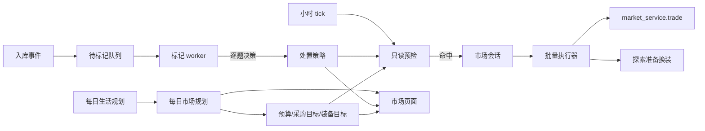

## Product Overview
把市场从“每天一次机会”改为“每天规划、按小时执行”的持续经营：居民每天规划预算与买卖目标，入库物品自动带处置意向，系统每小时检查市场并按需进场，让库存能持续流转，而不是堆在背包里。

## Core Features
- 每日市场规划：每天一次生成当日市场预算、采购目标（商店商品、居民挂牌、装备部位）和处置策略复核；装备目标按“当前装备、等级、职业、背包装备”签名决定沿用还是重算。
- 入库自动标记：美食、炼金成品、材料、农作物、畜产品等入库后进入待标记队列，逐项决定自用、出售商店、上架，以及目标持有量、星级顺序、挂牌价；历史未标记库存统一补标记。
- 支持美食、炼金成品、材料上架；撤单返还、星级与价格批次、探索口粮和炼金材料预留都要正确衔接。
- 每小时预检：只读检查当小时商店批次、居民挂牌、待处置物品和到期改价；命中才进场，进场时间在小时内随机并避开整点；装备目标每天允许 1–2 次盲进。
- 批量处置走独立执行通道，先处置后采购，稳定幂等键，部分失败记录原因并跳过，不整单失败。
- 装备“不买”按具体实例永久记录；买入后统一走探索准备换装，不自动装备。
- 市场页面展示日规划、采购目标、处置策略、不买清单和小时执行原因，用户能看懂“为什么没买/没卖”。


## Tech Stack
- 后端：Python 3.11 + Django + DRF，沿用现有 `system_settings.agent_world` 领域模块与迁移体系；新增迁移 `0082_market_plan.py`。
- 决策：沿用现有 JEV 决策服务（`system_settings/decision/jev.py`、`routing.choose_connections`），单问题单答案、0.2–2 秒；每日规划这类多输出任务使用现有文本模型 `complete_json`。
- 前端：React + TypeScript，沿用 `frontend_react/src/components/Market/*`、`useMarket.ts`、`api/market.ts` 的轮询与分页模式。
- 测试：Django TestCase + 现有市场专项测试；前端类型检查、构建与关键页面验收。

## 待确认假设
- 新增的 `MarketPlan`、`MarketGoal`、`MarketDisposition`、`MarketNoBuy` 纳入 WebDev/WebDAV 同步与市场完整性检查点；`MarketTick`、租约、执行凭证不同步（与 `MarketRuntime` 同类处理）。
- 旧的每日 `market_prepare` 机会保留为低频兜底：新流程故障或功能开关关闭时仍可走原路径。
- 通过 `LifeConfig.settings.market_automation_v2` 开关灰度上线，默认关闭，验收后开启。

## Implementation Approach
采用“三条独立链路 + 一个执行器”：

1. **入库标记链路（事件驱动）**：烹饪、炼金、收获、迷宫掉落、购买、撤单返还完成后，把可交易 sku 写入待标记队列；独立 worker 逐 sku 问决策模型，写入“目标持有量 + 出售/上架比例 + 星级顺序 + 挂牌价比例”。问题拆开问，禁止把数量与星级顺序合并成笛卡尔选项；每轮限制问题数与时长，问题键与状态签名幂等，失败默认“保留 + 待复核”。
2. **每日规划链路（每天一次）**：在每日生活规划完成后生成 `MarketPlan`，输入余额与预留、按 sku 聚合的库存、种植/炼金/探索计划缺口、当前装备与职业、已有挂牌、昨日目标。输出当日预算、采购目标、处置策略复核、装备目标。模型失败时降级为“沿用昨日策略 + 不新增采购目标”。
3. **小时预检链路（只读）**：每小时为每个活跃居民计算稳定随机分钟（避开每小时最后 5 分钟），到点只读检查：待处置超量、目标匹配的商店批次/挂牌、到期改价/撤回、装备候选（代码先过滤职业/等级不可穿戴与属性无提升）。没有命中就记 `skipped`，不扣体力、不占世界执行位。
4. **执行器**：命中后创建一次市场会话（仍扣 5 体力、5 分钟），先执行撤回/改价，再出售/上架，最后采购；批量动作直接调用现有 `market_service.trade`，不经过 `call_market_tool` 的 20 次计数，因此不受会话调用上限限制。每笔使用稳定 `request_id`（计划 + 处置/目标 + 版本），重试幂等；单笔失败记录原因并继续。

**预算与预留**：新增 `MarketPlan.spent` 和 `market_plan_scope`；`market_spending.spending_context` 在计划范围内返回 `min(计划剩余预算, 余额 − 其他生活预留)`，`change_money` 优先扣计划预算。探索/炼金计划的软预留优先于出售/上架，执行时重新计算可用量。挂牌预期收入不计入可用资金。

**品类扩展**：`tradable()` 增加 `elixir.` 与 `combat.material.`；出售路由保持现状（作物/畜产/美食走 `sell_to_market_shop`，材料走 `sell_combat_material`，炼金成品与纪念品只能上架）。星级顺序由执行器显式按星排序选行后再 `split_item`，不能用现有行内 FIFO 代替。

**装备**：`MarketNoBuy` 以 `(owner, actor, equipment_id)` 唯一，记录判定时价格与属性快照；候选过滤先查黑名单，再用 `permitted`/`_wear_slots`/`preview_equipment` 过滤不可穿戴与无提升装备，只把“可穿戴且有提升”的候选交给决策模型判断买/不买。装备卖给商店（`sold=True`）、实例删除、居民归档时清理黑名单。

**性能与可靠性**：
- 预检按 `(owner, actor, status)` 建索引；库存按 `sku + stars` 聚合，避免逐行读；同一挂牌/装备按 `version` 缓存判断结果，版本变化才重问。
- 每居民每轮标记 worker 限制问题数（建议 20）与总时长（建议 60 秒），超出顺延；预检不拿世界执行位，只有进场执行才拿。
- 批量执行逐笔短事务，单笔失败不回滚已完成动作；`MarketTick` 每小时唯一，防止重复进场。
- 诊断沿用 `run_diagnostics.progress/finish_record`，记录阶段、动作、失败原因，不写密钥或大对象。

## Architecture Design


## Directory Structure
```
system_settings/
├── agent_world/
│   ├── market_plan_models.py        # [NEW] MarketPlan/MarketGoal/MarketDisposition/MarketDispositionTask/MarketNoBuy/MarketTick 模型与状态枚举。
│   ├── market_disposition.py        # [NEW] 入库入队、按 sku 计算超量、星级顺序选行、预留校验、策略执行计划。
│   ├── market_disposition_worker.py # [NEW] 逐 sku 提问（意图/持有量/星级顺序/价格），问题键与答案缓存，限额、默认兜底。
│   ├── market_planning.py           # [NEW] 每日规划输入聚合、输出校验、装备目标签名沿用、失败降级。
│   ├── market_goals.py              # [NEW] 商店/挂牌/装备目标匹配与预检，数量与价格上限计算。
│   ├── market_no_buy.py             # [NEW] 装备不买记录、候选过滤、出售/删除/归档清理。
│   ├── market_tick.py               # [NEW] 小时随机分钟、MarketTick 幂等、预检调度、进场与执行记录。
│   ├── market_batch.py              # [NEW] 批量处置与采购执行器，直接调用 trade，稳定幂等键与部分失败处理。
│   ├── market_plan_queries.py       # [NEW] 计划/目标/策略/不买/tick 的只读查询与分页。
│   ├── management/commands/backfill_market_dispositions.py # [NEW] 历史可交易库存补标记队列。
│   ├── market_service.py            # [MODIFY] tradable 扩展 elixir/material；deliver 后入队；出售路由保持不变。
│   ├── market_spending.py           # [MODIFY] 支持 MarketPlan 预算范围，合并生活预留。
│   ├── market_sessions.py           # [MODIFY] 支持批量模式会话校验，不改变 5 体力/5 分钟。
│   ├── market_decision_candidates.py# [MODIFY] 挂牌候选覆盖炼金成品/材料；保留旧决策循环兼容。
│   ├── market_model_context.py      # [MODIFY] 投影与详情主题补充新品类。
│   ├── market_sync.py               # [MODIFY] 新模型加入资产检查点、指纹、恢复校验与清理。
│   ├── market_archive.py            # [MODIFY] 归档时清理计划、策略、不买与待标记任务。
│   ├── life_market.py               # [MODIFY] 创建/复用 MarketPlan；旧每日机会作为兜底。
│   ├── action_runner.py             # [MODIFY] tick 中调用 market_tick，预检不占执行位。
│   ├── cooking_service.py           # [MODIFY] 产出后入队待标记。
│   ├── alchemy_service.py           # [MODIFY] 产出后入队待标记。
│   ├── farm_bonus.py                # [MODIFY] 收获入库后入队待标记。
│   ├── combat/explorations.py       # [MODIFY] 迷宫掉落与返还入库后入队。
│   ├── market_views.py              # [MODIFY] 新增 automation 只读接口。
│   └── urls.py                      # [MODIFY] 注册新接口。
├── migrations/
│   └── 0082_market_plan.py          # [NEW] 新表、索引、约束；不写业务回填。
frontend_react/src/
├── api/market.ts                    # [MODIFY] 新增 automation 请求。
├── types/api/market.ts              # [MODIFY] 计划/目标/策略/不买/tick 类型。
├── hooks/useMarket.ts               # [MODIFY] 新 tab 与轮询状态。
├── components/Market/MarketPlanPanel.tsx        # [NEW] 日预算、目标进度、装备目标。
├── components/Market/MarketDispositionPanel.tsx # [NEW] 按 sku 的持有量/出售/上架/星级顺序。
├── components/Market/MarketTickPanel.tsx        # [NEW] 小时预检与执行原因、不买清单。
├── components/Market/MarketDialog.tsx           # [MODIFY] 接入新面板。
├── components/AgentWorld/decisionProcessGuides.ts # [MODIFY] 烹饪/炼金/探索流程补充“入库处置”说明。
docs/agents/
├── Agent市场日规划与小时执行说明.md   # [NEW] 当前规则、边界、代码入口。
├── Agent世界市场与交易一期说明.md     # [MODIFY] 品类扩展、批量执行、无到期/调价规则。
├── Agent市场决策执行说明.md           # [MODIFY] 决策拆分、标记 worker、预检与执行器。
├── Agent世界统一生活执行说明.md       # [MODIFY] 市场由日规划+小时 tick 接管。
├── Agent世界市场MCP说明.md            # [MODIFY] 手动 MCP 不受标记约束。
docs/数据同步逻辑说明.md               # [MODIFY] 新模型同步范围与检查点。
```

## Key Code Structures
```python
class MarketDisposition(models.Model):
    owner_id: str
    actor_id: str
    sku: str
    target_hold: int          # 目标持有量；新产出按此自动套用
    sell_ratio: int           # 0-100，占超量部分
    list_ratio: int           # 0-100，占超量部分
    star_order: str           # 'high' | 'low'
    list_price_ratio: Decimal # 挂牌价 = value * ratio
    status: str               # 'pending' | 'active' | 'review'

class MarketGoal(models.Model):
    owner_id: str
    actor_id: str
    kind: str                 # 'shop' | 'listing' | 'equipment'
    sku: str
    slot: str                 # 装备目标使用
    min_stars: int
    quantity: int
    filled_quantity: int
    max_unit_price: Decimal
    deadline: datetime
    status: str               # 'open' | 'filled' | 'cancelled' | 'expired'
```

## Implementation Notes
- 任何模型调用都不得放在数据库事务或世界执行位内；预检、标记 worker 均在事务外完成，执行器只做短事务。
- 批量执行使用稳定幂等键；重试同一动作必须复用，不能生成新键；部分失败不重试同一条件。
- 挂牌不是收入；采购只看计划剩余预算与真实现金，探索/炼金预留优先。
- 装备黑名单只在实例真正消失时清理；转手给其他居民仍保留。
- 新品类上架要同时覆盖：候选、工具文案、撤单返还、同步校验、战斗携带、炼金预留。
- 前端遵守现有红线：禁止原生 `<select>`，文本域 `resize: none`，滚动区域 `scrollbar-hide`。
- 文档必须先于实现更新，避免规划被当成现行规则。

