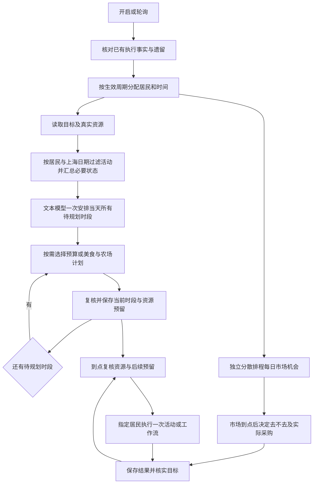
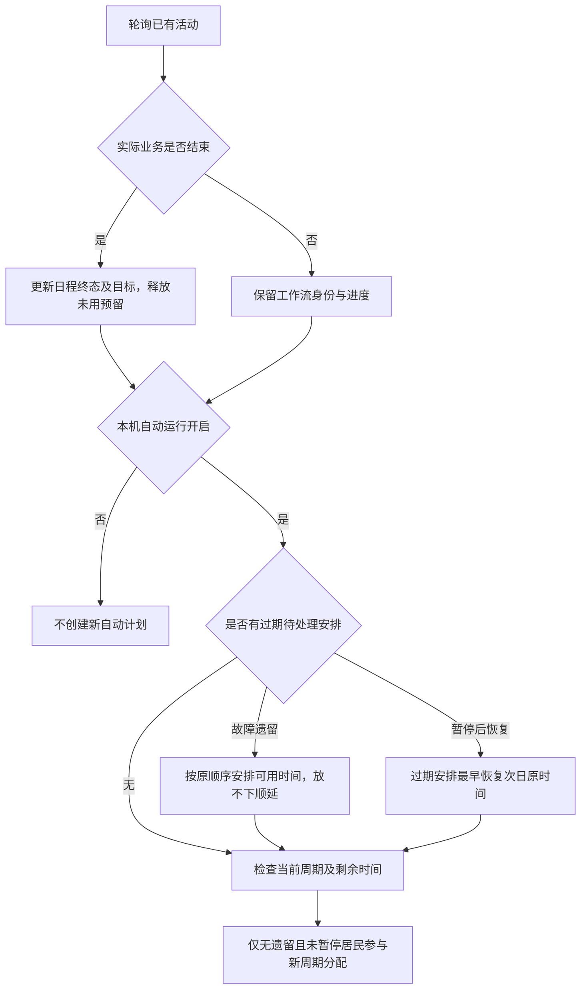
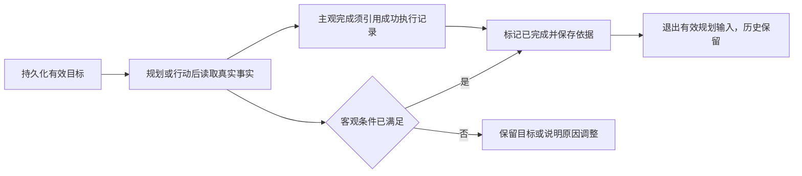
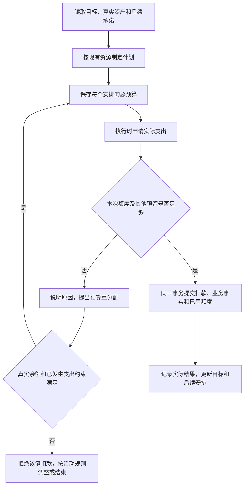
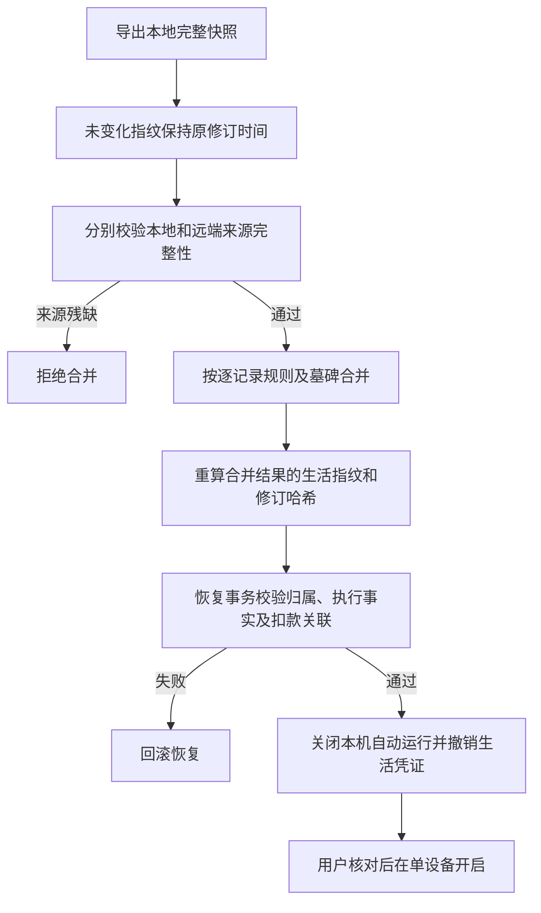

# Agent 世界统一生活规划与执行

更新时间：2026-10-17。本文描述统一生活入口的代码行为；数据库迁移、真实模型及双设备 WebDAV 接续分别验收。

## 1. 入口与执行流程

系统设置 → Agent →「统一生活运行」配置参与居民、固定间隔或自然日／周／月／年总次数、活动时间、居民最小间隔和补充规划最少剩余时间。Agent 世界 →「生活日程」查看周日程、列表、预算、调整历史，以及编辑居民偏好与目标。

内置卡片配置评论、发帖、旅行、农场、市场和投资能力，不再独立分配居民或时间。手动执行明确选择居民。普通自定义任务保留原调度，其确定安排与实际执行记录进入生活上下文。



计划不会提前创建成交、出发或消耗体力。模型提议，服务端验证身份、活动、预算与实际支出。新的时间表采用稳定 ID，刷新或重启不重新抽签。

日程活动始终走普通文本模型，与结构化决策开关和旧 `life_activity` 排除配置无关。服务端先按居民及上海日期汇总全部待规划时段，过滤活动开关、资格、农场每日限制、美食材料与等级体力、投资时段和旅行报价，再一次请求模型安排整天活动及理由。角色使用姓名、性格、兴趣和补充提示词，职业单独传一次；身份背景、年龄、MBTI、外貌与表达模块不加载。公共事实包括当前资金、体力、目标、近期实际成果和已确定安排；不附完整历史或其他居民的随机安排。没有候选的时段仅允许代码休息，其他时段不能主动休息。

整日意向先保存到各时段 `context.daily_choice`（原时间、活动、理由及旅行依据），领域准备或后续提交失败时继续当前阶段，不重抽已确定的活动。手动重新规划会清除该检查点；已完成、执行中、已关联实际执行或已固化农场队列的安排不覆盖。提交仍按最新资源和日程版本核验。旅行先固化预算，防止后续投资占用选定旅行的额度。

自动轮询每次处理一位居民的一个上海日期，整日不按50项截断。失败处理覆盖该日所有仍待准备的时段，已提交安排不回退；剩余时段统一五分钟退避，三次失败后结束。退避期间其他日期可以继续规划，同日新时段不能提前触发失败项重试。

旅行预算先尝试结构化 `life_budget` 场景：提供“不去”及500、1500、2500……世界币上限，最高档按可负担目录价格补齐；现金不足完整档时用实际可预留余额作为末档。选“不去”则本轮不提供旅行；选预算则在额度内随机最多三个地点。关闭、排除、未配置、不可用或非法选择时，直接随机最多三个可负担地点，交给整日日程模型判断，不增加普通模型预算请求。文本模型选中的目的地及报价存入 `context.travel_plan`，无结构化预算结果时由代码匹配最低覆盖档。当前资金供模型判断，服务器内部仍扣除其他有效预留，最后检查整日预算；规划不扣款。

投资保留保守10%、均衡15%、目标优先25%的有限预算选择及现有执行规则；仅工作日提供，持仓输入限股票种类数、总市值、整体盈亏比例和行情日期，缺失估值标为未知。农场输入空地、种子总数、已有作物及已安装队列的预计成熟状态、可领取畜牧产物；队列预测只使用真实库存，不假设采购已完成。

美食选定后最多三轮菜谱、数量和用料决策，每道1～10份；后续时段扣除已计划使用的材料。细节见[美食说明](./Agent美食星级与厨艺成长说明.md)。农场开工单独从服务端生成的整套种植候选中选择作物、数量、施肥与采购上限；优先使用世界结构化决策连接，普通模型兜底也只选候选ID。采购上限不重复预留市场采购款，提交前再按最新库存和可支配余额裁剪。阅读评论、发帖、美食制作、探索均不预留新增生活资金。新日程的旅行目的地在整日规划时确认；购物、投资交易和创作内容在各自工作流继续决定。

到点复核已保存预算，条件未变时不再调用模型重新分配。已选旅行地点停用、价格变化或费用无法覆盖时明确要求重新规划，不能静默换地点；旧旅行安排仍兼容原流程。领域失败及外部消耗保留已发生事实，不把计划当作成果。

日程顺延复用 LifeItem 及 LifeRevision；整日检查点和旅行报价依据存于既有 context，随原日程 WebDAV 同步并检查恢复格式，无新增表字段或迁移。

主图描述自动运行路径。自动开关关闭时，手动旅行仍可推进，并核对已结束的业务事实、释放未用预算；此时不创建新的自动生活计划。

## 2. 次数、周期与恢复

- 使用上海时间。固定间隔为每日活动窗口的固定网格；60 分钟全天对应 24 个世界机会。周期次数按时间分段随机，不集中生成。
- 12 次分给 4 人各 3 次；13 次本周期随机一人多一次，余数不跨周期累计。体力不足重试后休息、市场观望和明确失败均消费机会。
- 投资机会正常完成决策但没有成交时，和市场决定不进入一样记为休息；投资执行报错或中断仍记为失败。
- 参与居民及节奏从下次周期生效；暂停立即阻止新执行和费用提交。长周期提前生成全部时间点，活动意向分批规划，每天按资源修订当天安排。
- 默认同一居民最小间隔 15 分钟，新周期规划至少剩余 4 小时。22 点启动不压缩全天次数；容量不足返回明确错误。固定间隔补充只保留窗口内尚未到来的网格点。
- 遗留居民不参加新周期分配，其他居民正常分配。故障遗留按顺序挪到可容纳时间，不集中补跑；暂停后恢复，过期安排最早挪到恢复次日的原时间。未来安排保持时间。
- 前一任务、旅行、探索、市场或执行租约仍占用居民时，当前任务移至可用空档等待，不累计业务重试次数；农场也需通过该检查。每日市场不跨日，窗口耗尽时按当天规则结束。体力不足仍最多三次顺延，持续不足以休息结束；规划输出持续无效仍有重试上限。旅行节点可在原面板继续或取消，已发生扣款不退款。
- 迷宫探索按实际出发时长占用居民日程。出发或接续时，当天与探索时段冲突的未开始安排及其后续日程按原顺序顺延探索时长，并写入调整记录。顺延超出当天活动窗口的安排，以及探索跨午夜直接影响的次日日程，只放入次日活动窗口内的可用空档；不移动次日未受影响安排。每日市场机会仍限原定当天；每日最多一次的农场队列开工不会重复安排。次日无可用空档或活动日限额不允许时，普通安排以明确原因结束并可重新规划；每日市场机会按当天规则结束。不自动继续挤压次日其余日程。
- 农场开工安排跨日期顺延时，取消旧日期尚未开工的种植队列并解除当前队列关联，保留各日期原始规划依据；农场活动及新时间继续保留，次日开工前按当天真实库存重新准备队列和截止时间。同日内调整（包括次日已有安排在其原日期内换空档）继续沿用已有队列。

### 遗留恢复与开关边界



暂停／恢复操作会立即检查对应居民的安排；正在执行的工作流核对实际进度，不重新整段执行。未来正常安排不作为过期机会重排。

## 3. 共享上下文和目标

输入包括居民性格、职业、偏好、生活方向、有效目标、真实现金和体力、背包与农场、持仓、在途旅行、近期真实执行、今天已做事项及后续计划。记录按上限截取，市场列表及日程支持分页；缺失资源返回空值。

目标分为进行中、暂停、已完成和已放弃，保存进展与原因，不要求完成日期。现金、库存及旅行目标根据实际数据检查；居民自行完成主观目标须引用成功执行记录。已完成和已放弃不再进入有效目标输入，历史继续保存。人工管理目标也可明确修改状态并说明原因。



## 4. 市场与预算

每位生效参与居民每天有一次独立逛市场机会，不占普通行动次数。在当天活动窗口内分段随机分散安排，时间写入生活日程；启动较晚时使用当天剩余时间。到点才读取最新行情、真实库存和后续预算，由居民决定进入或不去；决定不去会结束机会，决策失败且尚未进入市场时可在当天窗口内手动重试，进入市场后失败则结束机会且不可再次启动。市场不再作为生活规划的前置步骤，规划先使用现有资源。市场执行器可说明原因调整采购预算，再按真实成交刷新资产。

“每日市场规划 + 入库处置 + 每小时预检”开启后，不再生成上面这条旧机会（开关关闭时仍按原路径）：每日规划由代码算好数量/价格档位、再由结构化决策链逐题选择，生成当日预算和采购目标；入库物品按 sku 自动生成处置策略，小时预检命中才进场。居民不再依赖“当天一次机会”才能上架或采购；处置执行与采购共用当日 `MarketPlan` 预算，详细规则见[市场日规划与小时执行说明](./Agent市场日规划与小时执行说明.md)。

同一居民同一天沿用稳定身份，重启和同步恢复不重新抽时间，旧版当天已完成的市场准备也不会重复。世界执行位忙碌时保留机会；居民忙碌或体力不足可在当天顺延，超出窗口或持续不可执行则结束。暂停恢复只保留尚在当天窗口内的市场机会，过期机会不跨天积攒补跑。市场会话仍允许自由买入、上架、出售、改价及主动离开，沿用调用数和时限。旅行、农场等活动仍可在执行前按需补给，使用该活动原预算并刷新执行上下文；此类补给和手动执行不计作额外的每日自动逛市场机会。

每小时新商店批次商品格数为生效参与人数 × 2。每位居民在一个批次内最多选两个商品格；重复 SKU 的不同格分别计额度，已选格可继续买剩余库存。跨会话由实际成交记录累计校验。饲料不占格额度但仍扣款，居民挂牌不受该格额度限制。人数变化不改写已经生成的批次；历史批次不变。

预算是共享现金的预留，不是新增余额或提前扣款。每个安排保存总预算与累计已用；其他未结束安排的剩余额度必须保留。扣款、已用额度及业务事实在同一事务提交，投资不能花掉旅行预留。

迷宫探索不属于需要预先分配生活预算的活动。药剂是可选补给，可用未被其他安排预留的真实余额购买；余额不足时减少或放弃采购，仍按现有库存出发，不得因生活预算为零而阻止战斗。

旅行上下文提供启用目的地的最低、典型及最高实际价格，可选购物另留预算。农场现金预期包含扩地、建筑和升级；种子、动物、饲料由市场购买。超预算可调用 `adjust_life_budget` 或提交农场预算调整；旅行扣费前必要时再次请居民调整后续预算。调整须说明原因，不能低于已支出或突破真实现金。外部手动改动后，下次执行再复核。



预算保护约束已经预留的资金，不保证模型一定安排旅行或保留任意比例现金。当前没有固定投资仓位上限；若其他安排没有预算、居民又选择投入全部可用资金，仍可能接近满仓。这与可自主选择生活活动的设计一致，但不能把“有生活上下文”当作“不再满仓”的保证。

## 5. 模块与接口

居民属性卡在当前状态旁以单行浅色文字显示下一次生活活动的计划时间（上海时间）；跨天补充明天或日期，到点尚未执行显示“待执行”，悬停显示完整计划时间。摘要取当前账号下最早的 pending/deferred 日程，排除休息安排、暂停和归档居民；没有安排时不占位。此时间随属性数据刷新，属于现有日程的只读投影，不新增持久字段，也无需增加 WebDAV 同步内容。

| 模块 | 职责 |
| --- | --- |
| `life_models`、`life_config` | 生活配置、资料、目标、周期、安排、调整及归属 |
| `life_schedule`、`life_time` | 上海时间、分配、持久身份、暂停及恢复 |
| `life_context`、`life_planner` | 有界真实上下文、活动提议及目标检查 |
| `life_market` | 每日市场机会独立排程、到点执行及当天恢复 |
| `life_scope`、`life_runner`、`life_manual` | 指定居民、统一触发及兼容手动入口 |
| `life_budget`、`life_travel_budget` | 实际支出保护及可解释重分配 |
| `life_views`、`life_sync`、`life_snapshot` | 账号隔离接口、来源快照校验、合并指纹及恢复关联检查 |

接口前缀 `/api/settings/agent-world/life/`：`config/`、`profiles/<actor>/`、`goals/`、`schedule/`、`schedule/<id>/`。日程支持日期范围、居民、状态和分页；操作支持暂停、恢复、取消与人工重规划。失败安排可在详情里重试：已固化活动保留原活动并换新的执行键，避免撞上旧的失败机会记录；尚未固化活动意向的失败安排会重新排队规划。重新规划会清除旧执行检查点；若安排关联农场队列，会先取消尚未播种的项目并解除队列关联，再重新选择活动。已经过点的时间按原顺序顺延到活动窗口内下一个可执行空档。每日市场机会仅在原定当天活动窗口内、且上次尚未进入市场时可重试；进入市场后已消费该次机会，不能再次启动。已有旅行行程请在旅行面板继续或取消。规划失败且尚未执行的安排仍可按居民批量重新排队。目标选项通过 `goals/?options=1` 获取。前端 API、类型、Hook 和展示组件独立组织，复用 `WorldDialog` 及公共 `Select`。

## 6. 迁移和 WebDAV

迁移为 `0048_unified_life_planning`、`0049_life_snapshot_integrity`、`0050_migrate_world_life_schedule`。将同账号内置任务绑定居民合并为参与列表，跨账号资产冲突报错；初始节奏为默认值，不累加旧任务频率。转换旧随机计划尚未消费的未来时间点，已物化执行与旅行继续核对原业务事实；错过或结束的机会不复活。

升级后本机自动运行关闭。确认迁移结果与统一配置后再开启。旧内置独立机会调度停止；旅行节点推进、自定义任务调度和已提交事务的恢复保留。投资最新已发布收盘数据的修复保留，不改历史成交成本或账本。

同步配置、资料、目标、周期快照、安排时间、预算、结果关联及调整原因。导出时保存各账号生活聚合指纹，恢复核验指纹、归属、执行记录和预算关联，并将实际扣款键对应的账本合计与累计支出核对；缺关键数据拒绝整个事务。本机开关、租约、线程和授权凭证排除同步。恢复会关闭世界执行，新设备核对后人工开启；运行中安排先核对事实，不直接重放。所有同步设备升级后才恢复新快照，仍限定一台设备自动运行。

开发验证使用隔离数据库、模拟模型和模拟 API 浏览器。真实 WebDAV 跨设备接续、实际模型规划质量及部署生效不由静态检查替代。

审查修正：周期内居民按随机确定的顺序轮转，避免轮次交界违反最小间隔；随机落点受限时回退到最早可用点，再判断容量。自动运行关闭时仍核对已执行活动的终态，手动旅行完成后释放未用预算，不触发新规划。同步先校验两端来源，再重算合法合并结果的生活指纹；相同内容的重复导出不产生新修订。




## 7. 本次验收与启用步骤

- 首轮实现验证：31 项统一生活场景，连同市场、农场、旅行、投资、评论、自定义随机任务和快照恢复共 283 项测试通过；模拟模型及外部失败，不调用真实交易或搜索。
- 2026-09-30 审查修正验证：统一生活、快照同步与旅行相关测试共 131 项通过，覆盖重复导出、两端独立目标合并、残缺来源拒绝、关闭自动运行后的旅行收尾、连续 30 天可行时间分配。该数字为本轮相关范围，不与首轮数量累加。
- Node 22.14.0：类型检查与构建通过。构建仍有现有大包体积提示。
- 隔离 Chrome 与模拟 API：实际检查统一配置保存、周日程／列表、预算详情、目标新增、空日程、错误提示及 390px 窄屏。
- 未执行：实际用户数据库迁移、生产部署、真实模型行为、真实 WebDAV 双设备接续。

启用时先备份数据，停止旧自动执行，更新所有同步端，使用项目 Python 运行 `manage.py migrate` 应用0048–0050，再重启后端并发布前端。系统设置中检查转换安排、参与居民及节奏；确认遗留事实后开启本机生活运行。旧设备停止并同步后，才在新设备开启。

回归命令：

```bash
.venv/bin/python manage.py test system_settings.agent_world.test_life_market_schedule system_settings.agent_world.test_life system_settings.agent_world.test_market system_settings.agent_world.test_farm system_settings.agent_world.test_travel system_settings.test_agent_world system_settings.agent_world.test_investment system_settings.agent_world.test_farm_bonus system_settings.tests.SyncManagerTests system_settings.test_agent_random_schedule --settings=book_analysis.test_settings --noinput
cd frontend_react
npm run type-check
npm run build
```

## 8. 与讨论预期的对应及当前边界

| 已确认约定 | 当前对应 |
| --- | --- |
| 一个入口统一分配，任务只提供能力 | 世界配置、周期及指定居民执行；自定义任务保留原调度 |
| 公平分配机会，余数随机且不跨天补齐 | 周期内随机顺序轮转，时间及居民身份持久化 |
| 能理解过去、现在、接下来的生活 | 共享角色、资源、有效目标、近期结果和后续安排上下文 |
| 根据真实资源规划，超预算可以调整 | 先按现有库存规划，市场独立到点决策及活动执行前按需补给，说明原因后调整预留 |
| 完成远期目标后不再反复规划 | 持久化目标状态，完成与放弃退出有效输入，历史保留 |
| 重启不重抽、不重复消费、遗留优先 | 稳定安排身份、原业务事实接续、故障及暂停分别恢复 |
| 日程和持久资料同步，本机授权不随同步开启 | 日程界面、来源及恢复校验、本机执行状态排除同步 |

主要业务链路已按上述约定接入，但不能据此宣布所有规模和真实运行场景均已验收。当前模型上下文最多带 20 个有效目标、50 个后续安排、20 条近期执行、100 条背包记录；有总量提示，界面有分页，但模型尚无对应的全量分页读取或自动摘要能力。长周期每批最多规划 50 个安排，不能将它理解为一次模型调用已经完整理解全年计划。这是与最初“长记录摘要和分页”要求之间仍需补齐的范围。

真实模型能否合理安排预算、是否频繁改变意向、真实 WebDAV 双设备接续及部署后的实际行为，仍需单独验收。模型自主选择的质量与服务器预算、身份、幂等约束应分别观察。

### 周日历完整范围展示（2026-10-09）

周日程请求 `view=week`，按上海时间的 `[start, end)` 完整返回最多7天内、符合居民和状态筛选的全部安排，不按100条拆页。界面只保留上一周／下一周，每日列独立滚动；切周或筛选时不把旧范围记录显示到新日历。状态看板继续使用 `view=list` 和每页100条的分页契约。此查询和展示调整不新增持久化字段或同步数据。

### 旅行购物预算与可承担候选（2026-10-09）

生活安排 `LifeItem.budget` 是含路线和购物的活动总预算；`TravelJourney.snapshot.selection.shopping_budget` / 选择节点结果单独保存 Agent 选择的购物上限。总预算减路线费不自动成为购物上限，购物上限允许为0；选择阶段要求在真实余额、当前安排剩余额度和其他安排预留范围内分配可选购物，并在选择理由中说明零额度。

纪念品仍为3～5种地方主题虚拟商品，单价采用路线费约1%～10%的既有10币步长范围。新生成候选在正常价格下限不高于可消费购物额度时，多数从正常价域与可承担价域的交集中抽取，留一个完整价域候选。额度低于正常下限时不强行降价。已有报价、参考价值、稀有度及购物决策不因恢复而重生成，Agent仍可选择空篮；不保证买多件的合计都能承担。

购物节点重新读取实际生活剩余额度、其他安排预留、购物上限和余额，以最小值作为可消费金额，并要求按数量核算合计。界面旅行费用展示路线费，不把它称为含购物的总额。本轮仅复用已同步选择、商品报价及预算字段；实时额度为只读派生计算，不新增数据库字段或WebDAV数据。

### 每日市场机会独立排程（2026-10-10）

复用已同步的 `LifeItem`，继续使用历史 `market_prepare` 活动值和每日稳定身份；显示名称改为“每日市场机会”。机会的时间、状态、预算、执行关联及调整记录随既有 WebDAV 快照同步，不新增模型、字段或快照格式。普通周期分配、活动规划和遗留重排不会将独立市场机会计入普通行动次数或改作其他活动。小时市场批次仍按实际执行时间读取，不为提前规划固化报价。

本轮验证：每日市场排程新增13项通过，包含零预算调整后实际工具采购、账本及生活同步校验，以及项目无时区存储模式。生活、市场、农场、旅行、投资相关252项通过（排除并单独复现4项旧生活预算夹具失败：未规划活动被当作可消费活动）；Node 22前端类型检查通过。使用隔离数据库与模拟模型，未修改实际用户日程、部署或调用真实模型。


## 逐时段规划代码入口

`life_sequential_planner` 编排；`life_eligibility` 组合过滤；`life_budget_choices` 计算比例候选；`life_choices` 统一有限选择及回退；`life_budget_recheck` 负责执行前代码复核。`life_plan_proposal` 保留农场领域计划和只读对比命令的兼容入口。
