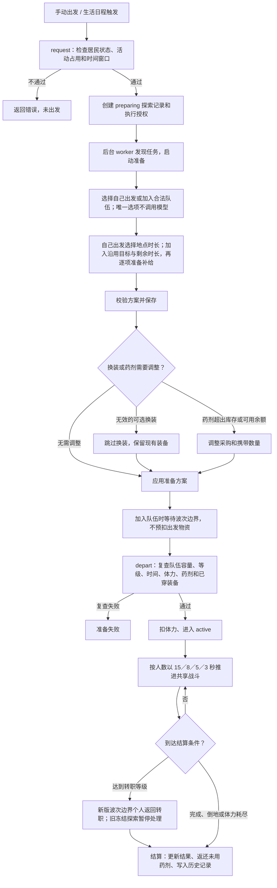

# Agent 迷宫探索与战斗

本文是当前业务入口，2026-10-24 对照组队实现、隔离回归及纯 local 浏览器检查；真实环境边界见组队验收记录。细节按下方导航继续阅读；[系统规划](./Agent迷宫探索与战斗系统规划.md)保留设计推演和阶段契约。

## 游侠「精准射击」改为「弱点射击」（2026-10-26）

`combat-1.0.33` 把游侠 10 级主动技能「精准射击」更名为「弱点射击」，效果从「偏高命中的物理攻击」改为「偏高暴击的物理攻击」：删除本次命中加成，改为本次暴击加成。

| 技能等级 | 伤害 | 本次暴击加成 | 耗蓝 | 冷却 | 持续 |
| --- | --- | --- | --- | --- | --- |
| 1 | 1.5 倍物攻 | 10 个百分点 | 4+0.4×等级 | 2 回合 | 即时 |
| 2 | 1.7 倍物攻 | 15 个百分点 | 4+0.4×等级 | 2 回合 | 即时 |
| 3 | 2 倍物攻 | 20 个百分点 | 4+0.4×等级 | 2 回合 | 即时 |

- 与战士「重斩」同耗蓝（4+0.4×等级）、同冷却（2 回合）：Rank 3 不暴击时 2.0 倍物攻高于重斩 1.62 倍，低于法师「魔力弹」2.8 倍魔攻；基础暴击倍率 1.5 下暴击为 3.0 倍，高于魔力弹。Rank 1／2 对应 1.5／1.7 倍。
- 三阶倍率按 1.5／1.7／2.0 单独给定，不套用「每级增加一级值 10%」的通用缩放；暴击加成 10／15／20 个百分点，与其他暴击来源相加后仍受 `critical_cap` 0.6 限制。
- 技能编号 `skill.player.007`、学习等级 10、耗蓝与冷却不变；改名只改 `skills.csv` 的 `name`，图鉴、技能面板与战斗动作共用该名称。
- 运行入口为 `combat/data/skills.csv`、`skill_levels.csv`、`skill_effects.csv`（`damage` + `attack_critical`）与 `manifest.json`；local 目录由 `frontend_react/scripts/generate-local-catalog.py` 同源生成。
- 无新增持久字段、迁移或同步协议；旧目录、在途探索与历史战报按各自冻结目录结算，不回写。
- 隔离验证入口为 `combat/test_ranger_balance.py`，覆盖三阶倍率与暴击加成，并断言不暴击高于重斩、低于魔力弹，暴击后高于魔力弹。

## 法师魔法屏障改版（2026-10-26）

`combat-1.0.33`（内容引擎 schema 10）把法师「魔法屏障」由额度护盾改为减伤加法力分担，持续 3 回合：

| 技能等级 | 减伤 | 法力分担 | 耗蓝 | 冷却 | 持续 |
| --- | --- | --- | --- | --- | --- |
| 1 | 10% | 30% | 6+0.6×等级 | 4 回合 | 3 回合 |
| 2 | 15% | 40% | 6+0.6×等级 | 4 回合 | 3 回合 |
| 3 | 20% | 50% | 6+0.6×等级 | 4 回合 | 3 回合 |

- 结算顺序是先防御、后减伤、再分担：属性与防御结算后为 100 点，减伤 20% 后为 80 点，其中 50% 改由法力承担，即生命 −40、法力 −40。
- 法力不足时只扣到 0，剩余部分回到生命，不出现负法力。承担量向下取整，余数归生命：81 点伤害、50% 分担时法力 −40、生命 −41。
- 物理、魔法、持续伤害与反伤都参与减伤和法力分担；减伤与其他来源相加，仍受 60% 状态减伤上限约束。
- 原「护盾量 1.0／1.1／1.2 倍魔攻」的额度护盾删除，不再产生护盾状态；圣盾等其它护盾技能不受影响。耗蓝、冷却、技能选择权重、命中与目标规则不变。
- 受击事件新增可选 `mp_paid`，观察栏在伤害卡片下显示「法力 −N」；无分担时不写该字段，旧事件仍可解析。

运行入口为 `combat/data/skill_effects.csv`（`modifier`+`reduction`、`mp_share`）、`skill_levels.csv` 与 `manifest.json`；引擎在 `effects.py` 的 `hurt()` 结算，`engine.available` 在状态生效期间不重复施放。local 目录由 `frontend_react/scripts/generate-local-catalog.py` 同源生成。本次不新增持久字段、迁移或同步协议，旧目录、在途探索与历史战报保持原规则，不回写。隔离验证入口为 `combat/test_mage_balance.py`；战斗套件 259 项中 6 项失败与本次无关（装备模板等级上限、历史 schema 版本 14、旧装备名），法师、规则、组队与服务用例通过，前端 `tsc --noEmit` 与定向 ESLint 通过。

## 牧师系基础法杖（2026-10-26）

`combat-1.0.31` 将基础单手法杖 `equip.mage_staff` 的职业许可扩展至牧师及全部后续转职：祭司、自然使、神官、审判者、德鲁伊、守望者；保留原法师系许可。等级条件仍按装备实例等级校验，等级达标的后续转职也可使用低等级基础法杖。秘法杖、晨祷权杖继续要求原有精通，本次不改变装备数值、掉落或转职赠送武器规则。

新生成法杖将这七个职业固化到现有 `EquipmentInstance.rules.job_levels`。旧装备的冻结穿戴条件不回写，因此更新后背包里已有的旧法杖不会自动获得新权限；此前的出售／上架意向也不清除。采用新版的新实例在出发准备时按既有规则参与换装比较，开放权限不保证模型一定更换。旧在途探索与历史结果保持原快照。

目录和装备条件沿用现有 WebDAV 同步，无新增持久字段、迁移或同步协议。运行入口为 `combat/data/equipment_professions.csv`、`equipment.allowed`、`equipment_snapshot.rules_for`；local 图鉴目录由 `frontend_react/scripts/generate-local-catalog.py` 同源生成。

## 日程组队探索预约（2026-10-25）

每日规划额外确认探索意向、地点和时长，不占主日程次数。完成当批规划后按地点配2～4人队伍，优先均衡与职业分散，时长投票／30分钟兜底；在共同空档插入10分钟准备及探索，预留体力和每日额度，自由活动不得挤占。未成队不安排单人预约。具体当前规则、同步15及验证边界见[组队探索预约说明](./Agent组队探索预约说明.md)。现有途中加入继续保留。

## 自由组队冒险（2026-10-24）

新版探索从自己出发开始即建立共享会话。自由活动选择冒险后，独立选择自己出发或加入正在探索的队伍；没有合法队伍直接自己出发。手动派遣台可显式选择队伍。代码先过滤账号、区域等级下限、容量、忙碌、休整、转职、活动时间、体力、每日额度和本机许可；低等级居民不会看到不能进入的区域。队伍版本使用成员修订，战斗回合不会让选项立即过期。手动刷新会保留仍合法的已选队伍，并更新成员、版本与可参与时长；成功刷新后队伍失效才回到自己出发，加载或失败时不清空选择。加入队伍时仍可设置战术风格，刷新校验未完成或失败时不能提交该队伍。

活动时间线按本人实际参与波次的成员快照展示人数：全程一人显示「单人探索 · 1人」，固定多人显示「组队探索 · N人」，期间人数变化显示人数范围。只统计本次成员加入至离开期间的波次，不计离队后的成员变化；尚无波次时读取结束快照或当前阵容，无共享会话的旧单人引擎显示1人，缺失人数事实时不猜测。单人倒地使用「角色倒地」，多人倒地保留「全队倒地」。单人报告不重复显示队伍击杀统计，界面去掉「（按怪物去重）」括注；统计计算口径保持不变。历史报告在时间线只读纠正文案，不回写旧结算。本次人数为现有同步波次、成员与结束快照的投影，不新增持久字段或WebDAV同步内容，也不改变探索流程和战斗结算规则。

自己出发仍为30／60／120分钟；加入按队伍剩余、个人空档及扣除其他预约预留后的每日额度取最小值，至少10分钟，体力不足时可缩至合法时长。短于30分钟的自由空档也可只提供加入。地点固定不重选，时长由代码计算；美食每30分钟一份向上取整。双方的装备、美食及药剂分别准备、消费和返还。

准备完成进入等待加入，在同一事务记录个人等待事实以保持同步完整性；重复请求沿用已保存的等待状态，不重复记录。不预占队伍槽位，不扣出发资源。波次边界在事务中重查，最多4人；满员、结束、归档或资格变化时只结束本次准备，不改成其他冒险。已经真实成交的可选采购留在本人库存。队长仅为展示身份，先离开时由最早加入者接任，不延长原队伍终点。

| 波初人数 | 回合间隔 | 每怪生命／物魔攻防和经验倍率 | 每波怪物数 |
| --- | --- | --- | --- |
| 1 | 15秒 | 1 | 1 |
| 2 | 8秒 | 1.5 | 1～2 |
| 3 | 5秒 | 2 | 2～3 |
| 4 | 3秒 | 2.5 | 2～4 |

每波只进行一次原有稀有遭遇抽取，精英与Boss合计最多一只，追加位置只抽普通怪；每趟最多一次Boss，成员变化不重置进度。怪物等级参考波初成员平均等级，继续服从区域限制；等级、MP、命中、暴击、闪避、抗性和速度不乘人数倍率。清场后寻敌等待仍为30秒。倒地者仍计本波人数，波内不重算难度、间隔或经验分母。

所有新冒险按速度决定敌我行动顺序：居民取最终敏捷；怪物取 `floor((5+2×(等级−1))×档案速度系数)`，最低1。普通1、敏捷／蝙蝠1.25、重甲0.8、魔法0.9。同速稳定随机，每轮每单位最多行动一次；按轮计算冷却、持续伤害和恢复。后台1秒发现到期回合，不补打离线回合；体力与每日额度按参与时间和跨5分钟边界计费，不随回合加速重复扣除；整秒计入后保留小数秒余量，跨日按实际时间拆分。推进晚于应执行时间超过30秒时先暂停计费，再结算已到返回截止的成员，不把中断时间补扣为体力或每日额度。

牧师治愈术可治疗单名队友；祭司恢复祷言、神官大治愈术作用于全体存活队友。盾墙全队减伤20%／25%／30%持续3轮，群嘲2轮，反伤仅自身，冷却5轮；同类全队减伤取最高值，遵守既有总减伤上限。怪物按伤害等量仇恨与有效治疗0.5倍分摊仇恨选目标，嘲讽优先；失效、倒地或退出解除强制目标。其他技能不自动变群攻。

三转旧主动改为50／60／70级，原80级起主要被动改60／70／80级；已是50／60／70的装备精通保留。神官复活术70／80／90级，恢复20%／30%／40%最大生命，耗蓝 `(30+2×等级)×1／1.15／1.3` 再应用原减耗，冷却10轮。每人每波最多被复活一次，不能自救，复活者下一轮行动。倒地不能被普通治疗或持续恢复救起，全灭失败；清场只做一次有现成蓝量和冷却资格的救援，不等待、不连锁；仍倒地者返回休整30分钟。

经验逐怪按基础经验（含品级）乘人数倍率再平分，之后各自应用既有等级差、经验上限和个人加成。组队逐怪生成公共掉落：普通／精英一个装备或材料槽，Boss装备与材料各一槽，没合法装备池回退材料。每件装备、每批材料各roll1～100，平点者重roll；获胜者得材料产量加成，个人有效装备概率按 `(基础概率+个人加成)×原间隔÷缩短后间隔` 封顶1，队伍取最高值。品质、装备池及Boss专属概率保留。单人保留旧时间额度；组队不累积、不消耗单人掉落机会。

普通加入／离队及转职在波次边界生效；召回、个人硬截止和撤权在下次行动前退出。退出保留此前所得，但不参与后续击杀奖励；剩一人下一波恢复单人，没人结束。实际击杀的参与名单、经验、roll轮次和奖励一次固化，刷新与重试不重抽。居民统计按本人逐怪参与事实累计魔物明细与首领数，经验按本人实际所得，各自完成／倒地／召回决定个人成功率；两人共同击杀各计入本人，世界击败总数按单位ID去重。统计包括普通药剂与炼金药水的实际使用量，详见[居民数据分析统计口径](./Agent居民数据分析统计口径.md#居民战斗经历排行榜)。

共享会话因中断暂停后，仍在队成员各自通过原有本机接续检查，全部就绪才恢复共享时钟；本机自动恢复仍逐人执行这些检查。只恢复一人不会推进仍暂停的队友，最后就绪时统一重置计时基准，不收取暂停期间消耗。未恢复者提前返回后，已就绪成员可以继续；原预计结束时间不延长。

共享会话、成员、波次、事件、个人结算及日程组队预约一起进入战斗同步15（波次指纹最低需要14）；执行许可继续使用仅本机的 `CombatRuntime`。共享事件哈希链与个人奖励事实互相校验，分叉须选择完整设备快照，不能逐行拼奖励。迁移0093新增 `AdventureWave.content_digest` 与 `AdventureParty.frame_version`，两者随组队业务数据进入WebDAV同步。新版聚合帧使用版本2：波次创建、击杀结果或结束状态改变时计算该波完整内容指纹；每个普通回合只读取波次ID、序号和指纹，不反复加载和散列历史原文。导出、同步与恢复仍逐波核对完整内容和指纹，再核对队伍聚合帧，不能只修改内容或替换指纹。版本1旧队伍保留原完整帧校验，下一次业务推进时一次补齐指纹并切到版本2；已结束且不再推进的旧历史不强制转换、不重算奖励。旧快照恢复明确补入版本1和空指纹，避免混用较新的本机值。其他设备恢复后不自动授权。旧在途仍走冻结单人引擎；旧历史不重算，闲置及旧探索结束后按新目录一次性补学技能。

入口：后端 `combat/party_rules.py`、`party_engine.py`、`party_options.py`、`party_sessions.py`、`party_tick.py`、`party_rewards.py`、`party_sync.py`；前端冒险方式与共享观察复用现有冒险入口。个人与共享战报统一进入观察栏“战斗动态”，不再单独显示上方共同战报；按共享事件 ID 关联个人有效时间，保留个人经验及奖励，并在动态内部支持共享历史向前分页（无个人时间关联的历史按队伍回合展示）；成员退出时保留当时冻结视图。观察画面首帧展示当前状态，不重放历史动作与飘字，后续仅按新增事件播放；历史事件仍保留在战报中。队伍投影批量读取成员、个人探索、居民与允许使用的图片资源，缺失成员来源会明确报错，不静默隐藏。完整验收见[组队冒险实施与验证记录](./Agent组队冒险实施与验证记录.md)。

## 法师系输出倍率（2026-10-24）

`combat-1.0.23` 提高法师系主动输出，倍率均乘当前有效魔攻，之后沿用魔防、减伤、属性、暴击与浮动结算：

| 技能 | 1级技能 | 2级技能 | 3级技能 | 结算边界 |
| --- | --- | --- | --- | --- |
| 魔力弹 | 2.2 | 2.5 | 2.8 | 单次；原1.35／1.485／1.62与重斩相同 |
| 灼烧术 | 2.4 | 2.7 | 3.0 | 直接伤害；原每跳0.2／0.22／0.24、3轮灼烧保留 |
| 炎爆 | 3.2 | 3.6 | 4.0 | 直接伤害；原每跳0.25／0.275／0.3、3轮灼烧保留 |
| 暴风雪 | 0.9×3 | 1.0×3 | 1.1×3 | 三段合计2.7／3.0／3.3；原降攻保留 |
| 衰败咒 | 0.8×3轮 | 0.9×3轮 | 1.0×3轮 | 完整持续伤害合计2.4／2.7／3.0；原降防保留，无直接伤害 |
| 魔灵契约 | 每段1.1 | 每段1.25 | 每段1.4 | 再乘召唤变体的段数与倍率；最弱变体2段，合计2.2／2.5／2.8 |

魔灵契约仍为60%水滴史莱姆（2段×1）、30%雷霆石像鬼（3段×1.2）、10%熔岩巨像（4段×1.6），原附加状态、灼烧和契约被动继续生效。未提高魔法屏障、虚弱咒、被动、生命、防御或其他职业技能；耗蓝、冷却、技能选择权重、命中、目标及持续轮数保持原规则，未改变探索准备或模型决策流程。

这些是技能系数，不保证每次战报数字都是普攻的同一倍数；战报显示实际扣血，受目标剩余生命和护盾限制，残血目标可能让高倍率法术和普攻显示相同伤害。

新目录安装后，空闲居民采用新版；正在探索的个人或共享会话保留冻结目录，返回后再更新。既有装备与历史战报不重算。本次不新增持久字段或迁移，沿用 `CombatCatalog`、目录切换事实及现有WebDAV同步，无需新同步开关。运行入口为 `combat/data/skill_effects.csv` 与 `manifest.json`，引擎仍使用 `effects.py`；local目录由 `frontend_react/scripts/generate-local-catalog.py` 同源生成。隔离验证入口为 `combat/test_mage_balance.py`。本次规则、法师伤害、组队、历史和服务套件共134项，133项通过（含6项新增伤害与local目录一致性检查）；1项快照版本测试被工作区量化同步版本校验提前拦截，使用改动前combat-1.0.22内容包同样复现，未修改量化代码。真实居民收益与生产部署仍需另行观察，不能把倍率提升视为所有职业排名的保证。

## 狂战士嗜血剑术（2026-10-24）

`combat-1.0.24`（内容引擎schema 7）将狂战士独有的 `skill.player.073` 从「双手剑精通」改为「嗜血剑术」。保留稳定技能ID、50／60／70级学习成长和双手剑穿戴资格；原本这项额外的武器攻击贡献加成改为10%／15%／20%吸血。继承自剑士的剑术精通与双手剑精通不受影响，狂怒击缺血增伤、不屈低血减伤仍保留。

- 仅实际穿戴在武器位的双手剑启用；卸下、换为其他武器不生效。不是自动扣血或锁定低血线。
- 普攻及直接物理技能按目标真正损失的生命累计，包含暴击和狂怒击增伤后的实际伤害；不含护盾吸收、超过剩余生命的过量伤害、持续伤害、魔法、召唤、反伤或圣盾破盾反击。
- 同次行动各段先完成伤害结算，再按总有效伤害乘吸血比例向下取整，恢复一次自身生命，最多补至生命上限，不受治疗能力加成。回血在普通反伤前发生；已因破盾反击等倒地时不回血，不复活、不改变原倒地与救援规则。不到1点不强制补1点。
- 恢复使用现有 `heal` / `healing` 战斗事件，来源及目标均为本人，战报显示「嗜血剑术·吸血」，观察沿用治疗飘字。组队中实际自疗遵循既有有效治疗仇恨口径。

本次无新增持久字段、迁移或同步协议。新效果保存在现有版本化目录与战斗快照中，沿用CombatCatalog、个人／共享事实和WebDAV完整性校验；同步设备需更新支持新效果的代码。新目录安装后空闲居民采用新版；在途冒险保留原目录及原精通，返回后更新，历史和装备不重算。`attributes.py` 按武器启用被动，`effects.py` 负责扣血后吸血；`test_lifesteal.py` 覆盖触发范围、连击、暴击、残血、护盾、反伤顺序、组队归属与旧目录。前端图鉴、技能详情和探索 `(i)` 共用当前规则，local目录同源生成。规则、法师、吸血、组队及历史套件104项隔离回归通过；Node22类型检查和定向ESLint通过，1440px／390px纯local图鉴核对名称、三个等级、触发条件与10%吸血效果说明，无页面脚本异常。真实生产与双设备WebDAV未在本次验证。

## 不屈分档减伤（2026-10-24）

`combat-1.0.25`（内容引擎schema 8）将狂战士「不屈」改为按当前血线取最高档，技能ID及60／70／80级学习等级不变：

| 当前生命比例 | Rank 1（Lv.60） | Rank 2（Lv.70） | Rank 3（Lv.80） |
| --- | --- | --- | --- |
| ≥50% | 0 | 0 | 0 |
| <50%且≥30% | 5% | 7.5% | 10% |
| <30%且≥10% | 10%（2倍） | 15%（2倍） | 20%（2倍） |
| <10% | 20%（4倍） | 30%（4倍） | 40%（4倍） |

血线均严格小于：恰好50%不触发，恰好30%按基础档，恰好10%按2倍档。每次直接伤害或持续伤害结算前，根据当时生命重新计算，连击跨血线后从下一段进入新档，不追溯减免已经承受的伤害。吸血或治疗把生命抬回更高血线后，下一次伤害自动降档；各档不相加。与防御动作、装备或队伍减伤相加后仍遵守原60%总减伤上限，不改变护盾、防御和复活规则。

当前规则使用新的 `passive_tiered_reduction` 效果码，旧目录和在途快照里的 `passive_low_hp` 保持原「低于30%触发5%／7.5%／10%」效果；返回并采用新目录后再切换。无新增持久字段、迁移或同步协议，沿用现有目录、战斗快照与WebDAV事实校验，所有同步设备需更新引擎。前端技能说明、图鉴、local目录和探索 `(i)` 同步维护。回归入口为 `combat/test_defiance.py`，覆盖各档临界点、连击跨线、回血降档、物魔／持续伤害、60%封顶、组队与旧快照效果；本次规则、法师、吸血、不屈、组队及历史110项隔离回归通过；Node22类型检查与定向ESLint通过，1440px／390px纯local图鉴核对三档说明且无页面脚本异常。不代表真实部署或远端WebDAV已验收。

## 回合恢复说明（2026-10-24）

冥想与圣愈在存活角色每个实际交战回合行动前触发一次；寻敌、暂停、离线不触发，恢复值不超过资源上限。单人15秒、组队8／5／3秒仅是回合推进间隔，恢复没有独立15秒计时器。`combat-1.0.26` 将6条旧技能说明及公共效果文案统一为“每个交战回合行动前恢复”；职业图鉴和居民技能详情对旧目录的同一旧文案作展示纠正。只更正文案，不改恢复比例、结算或旧目录内容，无新增字段、迁移或同步协议。

## 防具四件套与头部分类（2026-10-25）

combat-1.0.27基础包提供五种甲类各五档头部装备，原equip.head系列改为布甲法帽，其余甲类使用独立模板。现行新目录的布甲、皮甲、轻甲、重甲和板甲精通均要求头、身体、手、脚四件同类齐穿，缺件或混穿不触发；盾牌与武器精通沿用对应单件条件。旧目录使用原规则，既有装备的属性与冻结穿戴条件不回写。目录沿用现有WebDAV同步，无新增模型字段或迁移。当前吟游诗人规则见下一节；实施检查与验证边界见[执行检查表](./todo/吟游诗人与防具分类实施计划.md)。

## 吟游诗人回合规则（2026-10-25）

combat-1.0.28／引擎9当前代码加入第五个一转吟游诗人：10级吟游诗人→30级乐师／咒歌者→50级战歌指挥／镇魂歌者及琴圣／魔音术士，共7职业和23项技能；当前combat-1.0.30仅保留旅人（10～30）、吟风（30～50）、月弦（50～99）三档竖琴，双手持握；70、90级独立模板及新掉落已移除。精确职业成长、技能等级、倍率、耗蓝、冷却、基础持续时间以运行CSV为准，离线生成来源为`scripts/combat_design/bard_content.py`。新内容用于采用该目录的新冒险，旧冻结目录不回写。

- 乐师分支负责增益和削弱，咒歌者分支负责伤害。每名施法者只能维持一首主旋律，攻击／保护曲切换时移除自己旧曲效果；不同来源同类攻强／守护增益取最高，不重复相加。指挥艺术乘算主旋律强度，凯旋终章每首最多延长一次。
- 皮甲精通在10／20／30级升级，头、身体、手、脚齐穿皮甲时，自己施加的音律状态持续+1／2／3回合；不增加直接伤害、冷却或层数。无完整皮甲不生效。通用乐器精通只检查武器位，不要求防具套装。
- 琴圣回旋琴音三段至少一段命中才得一层节拍，最多3层；华彩乐章3层时消耗并强化为4／4.5／5倍。余音仅直接攻击实际造成生命伤害后按30%／40%／50%概率判定，每行动最多一次，随机一个其他存活队友，无人则自身；攻强8%、命中5个百分点、暴击3个百分点随机取一，基础2回合，同一施法者对同一目标只留一项。持续伤害、召唤、反伤和破盾反击不触发。
- 魔音术士共振按施法者独立记录，最多3层，基础3回合，叠加刷新到期；毁灭终曲命中才消耗自己的层数，其他施法者层数保持。额外穿透与不谐余震只影响对应直接攻击。
- 镇魂曲群体降攻，Boss减半。封声命中后阻止主动技能但保留普攻，Boss50%成功；封声结束后至少一回合不能再封声。安魂庇佑与其他减伤共同受60%上限。
- 全部选技由代码根据存活目标、已有增益、蓝量、冷却和层数评分；低层终结技降低权重而非强制禁止，药剂／防御仍走现有风格权重。战斗不新增模型调用。

状态存于既有个人／共享战斗JSON，用户已确认全部进入WebDAV；共享与个人完整帧均包含这些状态。已通过实际tick生成状态、SyncManager全量导出／重复恢复和个人／共享帧篡改拒绝测试，覆盖节拍、余音、主旋律及敌方共振。暂停不推进回合，恢复保存绝对到期回合，不重发增益或补离线回合。恢复沿用撤销本机执行授权的规则。七职业服装、独立氛围、竖琴握持、14项主动预览、HUD与音乐战报已接入；纯local在1440／390／320px验证样例、空、加载、错误。固定种子抽样及详细证据见[执行检查表](./todo/吟游诗人与防具分类实施计划.md)；真实远端WebDAV和生产部署未执行。无新数据库字段或迁移，旧目录不回写。规则入口为`bard_combat.py`，持续状态结构校验为`bard_state.py`，前端显示取已确认快照，不由动画写回。

## 入口与执行

居民冒险面板、每日探索记录和内置生活活动接入同一探索领域。手动探索与统一生活自动安排共用授权及资源检查；自动探索由本机开关控制，默认关闭。

2026-10-23 起，未建档居民在空档检查中只按1级新手预检探索；满足能力、时间、体力和运行资格后，由代码直接启动首次探索准备，不经过顶层活动选择，也不提供暂不活动。正式探索请求自动创建档案和初始装备，预检不写入这些数据；条件不足则等待，建档后恢复普通自主活动选择。该引导不跳过后续地点、时长和补给准备，也不保证战斗成功。

新空档探索先选择冒险方式，再逐项使用决策连接选择地点、时长、美食、风格、红药数量、蓝药数量与未处理装备；加入时地点与时长由目标队伍确定，唯一合法选项跳过模型。已确认问题保存检查点，失败后退避接续，不回退整套准备文本模型。旧日程及手动探索在结构化场景启用且未排除“迷宫探索准备”时走同样的逐项准备方式；场景关闭或排除时仍保留原文本模型准备路径。转职选择仍由模型负责，持续战斗、伤害、奖励与成长由代码执行，页面打开和演示动画不决定结算。

探索按“准备 → 持续遭遇与交战 → 返回结算”推进；旧冻结探索转职时可暂停；新版共享冒险在波次边界让达到转职条件的居民返回，其余成员继续。系统中断可进入暂停。普通唤醒按当前刻度推进，不用停机墙钟时长补发大量回合。实际结果保存为业务事实，查看历史不重抽奖励。

### 出发准备流程与模型边界

新版准备先选择自己出发或加入合法队伍。自己出发再按角色性格、MBTI、冒险职业和等级选择可进入的迷宫与时长；加入则固定队伍地点并由代码计算时长。随后依次选择美食、探索风格、红药和蓝药数量。地点候选会在代码中排除未达到推荐等级下限的迷宫；自己出发时长候选为当前允许的30、60、120分钟；加入使用至少10分钟的实际可参与时长。药剂数量候选包含 0 瓶，红药为 0～20 瓶，蓝药上限按“20 − 已选红药”生成，代码再结合库存、可用余额和实际药剂携带上限生成采购与携带方案。

之后代码逐件判断当前持有期尚未处理、且符合角色等级的闲置装备，不按职业过滤。已穿戴、已售、绑定、收藏，以及本持有期已有出售或上架标记的装备不参与这轮候选；**已标记出售或上架的装备下次出发准备不会重新询问**。空槽且可穿戴时直接装备；已有装备时，决策模型同时看到该部位现有装备和候选装备，可选择更换、出售或上架。等级符合但职业或精通不允许穿戴的装备只提供出售或上架选项。更换后会单独决定旧装备出售或上架。决定保存为可同步的 `gear_prepare` 战斗事实；高等级装备暂不做标记，升级后仍可判断。买入或买回同一装备实例产生 `gear_trade_in`，开始新的持有期并清除该实例旧处置意向的影响。

结构化准备从 `preparation_intents` 获取持有期内标记并跳过；保留的文本准备输入同样过滤这些闲置装备，当前穿戴仍作为比较信息保留。数量风险只针对同次新掉落、新买入或此前尚未处理的装备，不能理解为每次重新判断所有历史库存；当前未加单次未标记装备数量上限。

探索过程本身不调用大模型。新空档准备遇到决策连接故障时保留已确认检查点，按原阶段退避接续；不会用普通文本模型或代码默认选择替代尚未确定的答案。旧日程及手动的结构化准备保留原代码回退：默认30分钟（遵守指定约束）、红药3瓶、蓝药0瓶，再按携带上限、库存和未预留余额调整；美食从足量同菜同星候选中稳定随机选择，无候选则不消耗，装备判断本轮跳过留待后续。上述旧路径关闭结构化场景时仍用原文本模型并验证完整方案。

旧市场机会通过 `MarketExecution` 进入居民集市时，`process_preparation_equipment` 兑现待处理标记：出售按装备商店回收价成交；上架根据装备和商店回收价询价，结构化挂牌定价场景给出回收价的10%、20%、30%、40%、50%五项，未启用时由文本模型定价。装备以唯一实例挂牌，其他居民可购买或卖家可撤回；交易通过市场成交记录和战斗装备事实链同步。

新版按日计划的小时预检／批量市场（`market_tick` → `market_batch`）同样接入 `pending_preparation_actions`，复用原 `process_preparation_equipment` 处理器及真实交易服务：不重新询问出售还是上架。待售装备直接按商店回收价出售；待上架装备只向既有 `combat_listing_price` 决策场景询问上述五档价格，批量路径不提供普通文本模型兜底。缺少场景或可用连接时保留标记等下一次小时预检；仅有这种不可定价的挂牌时不进场、不扣体力。连接临时失败保留意向，本小时不循环重试，其他买卖继续。

已确认挂牌价格保存到**已同步**的 `MarketPlan.context.answers['combat_listing_price:' + intent_fact_id]`，使用本持有期意向事实键区分问题；同批次失败、下一小时或次日计划、同步恢复后接续同一待执行意向时复用已保存答案，不重新抽取价格。价格答案与其他计划答案共用既有完整性指纹和WebDAV链路，不新增数据库字段。`MarketTick.hits` 仅记录本机执行统计，不承载业务选择。商店出售、挂牌使用原意向稳定请求键及交易事实幂等，已完成意向不重复执行；批量会话与同批其他买卖共用一次5体力入场和5分钟窗口，实际消费先保护后续日程，自动开关或授权停止后不提交新交易。手动市场入口保留原有手动资源边界。

同一次准备中，同件装备的穿戴与后续出售/挂牌使用独立事实键，支持同一部位连续换装。被换下的绑定或收藏装备保留在背包，不询问出售/挂牌；历史遗留的不可交易意图在市场阶段跳过。装备买入后按新的持有期间重新判断，原卖家的历史决定或挂牌不会阻止再次上架；原居民买回也同样处理。已执行的挂牌决定在撤单后仍视为完成。历史挂牌的同步按当时成交转移、撤单返还事实校验，当前归属由完整战斗事实链校验，允许后续合法转售。

正常完成、主动召回、倒地和体力耗尽都可以是已完成结算的探索结果；任务执行是否失败与居民是否战胜怪物分别判断。判断入口为 `explorations.execution_completed()`。

### 过期与失去授权后的收尾（2026-10-24）

`life_activity_recovery` 在生活和探索轮询中独立核对结束边界，不将本机许可作为被动收尾的前置条件。已出发探索按原出发事实与固化时长判定返程期限，保留5秒轮询容差；暂停、授权撤销、许可记录丢失或来自其他设备时，过期仍通过原结算事务按 `completed`（探索完成）收尾，保留战斗、经验、掉落和消耗，返还未用补给，终止关联日程并释放仅属于该探索的租约。不补打离线回合，不重新授权或调用模型。未到返程期限、为到期主日程提前返回的已出发探索仍记为 `recalled`（已召回）；未出发准备超期记为 `interrupted`（系统中断）。既有终态和不可变事实不追溯改写。

未出发的空档准备使用机会截止时间；没有机会截止的旧准备最多保留30分钟。暂停或等待恢复的空档探索阻挡到期主日程时可提前收尾。转职资格保留在冒险档案，收尾不替居民选择职业，后续仍走原转职入口；不为保留转职暂停而无限占用生活执行。重复收尾只产生一次终态和物资返还，单条异常留到下轮并记录日志，不阻止其他居民恢复。以上沿用现有探索、战斗事实、日程和库存的WebDAV链路，无新增字段或快照格式。

### 美食冒险加成（2026-10-18）

时长确定后独立选择一种同星美食或“不消耗”。自己出发30/60/120分钟需要1/2/4份，加入则每30分钟向上取整，只读取本人背包中同菜同星库存，数量不足的选项不发送给模型。候选只包含稳定标识、名称、星级、库存、消耗份数和实际效果；没有可选美食时不调用模型。结构化准备在风格之前选择，文本准备在完整方案确定时长后补一次独立选择。后续结构化风格、药剂问题只携带已选效果摘要。

决策输入除候选清单外，还包含居民当前职业名，以及上一次已结算探索是否使用美食和其结果（完成、提前召回、倒地、资源不足、系统中断）。上次探索只取已结算且非本次的记录；未结算的准备中探索、准备失败和被排除的记录都不参与判断。结构化与文本两条路径携带同一组字段，便于模型判断当前职业是否需要这类加成、上次补给是否划算。

出发事务按同星FIFO和库存价格批次一次扣除，保存规则版本、效果及消费明细；准备阶段不扣、不预留、不采购。出发前同星库存不足则不消耗并记录原因，不换菜、不跨星凑数。新空档决策故障保留检查点退避；旧路径故障或非法输出时才由代码从足量候选中稳定随机选择一种，没有候选则不消耗。模型正常选择“不消耗”时保持原意，取消和授权撤销仍终止准备。重试出发或恢复快照不重复扣库存。

加成只覆盖本次冒险，转职、升级和暂停继续保留；不改变原有冒险返回截止时间。提前召回、倒地、体力耗尽均不退美食。结束后历史保留消费摘要，日常角色属性不再包含加成。效果规则和20道菜的对应关系见[美食说明](./Agent美食星级与厨艺成长说明.md)。

攻防加成作用于原最终属性并向下取整；六属性强化/抗性与职业、装备来源相加后统一裁剪，不能先裁剪旧值再加美食。恢复只在存活角色实际交战回合的行动前触发，每资源一次，正恢复至少1点、不超上限、不复活、不受治疗加成放大；寻敌、暂停、离线不恢复。页面沿用现有恢复事件，不修改战斗动画。

实现入口：共享纯规则 `food_effects.py`、领域准备与消费 `combat/food.py`、跨领域同步校验 `food_sync.py`（均相对 `system_settings/agent_world/`）。新增 `prepared_plan.food`、`snapshot.food_version/food/food_adjustment`、`state.food`、`result.food/food_adjustment` 和出发事实同名字段；`food`包括菜谱、星级、数量、版本、效果及实际消费批次。旧字段缺失表示无加成。战斗同步协议9、烹饪协议4，详见[同步说明](../数据同步逻辑说明.md)。

### 炼金药水携带与自动使用（2026-10-19）

炼金药水最多携带 5 瓶，与普通红药、蓝药合计 20 瓶的上限分开，不占用红蓝药名额。底层准备计划支持显式给出配方、星级与瓶数；当前结构化准备尚无炼金药水选择步骤，未给出清单时由代码按治疗 → 法力 → 护盾 → 防御 → 再生 → 净化 → 攻击类优先级挑选。仅读取本人背包现有药水，不采购、不跨星凑数。

出发事务按“同配方 + 同星级”FIFO 扣库，把效果、单价、触发条件和剩余数量冻结进快照；规则修改不影响已出发冒险。战斗中每回合在常规行动前判定一次，任一次使用后进入 3 回合共享冷却（与红蓝药的 2 回合冷却独立），同回合最多 1 瓶。生命、法力、负面状态类按阈值触发；攻击类（狂暴、秘法、烈焰、星辰）只在精英/Boss 遭遇首回合触发，每场遭遇最多一次，普通怪不消耗。未遇精英/Boss 时这些药水原样保留到结算。

结算把未使用部分按原星级与价格批次返还背包（幂等键 `<冒险ID>:elixir-return`），已消耗部分在提前召回、倒地、体力耗尽时都不返还；战报记录携带、消耗与返还数量。实现入口：`alchemy_limits.py`、`elixir_effects.py`、`combat/elixir.py`、`combat/explorations.py`；战斗同步协议 9，详见[炼金与药水说明](./Agent炼金与药水说明.md)。

## 资源、成长与装备

- 探索本身不需要生活货币预算；药剂采购是可选补给，只能使用未预留真实余额。采购余额不足时减少或放弃采购，按已有物资判断出发。
- 出发仍需通过居民状态、活动占用、体力和时间窗口校验。每位居民按上海自然日累计实际推进的探索时长，默认上限 120 分钟，可在「世界管理 → 冒险设置」中调整为 30～1440 分钟；换迷宫或重新出发不重置，跨日部分归入对应日期，未出发的准备失败不计入。超额提示会显示当前每日累计限额。单次允许时长为 30/60/120 分钟。
- 冒险职业与世界职业独立，档案绑定稳定居民 ID。当前内容支持 Lv.99、分支转职、自动技能成长和九个穿戴位；具体等级、技能、精通与数值从绑定内容版本读取。职业图鉴的专属技能按主动在前、被动在后展示，同类按解锁等级升序排列；神官顺序为大治愈术、复活术、神恩，仅改变展示顺序。
- 一转职业重选是账号管理员的手动纠错，不是 Agent 决策：等级 10～29、无进行中探索、无待完成转职时可用；等级与经验不变，基础属性按“新手覆盖 1～9 级、目标职业从 10 级起”的成长路径重算，旧路线技能替换为新路线技能，新职业穿不上的装备自动卸下，武器位为空时补发该职业绑定白装。二转及以上不能再更换一转职业，后续分支仍由 Agent 在探索中自动选择。实现入口：`combat/attributes.py`（`reselect_blocked`/`reselect`）、`combat/profiles.py`（`reselect`/`preview_reselect`）、`combat/views.py`（`reselect_job`/`preview_reselect`）、`frontend_react/src/components/Combat/CombatJobReselectDialog.tsx`。
- 装备采用独立实例，材料与药剂复用共用背包。携带、消费、返还、出售与掉落按领域事务结算，旧实例和历史事实保留原快照。
- 装备图标按稳定模板ID共用图鉴、装备行囊、装备槽、战利品和市场绘制。五类护甲全等级及头饰、盾牌、戒指、双手剑共79件已统一48格像素材质；市场优先读取快照模板ID。仅含实例ID而无模板的历史交易保留占位，详见[装备图标素材说明](./Agent装备图标素材说明.md)及[物品图片维护检查记录](./Agent物品图片维护说明.md)。
- 苔石洞窟推荐等级及区域装备等级均为 10～20；洞穴蝙蝠 10～14、洞穴晶蜥 12～16、精英苔石兽 13～17、首领苔冠巨兽 15～20。新掉落不会低于 10 级，并继续受模板与遭遇等级上限限制。废弃矿坑及其他地点不变。此调整使用既有目录版本与同步链路，无新增持久字段；进行中探索及历史事实保留出发时规则与原结果。
- 装备掉落会从怪物关联的区域装备池抽取；某件装备只有在本次遭遇怪物等级落入该装备模板等级范围、且区域等级限制允许生成实例时才进入候选。生成的装备实例等级也会落在模板和区域允许范围内。图鉴按怪物配置的出没等级范围列出候选装备，普通怪和精英仍需通过掉落概率，Boss 按首领装备规则结算。
- 九槽面板优先按标准槽位键展示；若历史或异常档案把戒指实例关联到非标准键，界面按装备类型映射到空戒指位，手动卸下时清除原键。非标准键不能用于穿戴新装备。
- 已穿戴装备按其绑定目录保留；出发只核对装备归属、未出售状态和槽位，不因当前目录中的启用、职业或等级规则变化而阻止探索。准备计划原样保留同槽装备不作为新穿戴；新换上的装备按当前目录校验职业、等级与启用状态。可选换装无效时放弃换装、保留当前穿戴继续出发。

## 内容版本与同步

洞穴晶蜥在 `combat-1.0.21` 新增「晶棘突袭」：1.35 倍物攻的土属性单体单次攻击，无控制和持续状态；沿用魔物重击耗蓝与 4 回合冷却，普攻 / 技能权重为 80 / 20。三段晶棘仅为同一次攻击的视觉展开。图鉴与观察中的四只洞窟魔物共用已确认的像素动作，Boss 保留 256 像素细节与 1.2 倍体型；观察动作和飘字仍不决定结算。新技能沿用 CombatCatalog 同步，未新增持久字段，不覆盖进行中探索的冻结目录。

当前仓库内容包为 `combat-1.0.33` / `engine_schema=10`；更新时以[生产包说明](../../system_settings/agent_world/combat/data/README.md)和 `manifest.json` 为准。`docs/data/combat` 是设计包，状态为 `design_only`。战斗同步版本与日程预约扩展见[组队探索预约说明](./Agent组队探索预约说明.md)；装备穿戴条件已独立固化（迁移0077新增 `EquipmentInstance.rules`），历史结果不再依赖旧目录重算，详见[冒险历史固化与同步说明](./Agent冒险历史固化与同步说明.md)。

属性伤害在原有物理或魔法结算之后乘一次修正。六种属性是水、火、土、风、光、暗。修正为 `clamp(1 + 攻击方属性强化 − 防守方属性抗性, 0.60, 1.50)`，通道伤害 100、修正 1.30 时最终伤害是 130。无属性与毒伤的修正固定为 1。角色强化和抗性默认 0，不随等级或六维增长；部分职业精通按技能等级提供固定比例。武器可以带属性类型，当前武器都是无属性。技能写明属性时优先于武器。持续伤害在施加时固化修正，之后每跳只再过防御。这些派生数值随档案和装备现算，不另存，也不抬升同步版本。

目录按版本、哈希和引用校验后安装，同版本不能覆盖不同内容。未结束探索固定出发时目录；已结束探索和已有装备以固化快照独立保存，原目录编号只作来源说明。发布新包不回写既有属性或已结算结果。最新及运行中需要的目录、档案、装备、回合和奖励事实纳入同步；租约、本机执行许可与自动开关由本机管理。其他设备恢复业务数据不等于获得原设备的执行许可。

数据库迁移、实际部署、真实模型和多设备接续需要分别确认。带版本的旧验收记录不证明当前包已重新完成全部验收，详见[同步说明](../数据同步逻辑说明.md)和[一期验收记录](../archive/agents/Agent战斗探索一期实施与验收记录.md)。

## 按任务继续阅读

| 要修改或排查 | 继续阅读 |
| --- | --- |
| 探索请求、推进、结算与恢复 | `combat/explorations.py`、`worker.py`、`recovery.py`、`permissions.py` |
| 模型准备与转职 | `combat/preparation.py`、`schedule.py`；[统一生活执行说明](./Agent世界统一生活执行说明.md) |
| 纯战斗、技能、成长与掉落 | `combat/engine.py`、`effects.py`、`attributes.py`、`profiles.py`、`rewards.py`及[生产包说明](../../system_settings/agent_world/combat/data/README.md)；图鉴候选展示见 `frontend_react/src/components/Combat/atlas/equipmentDropCandidates.ts` |
| 请求和界面状态 | `system_settings/urls.py`、`combat/views.py`、`frontend_react/src/api/combat.ts` 及 `components/Combat/`；出发准备决策指引与 `(i)` 说明见 `frontend_react/src/components/AgentWorld/decisionProcessGuides.ts`（准备流程变动时须同步更新） |
| 观察画面和动画 | [探索观察接入说明](./Agent探索观察战斗画面接入说明.md)、[魔物与动画规范](./Agent魔物形象与战斗动画设计规范.md) |
| 设计依据与历史版本 | [系统规划](./Agent迷宫探索与战斗系统规划.md)、[实施与验收记录](../archive/agents/Agent战斗探索一期实施与验收记录.md) |

表中 `combat/` 后端路径均相对 `system_settings/agent_world/`。真实接口前缀为 `/api/settings/agent-world/combat/`，由 `catalog/`、`config/`、`agents/<id>/`、居民历史、探索快照和遭遇列表构成；写操作与幂等键以实际 View 和前端 API 契约为准。

## 装备页专属冒险立绘（2026-10-20）

装备装配标题旁的「冒险立绘」打开生成和预览弹窗。生成仅读取当前 Agent 已上传头像、全身参考图、「外貌与服饰」、当前战斗职业和本次补充外观要求；头像优先确定外观，全身图补充外观，职业决定冒险装束。不加载年龄、性格、MBTI、喜好、表达与相处方式、身份背景或通用补充提示词，也不在固定提示中附加年龄要求。仅允许支持参考图的模型；Emoji 或外部 URL 不会被当作已上传参考图。可选择模型及输入本次补充外观要求。也可在弹窗点击选择或拖入一张「角色参考图」和一张「画风参考图」：仅接受当前账号有效的 PNG/JPEG/WebP 资源；角色参考图上传后替代 Agent 头像／全身参考图，未上传时使用 Agent 头像／全身图；画风参考图只用于线条、配色、明暗和渲染方式，不提供人物身份、服装、姿势或构图。两类参考图按 `reference_image_ids` 数组顺序一并发送，提示词逐张标明用途，且不改写 Agent 头像或全身图配置。固定表情为自然睁眼、清晰可见虹膜、轻微闭嘴微笑，不照搬角色参考图的眯眼、闭眼、眨眼、张嘴大笑或夸张笑容。已有图片不会自动重画。

生成使用既有 ImageGenerationTask，场景为 `loadout_portrait`，与像素战斗形象的 `battle_head` 任务隔离。背景按模型能力分两条路径：Grsai 的 `gpt-image-2.5`、`gpt-image-2-vip`、`gpt-image-2.5-flare`、`gpt-image-2.5-sunburst` 支持 `background: transparent`，这些模型直接请求原生透明画布，提示词不再要求品红底色；返回图已有透明画布时保留 alpha 和发丝等半透明边缘。其余模型（基础版 `gpt-image-2` 及 `nano-banana` 系列）仍要求纯品红背景；服务端对不透明品红底结果按键色去除，若返回图四角已透明则保留其 alpha，不做键色删除。两条路径最终都适配 768×1024 透明画布；返回整幅不透明画面或没有有效人物的结果标记失败。是否请求原生透明由服务端按模型名判定，前端不需要额外开关。用户也可直接上传 PNG/JPEG/WebP 本地立绘，不调用生图服务；上传后作为候选预览，可调整大小和位置，点击应用才替换当前立绘。关闭弹窗不会再次提交，重新打开恢复最近任务与预览；查询和图片下载恢复复用原任务。等待上限为 15 分钟，可停止本地等待；不承诺撤销提供商已接收的生成或退款。

只有点击「应用这张立绘」才写入 Agent `loadout_portrait`；本地上传图片也必须点击应用后才替换当前立绘。人物大小滑块支持 60%–150%，以脚底附近为缩放原点即时预览；人物位置提供水平、垂直微调，各自可移动立绘框尺寸的 ±20%，并随预览即时更新；保存大小或位置均不调用生图服务、不改变图片资源，关闭弹窗不保存未应用的调整。大小写入 `loadout_portrait_scale`，位置写入 `loadout_portrait_offset_x`、`loadout_portrait_offset_y`；装备页连线按调整后的立绘边界重新计算。预览可在当前立绘、未应用的生成结果和本地上传候选之间切换。恢复默认同时清空图片并重置比例为 100%、位置居中。生成成功、失败或重新生成都不自动替换已应用图片。恢复默认仅解除关联，保留资源。已应用图片参与资源库关联展示和删除保护，读取通过登录账号的图片资源接口；不赋予匿名读取权限。上述字段由专用接口管理，不随普通 Agent 编辑表单写回，避免旧设置表单覆盖新立绘。

预览舞台支持鼠标与触摸拖动，拖动期间即限制在水平、垂直各 ±20% 的可保存范围；像素与百分比换算使用未缩放的图片布局尺寸。舞台内滚轮调整缩放时阻止弹窗随之滚动，舞台外仍可正常滚动；拖动期间不接受滚轮缩放。

立绘仅用于装备页中心人物，保留职业光环和装备槽；不会修改职业、装备事实、战斗数值、已有像素战斗形象或历史探索。换装不自动重画，职业变化后可手动重新生成。不同体型人物的槽位连线仍使用现有职业锚点，未做逐角色解剖标注。

入口：`system_settings/loadout_portrait.py`（提示词、透明图处理）、`loadout_portrait_views.py`（授权任务与应用接口）、`frontend_react/src/api/loadoutPortrait.ts`、`components/Combat/useLoadoutPortrait.ts`、`LoadoutPortraitDialog.tsx`、`usePortraitReference.ts`、`CombatLoadoutSlots.tsx`。真实提供商生成质量及多设备 WebDAV 往返需单独验收。

战斗形象编辑器的生成背景选项独立生效：选择“透明 PNG”时，支持原生透明的 Grsai GPT-image 型号（与上述立绘能力名单一致）同时发送 `background: transparent` 参数和透明背景提示词；其他模型仅通过提示词请求透明。选择纯色背景时继续要求品红底，不发送透明参数。背景选择随生成任务请求保存，属于任务恢复元数据，不新增 Agent 同步字段；编辑器保留返回图片的透明通道。

### 闲置生命与法力恢复展示（2026-10-22）

- 非探索期间按完整 5 分钟块恢复：HP 每块恢复上限 5%，MP 每块恢复上限 10%，向下取整且至少 1 点，不超过上限。倒地先休整 30 分钟；期间不回血，MP 正常恢复，到期 HP 恢复至上限 20%，再开始普通回血。
- 档案接口依据既有 `hp`、`mp`、`recovered_at` 和 `rest_until` 计算当前展示值；普通闲置读取不写数据库、不重置恢复基准，实际出发仍使用既有恢复结算。准备中、探索中、暂停及结算中不计算闲置恢复。
- HP / MP 条下显示下次恢复倒计时、每次恢复点数及预计回满时间；休整时显示休整剩余时间和结束恢复至 20%。预计时间按当前上限与持续闲置计算，再次探索或调整装备后重新计算。
- 页面仅在下一恢复节点请求档案，倒计时在本地更新；隐藏页面暂停请求，回到页面后补齐到期刷新，失败时退避重试，满血满蓝后停止恢复请求。探索期间继续沿用原有战斗状态刷新。
- `recovery` 是 API 临时派生信息，无新增持久字段或同步字段；设备仍通过现有恢复基准重建显示。实现：`combat/idle_recovery.py`、`queries.py`、`useCombat.ts`、`CombatRecoveryHint.tsx`。本轮验证边界见交付说明。
