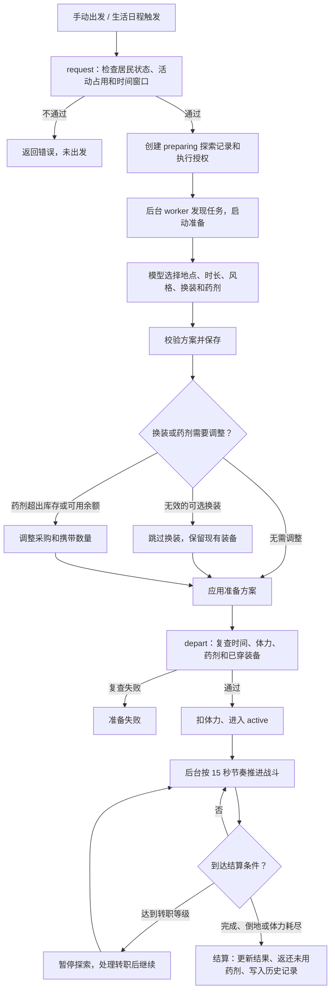

# Agent 迷宫探索与战斗

本文是当前业务入口，2026-10-16 静态对照后端领域代码、路由和内容包。细节按下方导航继续阅读；[系统规划](./Agent迷宫探索与战斗系统规划.md)保留设计推演和阶段契约。

## 入口与执行

居民冒险面板、每日探索记录和内置生活活动接入同一探索领域。手动探索与统一生活自动安排共用授权及资源检查；自动探索由本机开关控制，默认关闭。

结构化决策模型启用且未排除“迷宫探索准备”时，它逐项决定地点、时长、风格、红药数量、蓝药数量与背包装备处理；每个问题只接收代码生成的合法候选，并取概率最高的选项。此模式不再调用整套出发准备文本大模型。场景关闭或排除时，仍走原文本模型准备路径。转职选择仍由模型负责，持续战斗、伤害、奖励与成长由代码执行，页面打开和演示动画不决定结算。

探索按“准备 → 持续遭遇与交战 → 返回结算”推进；转职或系统中断可进入暂停。普通唤醒按当前刻度推进，不用停机墙钟时长补发大量回合。实际结果保存为业务事实，查看历史不重抽奖励。

### 出发准备流程与模型边界

结构化准备先按角色性格、MBTI、冒险职业和等级选择可进入的迷宫，再依次选择时长、探索风格、红药和蓝药数量。地点候选会在代码中排除未达到推荐等级下限的迷宫；时长候选只包含当前允许的 30、60、120 分钟。药剂数量候选包含 0 瓶，红药为 0～20 瓶，蓝药上限按“20 − 已选红药”生成，代码再结合库存、可用余额和实际药剂携带上限生成采购与携带方案。

之后代码按背包顺序逐件判断符合角色等级的装备，不按职业过滤。空槽且可穿戴时直接装备；已有装备时，决策模型同时看到该部位现有装备和候选装备，可选择更换、出售或上架。等级符合但职业或精通不允许穿戴的装备只提供出售或上架选项。更换后会单独决定旧装备出售或上架。出售、上架决定记入可同步的战斗事实；后续出发准备跳过已处理装备，高等级装备不做标记，升级后仍可再判断。

探索过程本身不调用大模型。模型连接在准备阶段临时不可用时，地点、时长、风格和药剂使用代码安全回退，装备判断本轮跳过并留待后续；不会因为决策连接故障阻止正常出发。关闭或排除结构化准备场景时，后端仍使用原文本模型并验证完整方案。

下次进入居民集市时，待处理的出售决定自动按装备商店回收价成交。上架决定会在市场阶段根据装备和商店回收价询价：结构化挂牌定价场景给出回收价的 10%、20%、30%、40%、50% 五项；未启用该场景时由文本模型定价。装备以唯一实例挂牌，其他居民可购买或卖家可撤回；交易通过市场成交记录和战斗装备事实链同步。

同一次准备中，同件装备的穿戴与后续出售/挂牌使用独立事实键，支持同一部位连续换装。被换下的绑定或收藏装备保留在背包，不询问出售/挂牌；历史遗留的不可交易意图在市场阶段跳过。装备买入后按新的持有期间重新判断，原卖家的历史决定或挂牌不会阻止再次上架；原居民买回也同样处理。已执行的挂牌决定在撤单后仍视为完成。历史挂牌的同步按当时成交转移、撤单返还事实校验，当前归属由完整战斗事实链校验，允许后续合法转售。

正常完成、主动召回、倒地和体力耗尽都可以是已完成结算的探索结果；任务执行是否失败与居民是否战胜怪物分别判断。判断入口为 `explorations.execution_completed()`。

## 资源、成长与装备

- 探索本身不需要生活货币预算；药剂采购是可选补给，只能使用未预留真实余额。采购余额不足时减少或放弃采购，按已有物资判断出发。
- 出发仍需通过居民状态、活动占用、体力和时间窗口校验。每位居民按上海自然日累计实际推进的探索时长，默认上限 120 分钟，可在「世界管理 → 冒险设置」中调整为 30～120 分钟；换迷宫或重新出发不重置，跨日部分归入对应日期，未出发的准备失败不计入。超额提示会显示当前每日累计限额。单次允许时长为 30/60/120 分钟。
- 冒险职业与世界职业独立，档案绑定稳定居民 ID。当前内容支持 Lv.99、分支转职、自动技能成长和九个穿戴位；具体等级、技能、精通与数值从绑定内容版本读取。
- 装备采用独立实例，材料与药剂复用共用背包。携带、消费、返还、出售与掉落按领域事务结算，旧实例和历史事实保留原快照。
- 装备掉落会从怪物关联的区域装备池抽取；某件装备只有在本次遭遇怪物等级落入该装备模板等级范围、且区域等级限制允许生成实例时才进入候选。生成的装备实例等级也会落在模板和区域允许范围内。图鉴按怪物配置的出没等级范围列出候选装备，普通怪和精英仍需通过掉落概率，Boss 按首领装备规则结算。
- 九槽面板优先按标准槽位键展示；若历史或异常档案把戒指实例关联到非标准键，界面按装备类型映射到空戒指位，手动卸下时清除原键。非标准键不能用于穿戴新装备。
- 已穿戴装备按其绑定目录保留；出发只核对装备归属、未出售状态和槽位，不因当前目录中的启用、职业或等级规则变化而阻止探索。准备计划原样保留同槽装备不作为新穿戴；新换上的装备按当前目录校验职业、等级与启用状态。可选换装无效时放弃换装、保留当前穿戴继续出发。

## 内容版本与同步

当前仓库生产包静态核对为 `combat-1.0.18` / `engine_schema=5`；更新时以[生产包说明](../../system_settings/agent_world/combat/data/README.md)和 `manifest.json` 为准。`docs/data/combat` 是设计包，状态为 `design_only`。战斗 WebDAV 元数据版本为 6，装备市场意图和跨居民装备转移复用现有事实、装备实例与市场挂牌实体，没有新增数据库列。

目录按版本、哈希和引用校验后安装，同版本不能覆盖不同内容。历史探索与装备绑定原目录，发布新包不回写已结算结果。业务目录、档案、装备、回合和奖励事实纳入同步；租约、本机执行许可与自动开关由本机管理。其他设备恢复业务数据不等于获得原设备的执行许可。

数据库迁移、实际部署、真实模型和多设备接续需要分别确认。带版本的旧验收记录不证明当前包已重新完成全部验收，详见[同步说明](../数据同步逻辑说明.md)和[一期验收记录](./Agent战斗探索一期实施与验收记录.md)。

## 按任务继续阅读

| 要修改或排查 | 继续阅读 |
| --- | --- |
| 探索请求、推进、结算与恢复 | `combat/explorations.py`、`worker.py`、`recovery.py`、`permissions.py` |
| 模型准备与转职 | `combat/preparation.py`、`schedule.py`；[统一生活执行说明](./Agent世界统一生活执行说明.md) |
| 纯战斗、技能、成长与掉落 | `combat/engine.py`、`effects.py`、`attributes.py`、`profiles.py`、`rewards.py`及[生产包说明](../../system_settings/agent_world/combat/data/README.md)；图鉴候选展示见 `frontend_react/src/components/Combat/atlas/equipmentDropCandidates.ts` |
| 请求和界面状态 | `system_settings/urls.py`、`combat/views.py`、`frontend_react/src/api/combat.ts`及 `components/Combat/` |
| 观察画面和动画 | [探索观察接入说明](./Agent探索观察战斗画面接入说明.md)、[魔物与动画规范](./Agent魔物形象与战斗动画设计规范.md) |
| 设计依据与历史版本 | [系统规划](./Agent迷宫探索与战斗系统规划.md)、[实施与验收记录](./Agent战斗探索一期实施与验收记录.md) |

表中 `combat/` 后端路径均相对 `system_settings/agent_world/`。真实接口前缀为 `/api/settings/agent-world/combat/`，由 `catalog/`、`config/`、`agents/<id>/`、居民历史、探索快照和遭遇列表构成；写操作与幂等键以实际 View 和前端 API 契约为准。
