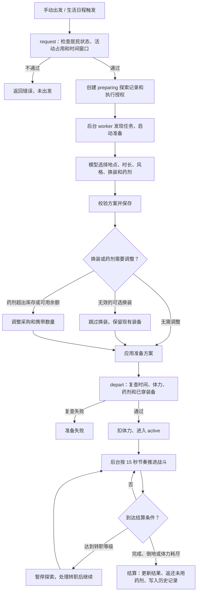

# Agent 迷宫探索与战斗

本文是当前业务入口，2026-10-16 静态对照后端领域代码、路由和内容包。细节按下方导航继续阅读；[系统规划](./Agent迷宫探索与战斗系统规划.md)保留设计推演和阶段契约。

## 入口与执行

居民冒险面板、每日探索记录和内置生活活动接入同一探索领域。手动探索与统一生活自动安排共用授权及资源检查；自动探索由本机开关控制，默认关闭。

模型负责出发准备、转职选择及相关回顾，决定目的地、30/60/120 分钟时长、风格、装备和药剂。持续战斗、伤害、奖励与成长由代码执行，页面打开和演示动画不决定结算。

探索按“准备 → 持续遭遇与交战 → 返回结算”推进；转职或系统中断可进入暂停。普通唤醒按当前刻度推进，不用停机墙钟时长补发大量回合。实际结果保存为业务事实，查看历史不重抽奖励。

### 出发准备流程与模型边界

大模型只负责出发前规划，不负责战斗回合。其输入包括角色设定与规划要求、探索约束、居民等级/职业/属性/生命与魔力、已穿装备和可用背包装备、技能、可选迷宫与风格、可用药剂、库存、可支配采购余额及体力消耗。模型需返回 JSON 方案，包含 `dungeon_id`、`duration_seconds`、`style_id`、`equipment`、`purchases`、`potions` 和 `reason`。后端再校验方案、执行换装和可选药剂采购，并在正式出发前复查条件；无效的可选换装会被跳过，保留当前穿戴继续。

当前模型输入未包含药剂总携带上限；生产规则上限为每次探索合计 20 瓶，超限方案会被后端拒绝。

正常完成、主动召回、倒地和体力耗尽都可以是已完成结算的探索结果；任务执行是否失败与居民是否战胜怪物分别判断。判断入口为 `explorations.execution_completed()`。

## 资源、成长与装备

- 探索本身不需要生活货币预算；药剂采购是可选补给，只能使用未预留真实余额。采购余额不足时减少或放弃采购，按已有物资判断出发。
- 出发仍需通过居民状态、活动占用、体力和时间窗口校验。日额度设置范围为 30～120 分钟；单次允许时长为 30/60/120 分钟。
- 冒险职业与世界职业独立，档案绑定稳定居民 ID。当前内容支持 Lv.99、分支转职、自动技能成长和九个穿戴位；具体等级、技能、精通与数值从绑定内容版本读取。
- 装备采用独立实例，材料与药剂复用共用背包。携带、消费、返还、出售与掉落按领域事务结算，旧实例和历史事实保留原快照。
- 已穿戴装备按其绑定目录保留；出发只核对装备归属、未出售状态和槽位，不因当前目录中的启用、职业或等级规则变化而阻止探索。准备计划原样保留同槽装备不作为新穿戴；新换上的装备按当前目录校验职业、等级与启用状态。可选换装无效时放弃换装、保留当前穿戴继续出发。

## 内容版本与同步

当前仓库生产包静态核对为 `combat-1.0.16` / `engine_schema=5`；更新时以[生产包说明](../../system_settings/agent_world/combat/data/README.md)和 `manifest.json` 为准。`docs/data/combat` 是设计包，状态为 `design_only`。

目录按版本、哈希和引用校验后安装，同版本不能覆盖不同内容。历史探索与装备绑定原目录，发布新包不回写已结算结果。业务目录、档案、装备、回合和奖励事实纳入同步；租约、本机执行许可与自动开关由本机管理。其他设备恢复业务数据不等于获得原设备的执行许可。

数据库迁移、实际部署、真实模型和多设备接续需要分别确认。带版本的旧验收记录不证明当前包已重新完成全部验收，详见[同步说明](../数据同步逻辑说明.md)和[一期验收记录](./Agent战斗探索一期实施与验收记录.md)。

## 按任务继续阅读

| 要修改或排查 | 继续阅读 |
| --- | --- |
| 探索请求、推进、结算与恢复 | `combat/explorations.py`、`worker.py`、`recovery.py`、`permissions.py` |
| 模型准备与转职 | `combat/preparation.py`、`schedule.py`；[统一生活执行说明](./Agent世界统一生活执行说明.md) |
| 纯战斗、技能、成长与掉落 | `combat/engine.py`、`effects.py`、`attributes.py`、`profiles.py`、`rewards.py`及[生产包说明](../../system_settings/agent_world/combat/data/README.md) |
| 请求和界面状态 | `system_settings/urls.py`、`combat/views.py`、`frontend_react/src/api/combat.ts`及 `components/Combat/` |
| 观察画面和动画 | [探索观察接入说明](./Agent探索观察战斗画面接入说明.md)、[魔物与动画规范](./Agent魔物形象与战斗动画设计规范.md) |
| 设计依据与历史版本 | [系统规划](./Agent迷宫探索与战斗系统规划.md)、[实施与验收记录](./Agent战斗探索一期实施与验收记录.md) |

表中 `combat/` 后端路径均相对 `system_settings/agent_world/`。真实接口前缀为 `/api/settings/agent-world/combat/`，由 `catalog/`、`config/`、`agents/<id>/`、居民历史、探索快照和遭遇列表构成；写操作与幂等键以实际 View 和前端 API 契约为准。
