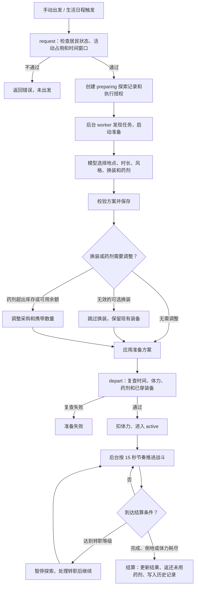

# Agent 迷宫探索与战斗

本文是当前业务入口，2026-10-16 静态对照后端领域代码、路由和内容包。细节按下方导航继续阅读；[系统规划](./Agent迷宫探索与战斗系统规划.md)保留设计推演和阶段契约。

## 入口与执行

居民冒险面板、每日探索记录和内置生活活动接入同一探索领域。手动探索与统一生活自动安排共用授权及资源检查；自动探索由本机开关控制，默认关闭。

2026-10-23 起，未建档居民在空档检查中只按1级新手预检探索；满足能力、时间、体力和运行资格后，由代码直接启动首次探索准备，不经过顶层活动选择，也不提供暂不活动。正式探索请求自动创建档案和初始装备，预检不写入这些数据；条件不足则等待，建档后恢复普通自主活动选择。该引导不跳过后续地点、时长和补给准备，也不保证战斗成功。

新空档探索强制逐项使用决策连接选择地点、时长、美食、风格、红药数量、蓝药数量与未处理装备；已确认问题保存检查点，失败后退避接续，不回退整套准备文本模型。旧日程及手动探索在结构化场景启用且未排除“迷宫探索准备”时走同样的逐项准备方式；场景关闭或排除时仍保留原文本模型准备路径。转职选择仍由模型负责，持续战斗、伤害、奖励与成长由代码执行，页面打开和演示动画不决定结算。

探索按“准备 → 持续遭遇与交战 → 返回结算”推进；转职或系统中断可进入暂停。普通唤醒按当前刻度推进，不用停机墙钟时长补发大量回合。实际结果保存为业务事实，查看历史不重抽奖励。

### 出发准备流程与模型边界

结构化准备先按角色性格、MBTI、冒险职业和等级选择可进入的迷宫，再依次选择时长、美食、探索风格、红药和蓝药数量。地点候选会在代码中排除未达到推荐等级下限的迷宫；时长候选只包含当前允许的 30、60、120 分钟。药剂数量候选包含 0 瓶，红药为 0～20 瓶，蓝药上限按“20 − 已选红药”生成，代码再结合库存、可用余额和实际药剂携带上限生成采购与携带方案。

之后代码逐件判断当前持有期尚未处理、且符合角色等级的闲置装备，不按职业过滤。已穿戴、已售、绑定、收藏，以及本持有期已有出售或上架标记的装备不参与这轮候选；**已标记出售或上架的装备下次出发准备不会重新询问**。空槽且可穿戴时直接装备；已有装备时，决策模型同时看到该部位现有装备和候选装备，可选择更换、出售或上架。等级符合但职业或精通不允许穿戴的装备只提供出售或上架选项。更换后会单独决定旧装备出售或上架。决定保存为可同步的 `gear_prepare` 战斗事实；高等级装备暂不做标记，升级后仍可判断。买入或买回同一装备实例产生 `gear_trade_in`，开始新的持有期并清除该实例旧处置意向的影响。

结构化准备从 `preparation_intents` 获取持有期内标记并跳过；保留的文本准备输入同样过滤这些闲置装备，当前穿戴仍作为比较信息保留。数量风险只针对同次新掉落、新买入或此前尚未处理的装备，不能理解为每次重新判断所有历史库存；当前未加单次未标记装备数量上限。

探索过程本身不调用大模型。新空档准备遇到决策连接故障时保留已确认检查点，按原阶段退避接续；不会用普通文本模型或代码默认选择替代尚未确定的答案。旧日程及手动的结构化准备保留原代码回退：默认30分钟（遵守指定约束）、红药3瓶、蓝药0瓶，再按携带上限、库存和未预留余额调整；美食从足量同菜同星候选中稳定随机选择，无候选则不消耗，装备判断本轮跳过留待后续。上述旧路径关闭结构化场景时仍用原文本模型并验证完整方案。

旧市场机会通过 `MarketExecution` 进入居民集市时，`process_preparation_equipment` 兑现待处理标记：出售按装备商店回收价成交；上架根据装备和商店回收价询价，结构化挂牌定价场景给出回收价的10%、20%、30%、40%、50%五项，未启用时由文本模型定价。装备以唯一实例挂牌，其他居民可购买或卖家可撤回；交易通过市场成交记录和战斗装备事实链同步。

新版按日计划的小时预检／批量市场（`market_tick` → `market_batch`）同样接入 `pending_preparation_actions`，复用原 `process_preparation_equipment` 处理器及真实交易服务：不重新询问出售还是上架。待售装备直接按商店回收价出售；待上架装备只向既有 `combat_listing_price` 决策场景询问上述五档价格，批量路径不提供普通文本模型兜底。缺少场景或可用连接时保留标记等下一次小时预检；仅有这种不可定价的挂牌时不进场、不扣体力。连接临时失败保留意向，本小时不循环重试，其他买卖继续。

已确认挂牌价格保存到**已同步**的 `MarketPlan.context.answers['combat_listing_price:' + intent_fact_id]`，使用本持有期意向事实键区分问题；同批次失败、下一小时或次日计划、同步恢复后接续同一待执行意向时复用已保存答案，不重新抽取价格。价格答案与其他计划答案共用既有完整性指纹和WebDAV链路，不新增数据库字段。`MarketTick.hits` 仅记录本机执行统计，不承载业务选择。商店出售、挂牌使用原意向稳定请求键及交易事实幂等，已完成意向不重复执行；批量会话与同批其他买卖共用一次5体力入场和5分钟窗口，实际消费先保护后续日程，自动开关或授权停止后不提交新交易。手动市场入口保留原有手动资源边界。

同一次准备中，同件装备的穿戴与后续出售/挂牌使用独立事实键，支持同一部位连续换装。被换下的绑定或收藏装备保留在背包，不询问出售/挂牌；历史遗留的不可交易意图在市场阶段跳过。装备买入后按新的持有期间重新判断，原卖家的历史决定或挂牌不会阻止再次上架；原居民买回也同样处理。已执行的挂牌决定在撤单后仍视为完成。历史挂牌的同步按当时成交转移、撤单返还事实校验，当前归属由完整战斗事实链校验，允许后续合法转售。

正常完成、主动召回、倒地和体力耗尽都可以是已完成结算的探索结果；任务执行是否失败与居民是否战胜怪物分别判断。判断入口为 `explorations.execution_completed()`。

### 美食冒险加成（2026-10-18）

时长确定后独立选择一种同星美食或“不消耗”。30/60/120分钟需要1/2/4份，只读取本人背包中同菜同星库存，数量不足的选项不发送给模型。候选只包含稳定标识、名称、星级、库存、消耗份数和实际效果；没有可选美食时不调用模型。结构化准备在风格之前选择，文本准备在完整方案确定时长后补一次独立选择。后续结构化风格、药剂问题只携带已选效果摘要。

决策输入除候选清单外，还包含居民当前职业名，以及上一次已结算探索是否使用美食和其结果（完成、提前召回、倒地、资源不足、系统中断）。上次探索只取已结算且非本次的记录；未结算的准备中探索、准备失败和被排除的记录都不参与判断。结构化与文本两条路径携带同一组字段，便于模型判断当前职业是否需要这类加成、上次补给是否划算。

出发事务按同星FIFO和库存价格批次一次扣除，保存规则版本、效果及消费明细；准备阶段不扣、不预留、不采购。出发前同星库存不足则不消耗并记录原因，不换菜、不跨星凑数。新空档决策故障保留检查点退避；旧路径故障或非法输出时才由代码从足量候选中稳定随机选择一种，没有候选则不消耗。模型正常选择“不消耗”时保持原意，取消和授权撤销仍终止准备。重试出发或恢复快照不重复扣库存。

加成只覆盖本次冒险，转职、升级和暂停继续保留；不改变原有冒险返回截止时间。提前召回、倒地、体力耗尽均不退美食。结束后历史保留消费摘要，日常角色属性不再包含加成。效果规则和20道菜的对应关系见[美食说明](./Agent美食星级与厨艺成长说明.md)。

攻防加成作用于原最终属性并向下取整；六属性强化/抗性与职业、装备来源相加后统一裁剪，不能先裁剪旧值再加美食。恢复只在存活角色实际交战回合的行动前触发，每资源一次，正恢复至少1点、不超上限、不复活、不受治疗加成放大；寻敌、暂停、离线不恢复。页面沿用现有恢复事件，不修改战斗动画。

实现入口：共享纯规则 `food_effects.py`、领域准备与消费 `combat/food.py`、跨领域同步校验 `food_sync.py`（均相对 `system_settings/agent_world/`）。新增 `prepared_plan.food`、`snapshot.food_version/food/food_adjustment`、`state.food`、`result.food/food_adjustment` 和出发事实同名字段；`food`包括菜谱、星级、数量、版本、效果及实际消费批次。旧字段缺失表示无加成。战斗同步协议9、烹饪协议4，详见[同步说明](../数据同步逻辑说明.md)。

### 炼金药水携带与自动使用（2026-10-19）

炼金药水最多携带 5 瓶，与普通红药、蓝药合计 20 瓶的上限分开，不占用红蓝药名额。底层准备计划支持显式给出配方、星级与瓶数；当前结构化准备尚无炼金药水选择步骤，未给出清单时由代码按治疗 → 法力 → 护盾 → 防御 → 再生 → 净化 → 攻击类优先级挑选。仅读取本人背包现有药水，不采购、不跨星凑数。

出发事务按“同配方 + 同星级”FIFO 扣库，把效果、单价、触发条件和剩余数量冻结进快照；规则修改不影响已出发冒险。战斗中每回合在常规行动前判定一次，任一次使用后进入 3 回合共享冷却（与红蓝药的 2 回合冷却独立），同回合最多 1 瓶。生命、法力、负面状态类按阈值触发；攻击类（狂暴、秘法、烈焰、星辰）只在精英/Boss 遭遇首回合触发，每场遭遇最多一次，普通怪不消耗。未遇精英/Boss 时这些药水原样保留到结算。

结算把未使用部分按原星级与价格批次返还背包（幂等键 `<冒险ID>:elixir-return`），已消耗部分在提前召回、倒地、体力耗尽时都不返还；战报记录携带、消耗与返还数量。实现入口：`alchemy_limits.py`、`elixir_effects.py`、`combat/elixir.py`、`combat/explorations.py`；战斗同步协议 9，详见[炼金与药水说明](./Agent炼金与药水说明.md)。

## 资源、成长与装备

- 探索本身不需要生活货币预算；药剂采购是可选补给，只能使用未预留真实余额。采购余额不足时减少或放弃采购，按已有物资判断出发。
- 出发仍需通过居民状态、活动占用、体力和时间窗口校验。每位居民按上海自然日累计实际推进的探索时长，默认上限 120 分钟，可在「世界管理 → 冒险设置」中调整为 30～1440 分钟；换迷宫或重新出发不重置，跨日部分归入对应日期，未出发的准备失败不计入。超额提示会显示当前每日累计限额。单次允许时长为 30/60/120 分钟。
- 冒险职业与世界职业独立，档案绑定稳定居民 ID。当前内容支持 Lv.99、分支转职、自动技能成长和九个穿戴位；具体等级、技能、精通与数值从绑定内容版本读取。
- 一转职业重选是账号管理员的手动纠错，不是 Agent 决策：等级 10～29、无进行中探索、无待完成转职时可用；等级与经验不变，基础属性按“新手覆盖 1～9 级、目标职业从 10 级起”的成长路径重算，旧路线技能替换为新路线技能，新职业穿不上的装备自动卸下，武器位为空时补发该职业绑定白装。二转及以上不能再更换一转职业，后续分支仍由 Agent 在探索中自动选择。实现入口：`combat/attributes.py`（`reselect_blocked`/`reselect`）、`combat/profiles.py`（`reselect`/`preview_reselect`）、`combat/views.py`（`reselect_job`/`preview_reselect`）、`frontend_react/src/components/Combat/CombatJobReselectDialog.tsx`。
- 装备采用独立实例，材料与药剂复用共用背包。携带、消费、返还、出售与掉落按领域事务结算，旧实例和历史事实保留原快照。
- 苔石洞窟推荐等级及区域装备等级均为 10～20；洞穴蝙蝠 10～14、洞穴晶蜥 12～16、精英苔石兽 13～17、首领苔冠巨兽 15～20。新掉落不会低于 10 级，并继续受模板与遭遇等级上限限制。废弃矿坑及其他地点不变。此调整使用既有目录版本与同步链路，无新增持久字段；进行中探索及历史事实保留出发时规则与原结果。
- 装备掉落会从怪物关联的区域装备池抽取；某件装备只有在本次遭遇怪物等级落入该装备模板等级范围、且区域等级限制允许生成实例时才进入候选。生成的装备实例等级也会落在模板和区域允许范围内。图鉴按怪物配置的出没等级范围列出候选装备，普通怪和精英仍需通过掉落概率，Boss 按首领装备规则结算。
- 九槽面板优先按标准槽位键展示；若历史或异常档案把戒指实例关联到非标准键，界面按装备类型映射到空戒指位，手动卸下时清除原键。非标准键不能用于穿戴新装备。
- 已穿戴装备按其绑定目录保留；出发只核对装备归属、未出售状态和槽位，不因当前目录中的启用、职业或等级规则变化而阻止探索。准备计划原样保留同槽装备不作为新穿戴；新换上的装备按当前目录校验职业、等级与启用状态。可选换装无效时放弃换装、保留当前穿戴继续出发。

## 内容版本与同步

洞穴晶蜥在 `combat-1.0.21` 新增「晶棘突袭」：1.35 倍物攻的土属性单体单次攻击，无控制和持续状态；沿用魔物重击耗蓝与 4 回合冷却，普攻 / 技能权重为 80 / 20。三段晶棘仅为同一次攻击的视觉展开。图鉴与观察中的四只洞窟魔物共用已确认的像素动作，Boss 保留 256 像素细节与 1.2 倍体型；观察动作和飘字仍不决定结算。新技能沿用 CombatCatalog 同步，未新增持久字段，不覆盖进行中探索的冻结目录。

当前仓库生产包静态核对为 `combat-1.0.21` / `engine_schema=5`；更新时以[生产包说明](../../system_settings/agent_world/combat/data/README.md)和 `manifest.json` 为准。`docs/data/combat` 是设计包，状态为 `design_only`。战斗 WebDAV 元数据版本为 8；装备穿戴条件已独立固化（迁移0077新增 `EquipmentInstance.rules`），历史结果不再依赖旧目录重算，详见[冒险历史固化与同步说明](./Agent冒险历史固化与同步说明.md)。

属性伤害在原有物理或魔法结算之后乘一次修正。六种属性是水、火、土、风、光、暗。修正为 `clamp(1 + 攻击方属性强化 − 防守方属性抗性, 0.60, 1.50)`，通道伤害 100、修正 1.30 时最终伤害是 130。无属性与毒伤的修正固定为 1。角色强化和抗性默认 0，不随等级或六维增长；部分职业精通按技能等级提供固定比例。武器可以带属性类型，当前武器都是无属性。技能写明属性时优先于武器。持续伤害在施加时固化修正，之后每跳只再过防御。这些派生数值随档案和装备现算，不另存，也不抬升同步版本。

目录按版本、哈希和引用校验后安装，同版本不能覆盖不同内容。未结束探索固定出发时目录；已结束探索和已有装备以固化快照独立保存，原目录编号只作来源说明。发布新包不回写既有属性或已结算结果。最新及运行中需要的目录、档案、装备、回合和奖励事实纳入同步；租约、本机执行许可与自动开关由本机管理。其他设备恢复业务数据不等于获得原设备的执行许可。

数据库迁移、实际部署、真实模型和多设备接续需要分别确认。带版本的旧验收记录不证明当前包已重新完成全部验收，详见[同步说明](../数据同步逻辑说明.md)和[一期验收记录](../archive/agents/Agent战斗探索一期实施与验收记录.md)。

## 按任务继续阅读

| 要修改或排查 | 继续阅读 |
| --- | --- |
| 探索请求、推进、结算与恢复 | `combat/explorations.py`、`worker.py`、`recovery.py`、`permissions.py` |
| 模型准备与转职 | `combat/preparation.py`、`schedule.py`；[统一生活执行说明](./Agent世界统一生活执行说明.md) |
| 纯战斗、技能、成长与掉落 | `combat/engine.py`、`effects.py`、`attributes.py`、`profiles.py`、`rewards.py`及[生产包说明](../../system_settings/agent_world/combat/data/README.md)；图鉴候选展示见 `frontend_react/src/components/Combat/atlas/equipmentDropCandidates.ts` |
| 请求和界面状态 | `system_settings/urls.py`、`combat/views.py`、`frontend_react/src/api/combat.ts` 及 `components/Combat/`；出发准备决策指引与 `(i)` 说明见 `frontend_react/src/components/AgentWorld/decisionProcessGuides.ts`（准备流程变动时须同步更新） |
| 观察画面和动画 | [探索观察接入说明](./Agent探索观察战斗画面接入说明.md)、[魔物与动画规范](./Agent魔物形象与战斗动画设计规范.md) |
| 设计依据与历史版本 | [系统规划](./Agent迷宫探索与战斗系统规划.md)、[实施与验收记录](../archive/agents/Agent战斗探索一期实施与验收记录.md) |

表中 `combat/` 后端路径均相对 `system_settings/agent_world/`。真实接口前缀为 `/api/settings/agent-world/combat/`，由 `catalog/`、`config/`、`agents/<id>/`、居民历史、探索快照和遭遇列表构成；写操作与幂等键以实际 View 和前端 API 契约为准。

## 装备页专属冒险立绘（2026-10-20）

装备装配标题旁的「冒险立绘」打开生成和预览弹窗。生成仅读取当前 Agent 已上传头像、全身参考图、「外貌与服饰」、当前战斗职业和本次补充外观要求；头像优先确定外观，全身图补充外观，职业决定冒险装束。不加载年龄、性格、MBTI、喜好、表达与相处方式、身份背景或通用补充提示词，也不在固定提示中附加年龄要求。仅允许支持参考图的模型；Emoji 或外部 URL 不会被当作已上传参考图。可选择模型及输入本次补充外观要求。也可在弹窗点击选择或拖入一张「角色参考图」和一张「画风参考图」：仅接受当前账号有效的 PNG/JPEG/WebP 资源；角色参考图上传后替代 Agent 头像／全身参考图，未上传时使用 Agent 头像／全身图；画风参考图只用于线条、配色、明暗和渲染方式，不提供人物身份、服装、姿势或构图。两类参考图按 `reference_image_ids` 数组顺序一并发送，提示词逐张标明用途，且不改写 Agent 头像或全身图配置。固定表情为自然睁眼、清晰可见虹膜、轻微闭嘴微笑，不照搬角色参考图的眯眼、闭眼、眨眼、张嘴大笑或夸张笑容。已有图片不会自动重画。

生成使用既有 ImageGenerationTask，场景为 `loadout_portrait`，与像素战斗形象的 `battle_head` 任务隔离。背景按模型能力分两条路径：Grsai 的 `gpt-image-2.5`、`gpt-image-2-vip`、`gpt-image-2.5-flare`、`gpt-image-2.5-sunburst` 支持 `background: transparent`，这些模型直接请求原生透明画布，提示词不再要求品红底色；返回图已有透明画布时保留 alpha 和发丝等半透明边缘。其余模型（基础版 `gpt-image-2` 及 `nano-banana` 系列）仍要求纯品红背景；服务端对不透明品红底结果按键色去除，若返回图四角已透明则保留其 alpha，不做键色删除。两条路径最终都适配 768×1024 透明画布；返回整幅不透明画面或没有有效人物的结果标记失败。是否请求原生透明由服务端按模型名判定，前端不需要额外开关。用户也可直接上传 PNG/JPEG/WebP 本地立绘，不调用生图服务；上传后作为候选预览，可调整大小和位置，点击应用才替换当前立绘。关闭弹窗不会再次提交，重新打开恢复最近任务与预览；查询和图片下载恢复复用原任务。等待上限为 15 分钟，可停止本地等待；不承诺撤销提供商已接收的生成或退款。

只有点击「应用这张立绘」才写入 Agent `loadout_portrait`；本地上传图片也必须点击应用后才替换当前立绘。人物大小滑块支持 60%–150%，以脚底附近为缩放原点即时预览；人物位置提供水平、垂直微调，各自可移动立绘框尺寸的 ±20%，并随预览即时更新；保存大小或位置均不调用生图服务、不改变图片资源，关闭弹窗不保存未应用的调整。大小写入 `loadout_portrait_scale`，位置写入 `loadout_portrait_offset_x`、`loadout_portrait_offset_y`；装备页连线按调整后的立绘边界重新计算。预览可在当前立绘、未应用的生成结果和本地上传候选之间切换。恢复默认同时清空图片并重置比例为 100%、位置居中。生成成功、失败或重新生成都不自动替换已应用图片。恢复默认仅解除关联，保留资源。已应用图片参与资源库关联展示和删除保护，读取通过登录账号的图片资源接口；不赋予匿名读取权限。上述字段由专用接口管理，不随普通 Agent 编辑表单写回，避免旧设置表单覆盖新立绘。

预览舞台支持鼠标与触摸拖动，拖动期间即限制在水平、垂直各 ±20% 的可保存范围；像素与百分比换算使用未缩放的图片布局尺寸。舞台内滚轮调整缩放时阻止弹窗随之滚动，舞台外仍可正常滚动；拖动期间不接受滚轮缩放。

立绘仅用于装备页中心人物，保留职业光环和装备槽；不会修改职业、装备事实、战斗数值、已有像素战斗形象或历史探索。换装不自动重画，职业变化后可手动重新生成。不同体型人物的槽位连线仍使用现有职业锚点，未做逐角色解剖标注。

入口：`system_settings/loadout_portrait.py`（提示词、透明图处理）、`loadout_portrait_views.py`（授权任务与应用接口）、`frontend_react/src/api/loadoutPortrait.ts`、`components/Combat/useLoadoutPortrait.ts`、`LoadoutPortraitDialog.tsx`、`usePortraitReference.ts`、`CombatLoadoutSlots.tsx`。真实提供商生成质量及多设备 WebDAV 往返需单独验收。

战斗形象编辑器的生成背景选项独立生效：选择“透明 PNG”时，支持原生透明的 Grsai GPT-image 型号（与上述立绘能力名单一致）同时发送 `background: transparent` 参数和透明背景提示词；其他模型仅通过提示词请求透明。选择纯色背景时继续要求品红底，不发送透明参数。背景选择随生成任务请求保存，属于任务恢复元数据，不新增 Agent 同步字段；编辑器保留返回图片的透明通道。

### 闲置生命与法力恢复展示（2026-10-22）

- 非探索期间按完整 5 分钟块恢复：HP 每块恢复上限 5%，MP 每块恢复上限 10%，向下取整且至少 1 点，不超过上限。倒地先休整 30 分钟；期间不回血，MP 正常恢复，到期 HP 恢复至上限 20%，再开始普通回血。
- 档案接口依据既有 `hp`、`mp`、`recovered_at` 和 `rest_until` 计算当前展示值；普通闲置读取不写数据库、不重置恢复基准，实际出发仍使用既有恢复结算。准备中、探索中、暂停及结算中不计算闲置恢复。
- HP / MP 条下显示下次恢复倒计时、每次恢复点数及预计回满时间；休整时显示休整剩余时间和结束恢复至 20%。预计时间按当前上限与持续闲置计算，再次探索或调整装备后重新计算。
- 页面仅在下一恢复节点请求档案，倒计时在本地更新；隐藏页面暂停请求，回到页面后补齐到期刷新，失败时退避重试，满血满蓝后停止恢复请求。探索期间继续沿用原有战斗状态刷新。
- `recovery` 是 API 临时派生信息，无新增持久字段或同步字段；设备仍通过现有恢复基准重建显示。实现：`combat/idle_recovery.py`、`queries.py`、`useCombat.ts`、`CombatRecoveryHint.tsx`。本轮验证边界见交付说明。
