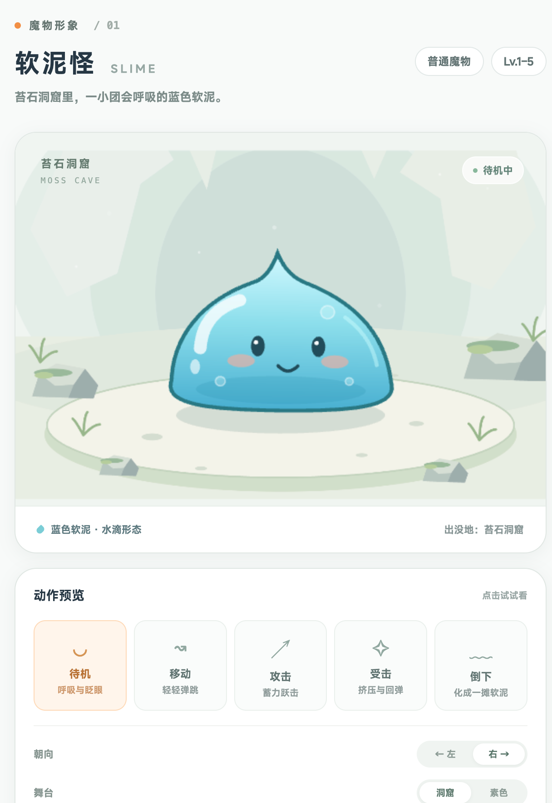

# Agent 魔物形象与战斗动画设计规范

本规范以用户已确认的软泥怪 PixiJS 形象、苔石洞窟背景和独立预览页为首个基准。后续魔物逐只制作，沿用同一套视觉语言与验收流程：**先制作独立预览，确认形象和动作，再接入图鉴；战斗场景复用角色与背景，技能效果单独设计。**

适用范围：魔物静态缩略图、PixiJS 角色、出没地背景、动作预览、技能特效及未来战斗场景。页面与组件仍须遵循[代码规范](../代码规范文档.md)和[UI 设计规范](../UI设计规范文档.md)。本规范不改变战斗数值或目录内容。

后续更新：用户要求剩余 20 只先采用现有人物、装备的像素素材方式，不再沿用 SVG 造型。透明 PNG 静态首版已在独立总览和图鉴预览展示，并于 2026-10-11 经用户确认接入正式图鉴；动作、技能与新区域背景不在本轮范围。前四只已确认魔物保留原版，正式图鉴仍按确认状态接入，详见[像素魔物首版素材](./Agent像素魔物首版素材.md)。

2026-10-22 更新：用户确认 `SproutMeadow_v1.html` 第六版，要求将软泥怪、绒耳兔、叶壳甲虫、晨光萤的像素设计与模板粉碎效果接入探索观察。该范围使用 `animation/meadowPixels/` 的 128×128 像素绘制与局部动作，替代旧软泥绘制和三只整图摆动；右侧魔物根据原图朝向决定是否镜像，统一面向左侧玩家。四只普攻没有新增主动技能或结算规则；击败仍由确认快照触发。后续同步四只的图鉴缩略图与详情待机动画，列表与详情加载回退使用同源导出的内置 PNG 首帧，避免异步生成前闪现旧形象，详情复用观察 Actor；其他角色仍遵守各自确认范围。具体入口、边界与验证见[探索观察接入说明](./Agent探索观察战斗画面接入说明.md)和[资源索引](./Agent魔物形象资源索引.md)。

**后续制作约定（2026-10-22，用户明确确认）：所有后续魔物的受击 `hit` 与倒下 `defeat`，统一复用上述已确认像素版，不再逐只设计、另出候选或重复请求确认。** 新角色重点制作形象、待机、移动、攻击与已有技能；共用受击和粉碎只适配角色原色、体型、脚底/悬浮锚点与朝向，并核对接入效果。详细规则见第 4 节。旧验收记录中的摊平、伏地、收翅落地等仅是历史版本，不作为后续制作要求。

2026-10-22 苔石洞窟更新：用户确认 `MossCave_v1.html` 第四版并授权接入图鉴与冒险。洞穴蝙蝠、洞穴晶蜥、苔石兽、苔冠巨兽统一使用 `animation/cavePixels/`，取代正式入口的旧 SVG Actor / 整图位移。前三只为 128 像素，Boss 保留同源 256 像素细节与 1.2 倍体型；重击沿用确认后的连续前腿形变。图鉴静态回退、详情待机与动作按钮共用该形象。闪身残影、厚岩护体、青玉护体、重击地裂和晶棘突袭均已接入；受击和倒下仍复用新芽草甸确认版。原始素材不覆盖。

晶棘突袭由候选转为目录技能 `skill.monster.crystal`，具体结算见生产内容包 `combat-1.0.21`。动画及形象是随前端发布的资源，没有新增持久动画状态或 WebDAV 字段；技能配置走既有版本化 CombatCatalog 同步。独立 HTML 继续保留作为确认基准。

## 1. 已确认的基准与当前接入范围

2026-10-22 洞窟形象更新：洞穴蝙蝠、苔石兽（第二版）、苔冠巨兽的新透明 PNG 已确认并替换图鉴列表与详情，详情暂用静态图；以下旧矢量动作与技能确认记录继续作为历史预览，不代表新 PNG 动作已制作。资源及当前状态见[资源索引](./Agent魔物形象资源索引.md)。

| 内容 | 当前状态 |
| --- | --- |
| 软泥怪 `monster.slime` | 形象、五个基础动作和预览页已确认 |
| 洞穴蝙蝠 `monster.cave_bat` | 形象、五个基础动作和“闪身”动作示意已确认；已接入图鉴 |
| 苔石兽 `monster.moss_beast` | 精英形象、五个基础动作和多边形“护体”示意已确认；已接入图鉴 |
| 苔石洞窟 `dungeon.moss_cave` | 背景已确认，预览与图鉴共用同一素材 |
| 怪物图鉴 | 列表使用同源静态形象；新芽草甸四只与原洞窟 Actor 详情使用待机动画；同洞窟怪物与首领复用背景 |
| 独立预览 | 已保存 HTML、TypeScript、CSS 和角色源码，可在本地重新启动 |
| 正式战斗动画 | 已接入探索观察的本地交替动作演示；HP/MP 与击败读取确认快照，尚非逐事件行动回放 |
| 各技能战斗特效 | 尚未建立通用实现；当前预览中的落地波纹和水滴是动作样例 |

已确认的预览页面参考图保存在仓库中，避免依赖临时附件或聊天记录：



参考图用于核对风格；交互和动画以保存的源码运行结果为准。

## 2. 魔物视觉语言

### 2.1 轮廓、比例与表情

- 原软泥怪及洞窟角色使用柔和、圆润的二维矢量绘制，优先用 PixiJS `Graphics`、渐变和分层容器实现可变形角色。后续已确认的 PNG 魔物及新芽草甸观察像素版遵循文首各自确认范围，不将不同版本的造型约束互相覆盖。
- 先保证剪影可识别：每只魔物有明确的主体形状，以及少量能区分物种的特征。蝙蝠可强调翅膀，岩石兽可强调石块与苔藓；不要求其他物种也做成水滴形。
- 角色主体占主要视觉面积，五官紧凑、表情清楚。以圆眼、小高光、简单嘴形为起点，表情可随性格和物种变化。
- 轮廓线用角色主色对应的深色，保持圆润的端点与连接。软泥怪参考绘制宽度约 228、轮廓线宽 4 个设计单位；其他角色按体型维持相近的视觉线重。
- 首领和精英通过体型、轮廓、装饰或动作气势增强辨识度，不仅靠更换颜色或添加品质角标区分。

品质差异应在隐藏文字和角标后仍可识别，并在图鉴小尺寸下成立：

| 品质 | 形象与动作方向 |
| --- | --- |
| 普通 | 主体简洁，少量物种特征，动作轻巧或自然 |
| 精英 | 加强肩背、体量或护甲层次，加入少量专属标记；蓄力、踏步与受击表达更强的力量或技巧 |
| 首领 | 在精英基础上进一步强化独特剪影、标志性装饰和技能节奏；保留面部与战斗信息的可读性 |

苔石兽已确认以宽肩厚甲、四足重步和警戒表情表达精英方向，护体采用覆盖身体前方的半透明多边形岩石护盾。
装饰保持克制，不提前耗尽苔冠巨兽的冠饰和体型空间；同一品质也可按物种采用不同方案。

### 2.2 配色、材质与光照

每只魔物使用一组主色、较深轮廓色和少量辅助色。主体比背景更鲜明；背景保持低饱和度。允许不同物种拥有自己的色相，整体保持清爽、可爱、略带幻想感。

| 软泥怪基准 | 色值或参数 | 用途 |
| --- | --- | --- |
| 主体渐变 | `#d2f9ff` → `#8ddfec` → `#48afd1` | 上亮下深，中间色位置约 44% |
| 轮廓 | `#287883` | 与蓝色主体协调的深色边线 |
| 五官 | `#204c59` | 保持缩略图中的对比度 |
| 腮红 | `#f6ad9e`，约 62% 不透明度 | 局部柔和点缀 |
| 高光 | 白色与浅青，局部半透明 | 左上方主光源、少量反光与气泡 |
| 投影 | `#356663`，约 16% 不透明度 | 椭圆落地阴影 |

软泥怪的透明感由高光、气泡和渐变表达，主体保持完整的蓝色。半透明只用于有意设计的局部层。**图鉴缩略图与详情必须采用同一配色，不因“尚未遭遇”降低整张卡片的不透明度或加灰度滤镜。** 探索状态使用文字和角标表达。

光照默认从左上方进入；阴影落在角色脚下，随离地高度缩小、变淡。岩石、毛皮等材质使用同样的线条与光照语言，但无需复用软泥的透明材质。

### 2.3 静态资源与动态形象一致

- 静态缩略图使用清晰的中性待机姿态，轮廓、色值、五官位置与动态角色一致。
- 新角色优先从同一分层矢量来源生成静态与动态绘制。苔石兽首版直接将内置 SVG 的分层转为 PixiJS `GraphicsContext`，避免分别维护两套轮廓和配色。
- 角色素材不嵌入出没地背景、名称、等级、状态角标或血条；这些由场景和 UI 负责。
- 图鉴列表使用轻量静态资源，详情按需加载动画；避免每张列表卡片都创建一个 WebGL 上下文。
- 加载动画或 WebGL 不可用时保留静态角色，背景也应继续显示。

### 2.4 玩家角色的像素形象与装备分层

玩家角色采用用户提供的《克鲁赛德战记》截图所示的像素小人方向，设计原创角色；2.1 的矢量绘制约定适用于已确认魔物，不限制玩家角色的素材形式。比例约 1.8～2 头身，头部（含头发）约占站立高度的 55%～60%，躯干、手脚短小，五官用简洁的矩形像素表达。使用清晰的阶梯轮廓、大块平涂色簇和每种材质约 2～3 档明暗，不把精细插画缩小或加像素滤镜当作精灵设计。放大预览保留硬边像素；避免细碎发丝、长腿、细长袍服、密集刺绣和脏色抖动。配色、左上光源、柔和表情与明暗对比仍须和软泥怪及苔石洞窟协调，小尺寸下保持清楚。

新手 → 法师 → 元素师 → 炎术师是同一角色的外观成长路线，保持脸型、发色、身体比例与站位基准；职业差异通过服装、披肩、腰带和服装纹饰表达。像素稿在确认前仅作为美术方向，不视为已拆分部件或已完成的精灵动画。当前修订稿为[四阶段空手形象与独立武器示意](./assets/combat/mage-route-pixel-concept-v3.png)，对应[生成提示词](./assets/combat/mage-route-pixel-concept-v3-prompt.txt)。此前插画版、像素 v1、v2 保留作迭代记录，不是已确认形象。四阶段像素形象与独立水晶法杖已获准用于图鉴。

| 层 | 资源与显示依据 | 必须保持的边界 |
| --- | --- | --- |
| 角色身份与外观 | 稳定角色 ID、外观版本及职业成长阶段 | 不把武器或完整技能特效画死在身体、服装或职业皮肤中 |
| 武器装备 | 实际 `loadout.weapon` 对应的装备实例及其模板/快照 | 随实际装备替换；不按职业名固定一把法杖、剑或专属火焰武器 |
| 动作 | 当前动作、持握类别与手部锚点 | 武器通过握点挂接，随手部动作移动；按需要处理手掌前后遮挡，不为每件武器复制角色全套动作 |
| 技能表现 | 角色实际已学技能与事件中的稳定技能 ID | 换职业外观或武器不清空已学技能；技能效果独立于职业皮肤和武器素材 |

概念稿先用空手形象比较四阶段服装，将临时武器单独展示；交互预览使用同一把明确标注的临时武器比较持握效果。临时武器不表示职业的固定装备。后续制作空手、单手持握等基础动作与独立武器素材，替换武器时保留角色的手部锚点、动作和身份。接入正式装备时复用现有穿戴资格校验；视觉解耦不等于取消职业/等级的装备使用条件，也不改变已有转职或数值规则。

当前服务端已返回装备实例、`loadout` 与 `progression.skills` 对应的技能列表。`frontend_react/player-route-preview.html` 已提供独立首版：四阶段外观切换、空手/临时法杖切换、五种基础动作和四个技能视觉演示；同场复用洞窟与软泥怪。动作采用原图的 PixiJS 纹理切片和部件控制，尚不是完整逐帧动作素材。职业图鉴现已使用统一新手身份的 29 套服装及独立职业氛围，6 件已确认武器已用于装备列表/详情；正式装备实例绑定与战斗事件播放仍待完成，详见[预览说明](../../frontend_react/src/previews/README.md)。美术阶段不新增持久字段或同步数据，不以概念稿或演示动作代表真实战斗已接入。

玩家技能特效与人物保持接近的像素颗粒和色簇尺度，但不能把“像素风”理解为小图标或限制所有技能的尺寸、颜色数量。以用户提供的《克鲁赛德战记》战斗截图为表现方向：连续流动的阶梯轮廓、亮芯/中间色/外缘的有限色带、前后遮挡与清晰的蓄力—释放—命中—消散节奏。避免写实纹理、密集微粒和直接缩小高清特效；少量透明能量面、光圈和辉光用于体积感，面部与主要动作仍应能辨认。高级技能允许更大范围的视觉占用、更长蓄力、冲击波、短暂环境压暗和轻微震动；表现规格必须明显高于基础技能，但不改变目录中的真实伤害范围和规则。

魔力弹保留短尾弹道与星芒命中；魔法屏障使用包裹全身的前后能量面、弧形高光、流动光带和地面符文；灼烧术以目标两侧与后方持续升腾的火焰、前方低焰与火星表达持续燃烧；炎爆使用杖顶压缩聚能、热核飞行、命中后向四周膨胀的不规则亮芯爆团、放射火舌、冲击环与短暂烟尘/碎火星；不用持续上窜的火柱或目标两侧余火，区别于灼烧术。不能靠同一弹体换色区分技能。装备武器提供独立的握点与发射点：水晶法杖从顶部水晶释放，镜像和动作后读取武器局部坐标变换；空手才回退到手部。换外观、朝向或武器不重置技能。

当前魔力弹像素帧在 `playerSkillPixels.ts`；低分辨率动态特效由 `pixelEffectDrawing.ts` 和各技能 `*Visual.ts` 绘制，`PlayerSkillRenderer.ts` 将地面、角色后方、角色前方三个小画布作为最近邻纹理交给同一个 PixiJS 场景。时序与视觉反馈在 `playerRouteEffects.ts`，不使用此前高密度生成特效稿。技能效果保留在独立预览，正式战斗事件播放尚未接入。

角色切片须遵循衣服与关节的真实边界，不能把整条衣身侧边当作手臂旋转。当前衣身保留完整披肩与衣摆，只切下袖口、前臂和手掌；肘部用重叠接缝保持连接，武器随握点转动。后续幅度较大的动作应制作专用姿态帧，不继续扩大切片旋转角度。

### 2.5 统一人物底模与职业氛围

后续玩家以已确认的新手为唯一首版身份基准，复用原图的头发、脸、肤色色板和靴子，手掌使用相同像素比例统一绘制。
服装、武器、职业氛围独立选择，不再为每个职业重新生成完整人物来决定脸或比例。
统一人物框架、脚底原点及关节位置；新身体类型以后通过兼容框架或独立适配加入。
服装须保留完整袖口，禁止为了替换手掌在衣服上挖矩形孔，也不要用方形袖口补丁覆盖接缝。
各套服装登记袖口握点，共用手掌覆盖原手部轮廓；保持左右手基本比例一致，持握拳可适当加宽以包住武器柄，右手拇指位于武器柄前方。
当前中性站姿手掌使用 7 px 网格：空手与持握外轮廓均为 42 × 42（统一人物逻辑坐标），通过三档阶梯宽度形成紧凑、偏圆的像素拳头；持握用折叠拇指和掌内阴影表示，不横向拉宽成矩形，也不使用平滑圆形。保持短手腕，不通过整体放大拳头来适配武器。
持弓姿态优先调整武器大小、倾斜角度与握点，不得用横向长条拉长前臂来避开五官。
站姿持握的图层顺序为完整角色底图、独立武器、左右像素手；武器仍在人物前方，双手盖住握柄。战斗形象版本 3 用 374×528 透明全身角色替换默认身体、服装和头部，职业氛围与武器系统仍独立。左右手锚定当前战斗职业的袖口握点，可分别平移、等比缩放和旋转；武器可单独校准握点。编辑器实时预览待机、受击和施法动作，保存位置与实际战斗共用。版本 1/2 的头部配置继续兼容读取；新生成应输出完整角色，不再把单独头部拼到默认身体上。

完整角色生图优先采用当前战斗职业和武器合成的姿势参考模板，以及用户本次上传的外观参考图；没有临时参考时，按 Agent 已配置的 `full_body_image`，再按头像选择外观参考。临时上传只作为本次生图覆盖，不修改 Agent 配置。姿势模板负责像素颗粒、轮廓、战斗站姿、睁眼专注表情和手腕位置；外观参考负责身份、发型、饰品、配色与服装设计。不得从头像复制闭眼笑脸，也不得复制姿势模板的新手服装。双臂袖口需与模板腕点对齐，右腕呈握持姿势，左腕放松；提示词要求紧凑拳形手，不生成摊开的手掌、张开的手指、挥手或手势，为系统覆盖的像素手和武器留出清晰层次。
编辑器的预览武器默认使用当前装备；未装备或资料尚不可用时显示示例剑，并明确标记只用于校准。预览可切换空手或其他武器，不修改装备与战斗数值。选择空手时禁止操作不存在的武器图层，图层偏移可一键重置。

完整角色的位置编辑按选区内的可见像素校验越界，透明留白超出画布不阻止保存；头发、衣服或鞋子真实超界时仍禁止保存与导出。「鞋底贴地」收紧当前选区内的透明留白，保留当前缩放（过大时缩小至完整适配），将完整鞋底对齐 528 px 画布底边；水平偏移保留在可容纳范围内。预览与实际战斗共用脚底锚点 `(187, 528)`，阴影位于人物后方；不可通过把鞋子拖出画布来模拟落地。此操作只调整现有选区和变换参数，不新增持久字段或同步格式。操作后可继续校准独立双手与武器，点击保存才生效。

生图背景可选择纯品红背景或请求透明 PNG。当前供应商适配没有可保证透明输出的参数，透明选项作为提示词要求，不能承诺收到的文件一定带透明通道；最终成品始终导出透明 PNG。自动去背景只删除边缘相连区域，发丝或袖口围住的色块通过“点选去背景”清理，按点击色与容差删除当前连通区域，不同时删除其他孤立同色色块；点选操作与画笔共用撤销/重做。

用武器携带角度避免遮挡五官，不要通过把武器放到头发后面来切掉杖头，也不要单纯把手掌放得过大。
切换服装时独立武器随右手握点重新定位，不能仅在切换武器时更新持握位置。

职业辨识通过独立氛围补充：29 个职业各有独立剪影与配色，登记在 `Combat/art/professionAuras.ts`。例如炎术师背后火焰、牧师背后圣光、圣骑士脚下十字光环、召唤师灵灯、冰术师飘雪、猎人爪印；随转职阶数逐步增加视觉规模。冰术师使用 `cryomancerSnowDrawing.ts` 绘制六枝像素雪花，大小错落、缓慢下落并轻微横漂，角色后景播放，接近地面时消散；静态缩略图复用同一绘制的固定时刻，不再使用竖直冰柱或通用上升光点。
效果按后景/地面分别放置，不画进人物或防具；换装不重置氛围选择。
职业氛围第二版沿用已确认冰术师的像素意象、渐变辉光、柔光和慢节奏动画，逐职业改造主体轮廓与运动：战士使用赤金流痕而非悬空实体剑，炎术师使用肩后浮焰而非自身灼烧火柱，游侠使用细羽而非菱形块。其他职业的符印、月影、祷环和林叶均有持续运动，不能只用固定大图标配飘动光点。绘制按四系模块拆分，列表静态合成、动态详情和总览共用入口，保留冰术师确认版。完整造型与运动表见[玩家职业氛围第二版](./Agent职业氛围设计说明.md)。
保持主要五官清楚、避免持续全屏爆发，允许关闭/暂停，不引入伤害、Buff 或技能绑定。
战斗技能仍依据角色已学技能和事件 ID 播放，不能把氛围当真实释放或持续状态。

分层预览入口 `frontend_react/player-layered-preview.html`，场景与挂载留在 `previews/layeredPlayer/`；共用人物、握点与职业氛围在 `Combat/animation/playerAppearance/`，供预览、正式图鉴及技能演示复用。
原四服装同源，其余 25 套先适配躯干框架；当前是中性站姿装配与轻微待机，
不代表完成全方向动作、每件防具的关节部件或正式装备绑定。
29 套站姿装配与独立氛围已接入图鉴；列表缓存同源静态合成图，详情按需播放同一人物待机。逐帧服装动作与真实装备外观绑定继续单独制作。


### 2.6 图鉴技能与材料首版

职业图鉴按稳定技能 ID 提供 32 个目录主动技能的播放按钮，被动技能不加播放按钮。新手没有目录主动技能，仅使用 `preview.novice.strike` 基础攻击示意，不写入已学技能或同步资料。
技能按武器斩击、射击、护罩、治愈、火焰、冰霜、诅咒、召唤与自然效果分别设计轮廓和时序，高阶技能扩大蓄力、命中和消散规模；不以换色代替技能差异。优先保留已确认的魔力弹、屏障、灼烧与径向炎爆。
技能图层使用低分辨率 Canvas 纹理、最近邻采样和同一个 PixiJS 场景；角色、职业氛围、技能与背景独立。技能演示可以换武器、暂停、拖动进度，换武器保持播放进度。自我治疗和护罩不触发敌方受击，攻击只在视觉命中后反馈。

材料图鉴按 24 个现有材料 ID 登记 32×32 像素绘制，颜色和剪影表达软泥、蝠翼、矿石、孢子、水滴、火核及星晶等；区域凭证采用同一底牌和独立区域图案。列表和详情共用缓存图像，未知 ID 回退原图标，不新增材料或修改掉落/价格。

全部仅为前端内置资源与视觉演示；技能伤害、目标判定、回合和状态仍由既有战斗事实决定。整体复查入口为 `combat-atlas-preview.html`，记录见[资源索引](./Agent魔物形象资源索引.md)。

## 3. 出没地背景与构图

- 背景按稳定地牢 ID 关联，通过目录中的怪物分布与首领关系查找。不要以中文名称作为资源键，也不要将背景绑定为某只魔物的专属素材。
- 同一怪物有多个出没地时，图鉴按目录中的怪物分布关系顺序选择首个已注册背景，再考虑首领关联；出没地文本仍完整显示。独立预览可指定正在设计的区域，正式战斗使用实际进入的地牢，不沿用图鉴的默认选择。
- 苔石洞窟统一使用 `frontend_react/src/assets/combat/moss-cave.svg`。洞穴蝙蝠、苔石兽、苔冠巨兽以及后续同区域魔物复用这一份背景。
- 保留洞口层次、浅绿灰色石壁、苔藓、少量草叶与岩石、椭圆落脚平台。背景细节用于交代环境，角色面部和行动区域保持干净。
- 背景、角色、落地阴影与技能特效独立分层。角色脚底锚点为 `(0, 0)`，场景负责站位和缩放，角色负责内部绘制与形变。
- 当前洞窟展示参考设计空间为 `640 × 420`，角色脚底位于画面高度约 74%；软泥怪预览缩放为 1.15。后续体型不同的魔物可调整展示缩放以完整呈现轮廓。
- 图鉴详情保持主体居中，名称和出没地置于场景下方；战斗场景可沿用同一背景素材，但需重新安排双方站位、交战距离和技能空间，不能直接照搬单角色居中构图。
- 无已设计背景的区域保留现有简洁展示；新区域另行设计、确认并注册背景，不使用苔石洞窟代替全部区域。

## 4. 基础动作规范

每只魔物应具备 `idle / move / attack / hit / defeat` 五个动作。待机、移动、攻击按物种设计；受击与倒下直接接入已确认的共用像素效果，适用于后续普通、精英和首领魔物，不另做专属版本。

| 动作 | 表现要求 | 软泥怪基准 |
| --- | --- | --- |
| 待机 `idle` | 有生命感，幅度轻微，长期播放不干扰阅读 | 呼吸约 ±2.5% 形变、小幅摇晃、周期眨眼、气泡浮动 |
| 移动 `move` | 明确区分移动与待机，阴影与落脚协调 | 弹跳、离地、回弹；角色场景位移与内部形变分开 |
| 攻击 `attack` | 蓄力 → 出手 → 命中表现 → 恢复，有清楚的节奏 | 下蹲、跃击、落地波纹与水滴；约 1.3 秒结束 |
| 受击 `hit` | 复用当前像素版的短暂闪白、回震、轻微挤压/倾斜与恢复 | 共用约 0.85 秒采样，结束返回待机；按朝向处理回退 |
| 倒下 `defeat` | 复用模板击败粉碎，完整角色炸成自身原色像素碎块 | 0.26 秒闪白、裂纹、震颤后全尺寸炸开，碎块弹跳落地并保留 |

待机、移动与攻击的时序可按物种设计；受击和倒下保留共用版本的时序与视觉设计。待机与移动可循环，攻击和受击结束后返回待机，倒下需明确的重置或下一场事件才能恢复。

### 4.1 已确认的受击与倒下复用入口

- 受击姿态：`frontend_react/src/components/Combat/animation/meadowPixels/meadowMotion.ts` 的 `hit` 分支；像素变形由 `meadowBodyDrawing.ts` 和角色绘制实现，场景负责交战距离与整体后退，避免重复叠加位移。
- 倒下采样：同文件的 `defeat` 分支与 `meadowShatterAt`；碎片物理由同目录 `MeadowShatter.ts` 实现；`MeadowMonsterActor.ts` 管理闪白/裂纹、主体隐藏、碎片播放和重置。
- 粉碎沿用每 2 像素采样角色原色、2–3 像素碎块、径向炸开、重力与阻力、2–3 次弹跳、地面冲击环和短暂震屏。角色不先缩小或摊平；不追加伏地、融化、残留水滩或渐隐版死亡设计。
- 新魔物只适配源像素、配色、缩放、地面/悬浮锚点和原图朝向。现有接口需要支持更多角色时，扩展或抽取这套实现，不为每只魔物复制一套受击/粉碎算法，也不另生成专属受击/死亡素材。
- 对照入口：`docs/agents/demo/SproutMeadow_v1.html`；独立预览对应 `demo/sprout-meadow/motion.js` 与 `pixel-shatter.js`。后续预览仍提供受击、倒下按钮，但用于验证共用效果的体型、朝向、暂停与清理，不作为新设计审批。
- 真实场景仍由确认快照触发击败。当前探索观察至少保留 4 秒粉碎过程，碎片保留到下一次不同遭遇；本地演示不能决定伤害或击败。该约定不表示其他旧角色已全部完成运行时迁移，后续接入时按此执行。

动作采样只依赖动作类型、本地经过时间与朝向，避免按帧数推进造成不同设备速度不一致。允许重复播放、暂停、恢复和左右朝向切换。大动作采用预备、运动和恢复阶段，通过形变与节奏表达重量，而非叠加大量闪烁。

左右朝向采用 `-1 / 1`；尽量通过五官朝向和运动方向处理，避免直接镜像整个角色导致左上光源反转。特殊不对称角色可设计单独朝向，仍保持光照一致。

## 5. 独立预览页作为后续制作模板

### 5.1 固定保留的页面设计

沿用当前软泥怪预览页的浅色底、大圆角场景卡、白色控制卡、柔和边框、克制阴影和橙色选中态。桌面使用场景与控制双栏，窄屏上下排列；内容保持以下顺序：

1. 标题区：制作序号、魔物中文名、可选英文名、简短性格或形态描述、品质与等级范围。
2. 场景卡：出没地标题、当前播放状态、角色与背景；底部显示形态描述和出没地。
3. 动作卡：五个基础动作、动作说明、当前选中状态。
4. 调节区：左右朝向、出没地/素色舞台切换、图鉴尺寸、暂停与继续。
5. 后续有技能的角色增加独立技能预览区，保留基础动作区，不能把全部技能塞进一个“攻击”按钮。

当前预览页的样式参考值如下，后续适配体型或屏幕时保留这些视觉关系；具体实现以 `slimePreview.css` 为基准：

| 项目 | 当前基准 |
| --- | --- |
| 字体与主文本 | MiSans，`#263744` |
| 页面底色 / 场景底色 | `#f8faf9` / `#f0f5f1` |
| 卡片 | 白色，边框 `#e0e7e3`，圆角 24px，轻阴影 |
| 桌面排版 | 最大宽度 1176px，控制栏 288px，栏间距 20px，场景高 470px |
| 动作选中态 | 底色 `#fff5eb`，边框 `#fed9b7`，文字 `#b87233` |
| 强调色 | 标题小圆点 `#f28f45`；不大面积铺满橙色 |
| 宽度 ≤840px | 场景与控制上下排列，五个动作横向排列，场景高 410px |
| 宽度 ≤480px | 卡片圆角 20px，场景高 330px，收紧字号与间距 |

数字 1–5 切换基础动作，空格暂停；输入框中编辑时不触发快捷键。控制须能触控使用，不仅依赖悬停。禁止原生下拉框、可拉伸文本域和可见内部原生滚动条。

新角色优先复用现有排版与控件设计。第二只角色制作时再根据真实共用部分抽取预览组件，避免提前搭建没有使用者的通用框架；软泥怪预览入口始终保留作为回归基准。

### 5.2 保存与重新打开

现有页面不是只存在于临时浏览器中的截图，源码入口为：

- `frontend_react/slime-preview.html`
- `frontend_react/src/previews/slimePreview.ts`
- `frontend_react/src/previews/slimePreview.css`

从仓库根目录启动已有前端开发服务：

```sh
cd frontend_react
nvm use 22
npm run dev
```

按当前 Vite 配置，默认访问 `http://127.0.0.1:43127/slime-preview.html`。2026-10-11 本轮制作时单独启动的预览地址为 `http://127.0.0.1:43131/slime-preview.html`；这是当次本机服务地址，不代表服务永久在线。服务仍在运行时可以直接打开，不必重复启动。端口被占用时先检查已有服务，或显式选择另一个本机端口。

源码保存与服务是否运行是两回事：服务停止后可重新启动，角色与页面不会丢失。必须通过开发服务访问，以加载 TypeScript 模块和素材。该独立 HTML 目前不在默认生产构建入口中，生产应用复用的是已接入图鉴的角色模块。

后续预览入口可采用 `<monster>-preview.html`，每只角色记录稳定目录 ID、资源入口和确认状态。所有正式源码与资源保存进仓库目录；临时运行地址和聊天附件不能作为唯一保存位置。

## 6. 逐只制作与确认流程

1. **读取目录与规范**：确认魔物 ID、物种、品质、等级、出没地、已存在的技能和战斗规则；先查本规范与相关源码。
2. **制作独立预览**：完成主体形象、静态缩略图、待机/移动/攻击及已有背景关联，直接接入第 4 节已确认的共用受击与粉碎；不为这两个动作另做候选，不在新形象确认前替换正式图鉴形象。
3. **提交可操作的预览**：提供页面入口，让用户检查大尺寸、图鉴尺寸、朝向和动作；配合截图说明本只魔物的特点与待确认项。
4. **确认后接入图鉴**：用户明确确认形象与动作后，列表更新静态形象，详情接入待机动画与出没地背景；保留未完成魔物的原有图标。
5. **设计技能表现**：有技能的魔物在同一预览页展示对应技能。角色形象确认不等于技能特效已经确认；技能效果可以随后逐个补齐、确认。
6. **接入战斗场景**：角色、背景和已确认特效接入事件播放层，验证真实事件、重复请求和暂停/继续，不将预览的演示动作作为战斗事实。
7. **记录结果**：更新[角色资源索引与验收记录](./Agent魔物形象资源索引.md)及预览说明；新增角色独立资源，避免覆盖已确认角色和共用背景。索引统一记录资源路径与确认状态，验收详情写在该文件对应角色的小节中。

软泥怪及苔石洞窟已通过形象确认与图鉴接入阶段，不需重复确认同一版本。以后改变已确认的造型、主配色或背景，应重新展示变化。

## 7. 技能效果的设计方式

### 7.1 角色动作、技能特效与事件播放分离

| 层 | 负责内容 | 不承担的职责 |
| --- | --- | --- |
| 角色动作 | 蓄力、出手、移动、表情、受击、倒下 | 计算伤害、奖励或消耗 |
| 技能特效 | 弹道、斩击、冲击、护盾、治疗、状态标记等画面 | 决定是否命中、暴击或生效 |
| 事件播放 | 根据已结算事件编排角色与特效，安排时点与播放队列 | 用动画时间重新推进战斗规则 |

技能可以共享角色的基础攻击动作，但应通过准备姿势、节奏、特效形状和接触反馈表达差异。先建立少量效果原语，再按已存在的技能 ID 组合；不要为每个技能复制一套渲染器。

这些是后续接入的职责边界，尚不存在完整的通用技能渲染器或多角色战斗舞台。本轮不为了规范而提前创建这些模块。

### 7.2 每个技能需要说明的内容

制作前先对照目录中的技能与效果，再填写以下信息：

| 项目 | 必须说明 |
| --- | --- |
| 身份 | 技能稳定 ID、目录显示名、使用者；不按中文名称匹配特效 |
| 语义 | 伤害、治疗、护盾、增益、减益或被动；效果与实际规则一致 |
| 时序 | 准备、释放、接触/生效、收尾；哪些是纯视觉标记 |
| 空间 | 起点、目标、脚底/身体锚点、弹道或范围、左右朝向 |
| 外观 | 主色、轮廓、运动轨迹、粒子形状与密度、持续时间 |
| 分支 | 命中、未命中、暴击、多段、目标倒下、目标缺失时的表现 |
| 持续效果 | 状态挂载、刷新与移除时点，避免重复叠加残留 |
| 可访问性 | 减少动态效果时的静态提示，关键状态不只靠颜色 |
| 生命周期 | 暂停、结束、中断、重播后的清理策略 |

以下是效果类别的视觉起点，**不是已经实现的技能清单**：

- 近战与撞击：蓄力、冲出、局部接触弧线或波纹；冲击范围适度，不遮住双方。
- 弹道攻击：可见的发射点、运动轨迹和抵达效果；区分飞行过程与命中反馈。
- 治疗：柔和上升的光点或局部光晕；治疗量与是否生效读取战斗事件。
- 护盾：贴合目标的轮廓或薄层，能看出获得、持续与移除；避免遮住五官。
- 持续伤害与减益：小范围稳定标记，状态存在与回合剩余读取权威数据；每段伤害仅响应对应事件。
- 被动技能：需要反馈时使用轻量标记，无需每回合播放完整施法动画。

强效果通过清楚的准备和接触节奏表现，不以全屏白闪、高密度烟雾或持续震屏代替。多技能同场时限制粒子数量与占用范围，使角色、血条和状态始终可读。

### 7.3 与实际战斗事件衔接

2026-10-11 补充：用户明确选择探索观察采用本地交替动作演示，不等待每个 15 秒战报回合。此模式的动作与飘字必须标为演示，真实 HP/MP、奖励与击败状态仍来自快照；只有确认击败计数增长才播放当前魔物消散，首次打开不补播历史。实现和只读视觉 ID 投影见 [探索观察战斗画面接入说明](./Agent探索观察战斗画面接入说明.md)。以下真实事件播放要求用于事件绑定模式，不把本地演示动作当成结算事件。

战斗的伤害、命中、暴击、治疗、状态、血量和奖励必须来自后端结算事件或快照。预览页可以构造明确标注的演示数据，但不能写入玩家探索资料。

当前 `CombatEvent` 有稳定 `id`、`sequence` 和 `payload.events`。后续播放层应按事件 ID 去重、按序号排序，并为同一事件内的动作索引建立本地播放键；重复轮询不能重复触发特效。刷新或重连后明确选择继续播放或展示当前快照，不能无限补播全部历史。

当前 `CombatAction.actor / target / action` 为字符串，尚未建立完整的角色 ID、技能 ID 和目标锚点契约。正式绑定技能特效前须检查事件负载能否提供可靠的稳定身份；不得假设显示名称就是目录 ID。若需要扩展持久事件字段，按代码与同步规范核对兼容性，并确认新增字段是否纳入 WebDAV 同步。

未命中可播放挥空或经过目标的弹道，但不能出现命中闪白、伤害数字或命中状态。多段效果按实际事件提供的段次编排，不能凭粒子数推断攻击次数。倒下仅在权威事件或快照确认后进入终态。

## 8. 已有源码职责与复用方式

以下路径相对仓库根目录：

| 路径 | 当前职责 |
| --- | --- |
| `frontend_react/src/components/Combat/animation/SlimeActor.ts` | 纯角色容器，绘制身体、五官、表情与形变 |
| `frontend_react/src/components/Combat/animation/slimeMotion.ts` | 根据动作、本地时间、朝向采样姿态 |
| `frontend_react/src/components/Combat/animation/SlimePreviewScene.ts` | 单角色预览的应用、舞台、阴影、动作样例效果与生命周期 |
| `frontend_react/src/components/Combat/animation/slimeStage.ts` | 独立预览中的洞窟/素色背景装配 |
| `frontend_react/src/components/Combat/animation/AnimatedMonsterPortrait.tsx` | 共用图鉴详情动画宿主，懒加载与静态回退 |
| `frontend_react/src/components/Combat/animation/MonsterPortraitRenderer.ts` | 共用透明角色画布与生命周期，保留各角色构图、姿态与阴影 |
| `frontend_react/src/components/Combat/atlas/MonsterPortrait.tsx` | 按魔物 ID 选择静态/动态形象，组合出没地背景 |
| `frontend_react/src/components/Combat/atlas/monsterHabitats.ts` | 按地牢 ID 复用战斗注册表中七个已确认像素背景，不请求或修改业务资料 |
| `frontend_react/src/assets/combat/slime.svg` | 软泥怪静态缩略图与回退形象 |
| `frontend_react/src/assets/combat/moss-cave.svg` | 共用洞窟背景，独立于角色 |

后续战斗场景可直接创建 `SlimeActor` 并挂载到场景的 `Container`，调用 `sampleSlimePose` 得到姿态，然后应用场景中的水平位移、调用 `actor.update(...)` 更新内部姿态。现有预览用的水平往返运动是展示方式，正式战斗需由站位和事件决定，不直接复制运动轨迹。

角色不持有业务 API、玩家状态或伤害公式。多个角色共用一套场景 `Application`；React 宿主只负责挂载与卸载，复杂播放逻辑放在场景或纯逻辑模块中。

离开视口、页面隐藏或系统请求减少动态效果时，图鉴停止动画，保留静态可读画面。卸载时释放 ticker、观察器、监听器和场景对象；共享的不可变素材不随单只角色销毁。软泥怪已有共享渐变纹理，后续资源清理须保留这一所有权边界，避免其他实例继续引用已销毁纹理。

角色形象、背景和前端特效映射目前是随前端发布的内置资源，不新增持久模型或字段，因此本次不新增 WebDAV 同步数据。将来若支持上传、编辑或跨设备同步素材，须另行定义资产、版本和同步契约。

## 9. 每只角色的验收清单

- 大尺寸与图鉴尺寸下均能辨认物种和表情；静态与动态的轮廓、配色一致。
- 已有地牢背景正确复用，首领关联有效，其他区域不误用背景；名称或等级不写进素材。
- 五个基础动作完整，左右方向正确，动作连续切换无残留；受击与倒下复用第 4 节的确认版，只核对适配，粉碎后保持终态。
- 动画加载时有静态回退；减少动态效果、页面隐藏、重复开关预览与图鉴时无资源或监听残留。
- 预览可暂停、继续、重播，快捷键和触控可用；390px 窄屏无横向溢出，内部滚动区域不展示原生滚动条。
- 有技能时分别验证命中、未命中、暴击、多段、持续状态与中断清理，能清楚区分技能预览已确认和待设计项。
- 检查控制台和资源加载；按实际改动运行类型检查、相关 lint 或构建，记录浏览器验收结果。
- 用户确认后再更新图鉴；正式战斗接入另行验收真实事件驱动，不能只凭独立预览通过就宣称已完成。

每次交付至少记录：魔物 ID、预览入口、角色与背景资源路径、已完成动作、技能列表及确认状态、图鉴/战斗接入状态、验证结果。

### 战斗形象跨环境导入导出

战斗形象编辑器提供「导出形象包」「导入形象包」，采用 `agent-battle-appearance` v1 JSON 包（最大 64 MB），内嵌原图、当前去背景结果、374×528 最终透明角色，以及选区、角色变换、左右手和武器的平移/缩放/旋转。包不包含本地资源 ID、账号或模型密钥。首版支持完整角色 v3；旧版头部需先升级为完整角色。

导入先检查版本、图片尺寸、布局范围、成品像素与参数一致性，再载入编辑草稿；失败不替换已有形象，成功后由用户检查并保存。保存复用当前账号资源上传及服务端归属/透明 PNG 校验，在目标环境创建资源 ID。反复导入不依赖源环境访问。包记录预览职业和武器以还原编辑视图，不变更目标居民的职业或装备；实际战斗需要相同职业、武器及兼容的前端素材版本才能完全一致。内置手和武器由目标版本提供，不烘焙到人物 PNG。

导入保存继续使用既有 `battle_appearance` 配置和三张 Asset 的关联、删除保护、修订追踪及 WebDAV 图片同步，不新增数据库或同步字段。形象包为用户主动下载的便携文件，不作为新的同步事实。

完整角色自动适配、缩放滑块、后端保存校验及形象包解码统一允许 `0.01～4` 倍缩放；自动适配按轮廓宽高取能完整放进画布的比例，不因原图较大而强制放大裁切。原图与去背景画布仍保留原分辨率，不为修复缩放而重采样原始素材。
