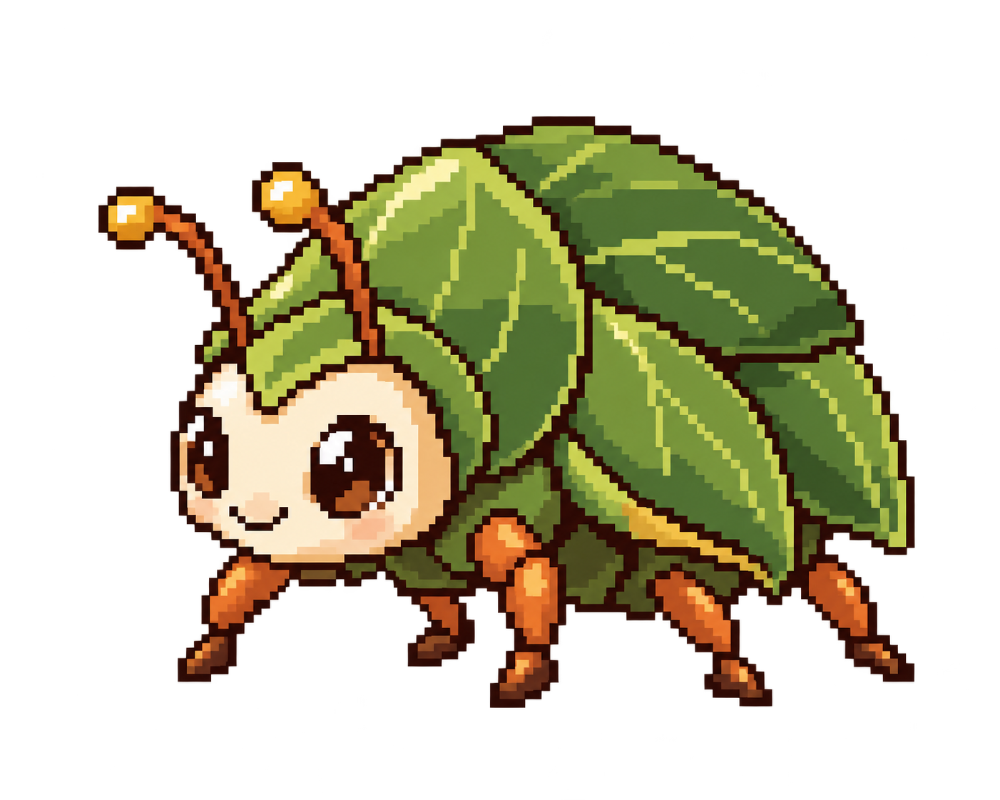
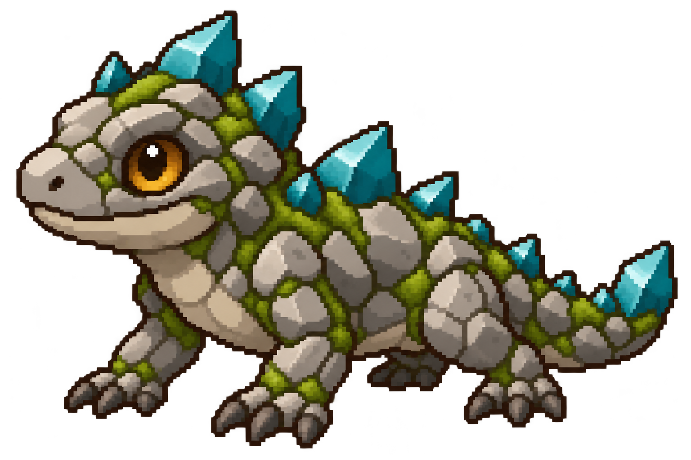

# 新手区域与新增普通魔物 · 设计预览

> 历史归档：2026-10-17 静态素材接入。2026-10-23 整理归档；下文的“当前、待接入、未实现、待确认”和验证结果均属于记录当时，不作为现行规则或待办清单。当前实现见[现行说明](../../agents/Agent探索观察战斗画面接入说明.md)；其他领域见[Agent 导航](../../agents/README.md)。

状态：2026-10-17 用户要求加入图鉴；四只静态像素形象已注册，战斗动作尚未制作。

## 区域与等级草案

| 地点 | 推荐等级 | 普通怪物 | 精英 / Boss |
| --- | --- | --- | --- |
| 新芽草甸 `dungeon.sprout_meadow` | 1～15 | 软泥怪 1～5、绒耳兔 1～7、叶壳甲虫 5～10、晨光萤 10～15 | 无；只出现普通怪 |
| 苔石洞窟 `dungeon.moss_cave` | 10～20 | 洞穴蝙蝠 10～20、洞穴晶蜥 10～20 | 苔石兽与苔冠巨兽沿用现有等级和属性 |
| 废弃矿坑 `dungeon.abandoned_mine` | 15～25 | 原有普通怪物 | 精英与 Boss 沿用现有等级和属性 |

新芽草甸的遭遇池只有普通品阶，不设置精英或 Boss。软泥怪从苔石洞窟迁至新芽草甸；苔石洞窟新增一只普通怪。洞穴蝙蝠使用独立属性档：HP 倍率 0.8、攻击倍率 0.9、闪避率 6%，只影响普通洞穴蝙蝠，不改其他敏捷怪。以上地点、魔物和属性已纳入 design-0.18 与 combat-1.0.18 内容目录。

新手区三只新怪都先用普通攻击，不新增战斗技能。绒耳兔侧重轻快、低伤害；叶壳甲虫侧重较稳的防守；晨光萤使用远程魔法普攻。洞穴晶蜥使用普通物理普攻，避免给新区域增加额外机制负担。

## 正式图鉴静态形象

以下文件各自独立，可单独审阅。像素造型沿用深褐描边、有限配色和左上高光；同一文件用于图鉴列表和详情静态图。

### 绒耳兔

新芽草甸，建议等级 1～7，普通敏捷型。

### 叶壳甲虫

新芽草甸，建议等级 5～10，普通防守型。

### 晨光萤

新芽草甸，建议等级 10～15，普通魔法型。

### 洞穴晶蜥

苔石洞窟，建议等级 10～20，普通物理型。

## 接入边界

- 本次仅接入静态形象；待机、移动、攻击、受击、倒下动作和技能特效仍未制作。
- 新手地点不复用苔石洞窟背景；本轮未制作新背景。其战斗预览使用无区域背景的中性舞台。
- 新区域不新增持久字段或 WebDAV 实体；生产目录安装按新版本整体发布。
