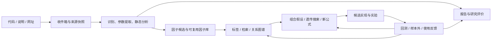

# AI 量化研究系统整体重构

日期：2026-10-24。状态：设计与实施规格；自动报告、因子库、本机实验、连续研究、反馈方案及候选指标导出已在本地实现；完整目标与真实环境验收尚未完成。当前代码行为见[量化文集一期说明](../quant/量化文集一期说明.md)。本文覆盖完整目标，分阶段交付不代表缩减为“生成一篇解释”。

## 1. 产品目标与成功标准

用户主要负责把网上发现的代码、说明、网址和使用后的反馈投入系统。系统自动整理、分析、评价，沉淀可复用因子，持续提出并验证新的参数、因子组合和策略假设。保留人工输入、纠错、删减 AI 内容和补充证据的能力，但人工写研究正文不再是主流程。

支持来源：TradingView/Pine、通达信公式、聚宽/Python、MQ4 指标与 EA，以及其他可归档源码。平台和语言分开记录：Python 不等于聚宽，MQ4 不等于 EA，指标也不等于策略。

完整闭环：

成功必须同时体现：收集后自动产生报告；参数被解释且可形成实验方案；因子积累可追溯、可去重；关联有依据；生成的公式有父代与实验记录；反馈改变后续研究决策。未经证据支持，不承诺“收集越多收益越高”。积累价值以重复劳动减少、可复用成果和验证证据衡量。

## 2. 当前系统与改造边界

2026-10-24 核对 `quant/models.py`、`worker.py`、`services.py`、`sync.py`，以及前端 QuantPage、NewEntryModal、EntryEditor、AIPanel：

- 已有私密文集、研究条目、不可变代码版本、附件、手填回测、解释与转换任务及同步保护。
- 解释任务只保证 explanation 非空，与转换共用字符串结果结构；缺少参数清单、因子实体、评分规则与证据关系。
- 新建要求用户填标题，正文以手工编辑为主；解释结果需主动追加，追加不包含其他结果字段。
- 语言枚举只有 Python/Pine/MQL4；没有通达信分析适配。
- 没有因子实验执行器、量化向量索引、因子图谱或演化循环。现有 Agent 世界业务并不等于量化研究 Agent。

保留现有权限、代码快照、资源归属、模型配置、用量记录、取消/租约、同步与恢复基础设施；重新设计研究领域数据和主页面。不能用不断扩大的 Entry.content 或 AIRun.result 代替因子、证据、实验等具有独立身份的模型。

## 3. 用户体验

### 3.1 收集入口

一个主入口“收集并分析”：粘贴代码、上传源码、粘贴说明或网址，可混合提交。标题、类别、语言可自动识别，允许纠正；标的、周期、市场和特别关注点均可选，不阻止归档与基础分析。未配置模型时照常归档，任务显示“等待配置模型”。

默认在用户启用自动分析后，收集完成触发标准分析；生成报告、因子候选、标签和关系候选。每批次展示预算与进度，支持批量收集、取消、失败重试。无需每次进入“代码实现→解释→复制到正文”。

网址必须保留原 URL、最终 URL、作者、抓取时间、内容哈希与可获得的授权信息。抓取失败、登录限制、仅有讲解无源码、受保护脚本分别标注；成功抓取网页不等于拿到源码。可继续分析已有说明，但不能据此断言源码行为。补充源码后增量分析。

网页、代码注释和附件均是待研究材料，不得成为 Agent 指令。抓取使用受控服务，重定向重新验证目标，限制大小/时间；不获取登录凭据、不绕过访问限制。站点适配优先，通用提取兜底；无法抓取时保留资料并提示缺失项。

### 3.2 页面结构

| 工作区 | 用户首先看到什么 | 主要操作 |
| --- | --- | --- |
| 收件箱 | 待分析、已完成、失败与缺失材料 | 投入资料、批量分析、补充材料 |
| 研究详情 | 一句话结论、研究评分与证据等级、关键问题 | 阅读/编辑报告、查看参数、追溯源码 |
| 因子库 | 因子定义、分类、来源数量、验证状态 | 搜索、筛选、比较、进入因子详情 |
| 关联图谱 | 选定因子的邻居、关系类型与依据 | 查同类、互补候选、父代与衍生 |
| 研究实验室 | 当前假设、预算、候选、实验结果 | 发起/暂停研究、导出候选实现 |
| 反馈与证据 | 回测、模拟、实盘资料及可比较范围 | 导入结果、纠正映射、查看结论更新 |

报告采用目录、短结论、参数表、证据定位与分节阅读；不再把全文塞进弹窗。图谱由检索和选定节点展开，不默认渲染全部节点。宽屏详情与证据并列，窄屏单列切换；沿用项目橙色、白卡片和公共控件。

AI 原始报告不可变；用户编辑形成修订稿，可回看原稿、差异和来源版本。重新分析产生新报告并展示差异，保留人工修订，不静默覆盖。删除/隐藏内容与否定事实分开：纠错可成为后续分析输入，纯编辑不自动推断为实验结论。

## 4. 分析工作流与报告合同

每一步有输入快照、输出 schema、状态、模型/工具版本、用量、失败原因及幂等键。可确定的检查由代码执行；解释与假设交给模型。所有关键结论标注“源码事实 / 作者主张 / AI 推断 / 实验结果 / 用户反馈”。

| 阶段 | 输入 | 输出与约束 |
| --- | --- | --- |
| 接收与归一 | 原始材料 | 来源版本、文件清单、内容哈希、缺失说明 |
| 识别与切片 | 源码和说明 | 平台/语言/版本、类别、函数/公式结构、依赖；未知语法保留 |
| 参数与静态检查 | 有行号的源码片段 | 参数结构、数据依赖、时间对齐/重绘/执行语义疑点 |
| 研究分析 | 上述结构与相关原文 | 原理、公式、用途、适用条件假设、风险与复现步骤 |
| 因子提取 | 依赖图和计算逻辑 | 因子候选、组合规则、来源行与无法独立抽取的原因 |
| 检索比对 | 候选及已有库检索结果 | 重复、变体、相关/互补假设；保留比对依据 |
| 评价与审查 | 分析、证据及缺失项 | 分维度评价、证据充分度、矛盾与修订；审查本身不算实证 |
| 发布与索引 | 完整且校验通过的结果 | 报告快照、候选因子、标签、关系与索引更新任务 |

报告必含：摘要/结论、分类、原理和公式、数据与时序、参数、代码质量与缺陷、适用情景假设、可提取因子、研究评分、未验证事项、下一步实验。每个问题关联源文件/行范围或材料片段；不能定位的推断降低证据等级。

报告合同按启用能力与 schema 版本定义：P1 未上线的因子提取、检索、关系步骤明确标记“未启用”，不阻止基础报告发布；P2/P3 启用后必须通过对应阶段校验，旧报告可增量补全而不伪装成已完成。

支持独立阶段重试和断点续作；失败不发布残缺报告，不清除旧报告。新源码使旧报告显示“基于旧版本”，不得复用旧评分冒充新结论。增量任务只重算受影响节点。

## 5. 参数研究是一等能力

参数记录：稳定 ID、变量名、显示名、类型、单位、默认值、声明范围/枚举/步长、作用、引用位置、约束、相互依赖、可调性、证据与置信说明。

区别：源码默认值、用户运行配置、写死常量、随时间变化的内部状态、AI 候选参数、经实验支持的参数区域。读不到实际配置时显示未知，不能以默认值代替实盘值。

适配要求：Pine input 与旧版本形式；MQ4 input/extern 与 .set 文件；通达信公式参数及外部参数表；Python 函数/配置/策略全局参数。展示参数、信号参数、仓位风险参数、执行参数分别归类，颜色/线宽不进入收益优化空间。

参数建议必须附：用途、市场/周期前提、理由、搜索范围、关联约束和验证计划。信息不足先给待检验范围；写死常量的改变生成新的源码版本。运行时自适应参数记录规则及时间序列，不假定是固定值。

实验先比较基线与邻域，观察参数敏感度及稳定区域，避免只推荐一个最优点。相同周期值在不同频率不自动等价；测试须记录预热、缺失值与交易日口径。不同平台的同名参数也不能默认一致。

## 6. 评价、评分和证据

采用两套评价，页面并排显示：

1. **研究质量分（0–100）**：可由静态分析产生，用于收藏筛选，不能解释成预期收益。五维各 0–5，按固定等权重汇总：逻辑清晰度、实现质量、数据与时序可靠性、参数可解释性、复现与复用价值。每维必须给理由、证据和未知项。未知维度不记 0，也不静默重新加权；显示已评维度和暂缺总分。评分规则版本固定，跨版本不混排。
2. **实证评价**：必须依赖具体实验，展示指标和证据等级，后续数据充足再提供有版本的同条件评分。初始没有回测时为“未评估”。收益、回撤、IC 等由数据计算或标为用户提供，模型不得编造。

类别约束：因子评输出定义/预测对象；指标评计算、信号与可观测性；策略/EA 额外审查仓位、成交和风控。指标没有下单函数不扣分。缺陷严重度与分数独立展示，严重的时间泄漏不能被其他维度平均掩盖。

证据链：仅说明 → 源码静态检查 → 可复现计算 → 历史实验 → 样本外/滚动检验 → 模拟/实盘观察。它是证据状态，不是收益保证；单个好结果不自动晋级所有市场。每条结论限定对象版本、参数、市场、时间、成本、数据源及样本规模。

## 7. 因子库、标签和图谱

因子不是任意代码块：至少描述输入、输出、时间窗口、计算公式/表达式、数据可得时间、缺失值、参数、用途和来源。保留信号条件、风控、交易执行、可视化等模块类别，不能全部命名为 alpha 因子。

提取结果先自动入“候选”，无需人工逐项批准；通过结构和依赖检查后进入可复用层，有实证后进入对应验证层。提取失败保留原因。源策略评价低时，组件仍可保留研究价值。

使用平台无关的类型化表达式/中间表示表达支持的算子；无法转换的代码保留为平台片段，禁止伪造等价公式。等价性通过固定输入、输出对齐与误差规则检验。

去重顺序：原始内容哈希 → 标准化表达式哈希 → 语义近似候选 → 显式等价证据。不同名称可能同义，同名因子可能不同；近似不得自动合并。合并保留别名、来源、版本及可撤销关系。

分类维度：动量/趋势/反转/波动/量价等机制，时序/截面，资产与频率，数据要求，信号/过滤/风控用途，平台，可调性和验证状态。AI 标签可编辑；维护受控词表与别名。

图谱节点包括来源、报告、因子版本、策略版本、实验、市场情景与反馈。边区分：提取自、调用/组成、变体/衍生、已证等价、语义相似、统计相关、互补假设、支持/反驳、适用情景。边记录依据、方法、时间范围和置信说明。

Embedding 仅负责语义检索候选，不证明相关性、因果、等价或收益。统计边必须来自对齐后的数据和实验；互补性要看组合的增量价值。检索采用关键词/标签/表达式 + 向量混合，先按所属用户和文集权限过滤再返回。

## 8. 演化研究与新策略生成

保留“因子生因子、组合生策略”的完整目标，分为提出假设与实验选择两层。无数据时可自动提出候选及导出平台代码，有数据/执行器时才评价表现并选择下一代。

研究任务先固定：目标市场与周期、预测/交易目标、可用数据、成本、允许算子、复杂度限制、候选数、世代数、实验/模型预算、停止条件。初期默认每次有界研究批次；自主重复研究需启用预算策略，预算耗尽、数据缺失或连续失败自动等待。

候选来源：相似因子的参数变体；同类去冗余；不同机制组合；趋势/波动/流动性情景过滤；误差与失败案例驱动修订。算子包括标准化、排序、滞后、平滑、残差化、条件门控、加权组合；限制输入输出类型、单位、时序和依赖。

遗传流程：选择父代 → 类型安全的交叉/变异 → 静态可执行性检查 → 去重和复杂度约束 → 训练/验证实验 → 多目标选择 → 下一代。记录随机种子、父代、变换、全部尝试和淘汰原因；保留多样性与简洁基线，不能只优化收益单目标。

适应度由可复现计算提供，考虑稳定性、成本、换手、复杂度与相对基线增量；LLM 评分不能替代适应度。情景划分必须用当时可获得的信息，不能事后挑出盈利行情再宣称适用。

测试期与标签跨度隔离，按数据频率和目标采用滚动/嵌套验证及必要的间隔剔除；最终留出集不参与候选生成或选择。留出结果反馈进入下一轮后，该数据不再是新一轮的独立留出集。记录试验次数和搜索家族，评价多重尝试与过拟合风险。

输出：新因子表达式、依赖清单、候选指标/策略代码、参数配置、实验报告、与父代/基线差异及适用边界。每个新产物回到资料/因子库并保留谱系。生成 MQ4 EA 时补齐信号到执行的明确规则，禁止把一个指标直接宣称成可用 EA。

## 9. 实验执行与反馈闭环

先完成外部结果导入和可复现数据合同，再接受限内部计算。平台代码执行走平台适配器：TradingView、通达信、聚宽、MT4 的运行能力须逐一核验，不能把翻译成 Python 当成原平台验证。

内部计算器优先运行受控表达式，不直接在 Web/Worker 进程执行上传源码。确需运行 Python 依赖的实验用隔离进程/容器、资源与时间限制、固定依赖、只读输入和默认无网络；平台连接凭据留本机。生产下单不属于本次目标，实盘反馈来自用户导入资料。

统一证据包：对象/源码哈希、参数、平台版本、标的/样本池、时间与时区、复权/幸存者/数据可得口径、成本/滑点、成交约定、数据哈希、指标、收益曲线/成交、生成工具与原件。缺失字段显式保留。

支持 CSV/JSON、平台报告 HTML、文本与截图/PDF原件。结构化导入按版本适配；截图/文字先形成“待核对的用户报告”，不自动升级为可复现实验。净值、持仓、成交、文字心得按各自证据层级处理。实盘/模拟/历史回测明确分开。

反馈分析：信号与成交偏差、成本与滑点、参数实际值、情景变化、样本覆盖和失效条件。先尝试解释平台/数据差异，再判断是否需要改公式；报告支持与反驳证据并存，不删除负面结果。只更新受影响对象及关系，生成新的研究假设和后续实验计划。

## 10. 数据模型、服务与同步

拟议实体（最终字段在各阶段实施时固定）：

| 实体 | 主要内容 |
| --- | --- |
| SourceMaterial / SourceRevision | 原始代码/说明/网址、来源与抓取快照、附件和哈希 |
| ResearchReport / ReportRevision | 结构化分析、评分、原稿与人工修订、证据引用、模型/规则版本 |
| ParameterSchema / ParameterSet | 声明与约束、默认/实际/候选配置、适用条件 |
| Factor / FactorVersion | 稳定身份、公式/表达式、依赖、参数、标签、验证状态 |
| Relation / Evidence | 类型化关系、证据范围与来源、失效/撤回 |
| ResearchCampaign / Candidate | 目标、预算策略、父代、变换和候选状态 |
| Experiment / Observation | 固定输入、执行结果、外部证据与反馈映射 |
| WorkflowRun / StepRun | 请求/输入输出快照、阶段状态、成本和恢复信息 |

2026-10-24 用户已确认：上述业务数据全部进入 WebDAV/FTP/SFTP 同步；向量索引在各设备重建，执行队列留本机。报告、标签、关系、实验事实和原始反馈是业务资产；附件沿用 Asset 与 Blob。向量模型/切片版本和源内容哈希可作为重建元数据，向量文件、租约、进程锁、凭据不进入同步。

同步升级：扩展 quant manifest/哈希/引用完整性，提升量化 schema 与应用兼容版本；旧快照升级映射，新快照拒绝旧客户端恢复；同步恢复只恢复任务记录、输入和检查点，将未完成任务标记为中断/等待授权；本机重新获得执行授权并检查预算后才可入队，不自动续跑或恢复旧执行授权。因子关系不能跨用户串联，软删保留已被报告/实验引用的证据。

模块建议：`quant/ingestion/`、`analysis/`、`factors/`、`graph/`、`experiments/`、`evolution/`、`feedback/`、`workflows/`。前端按同领域拆分组件/Hook/API/类型/纯逻辑，复用安全 Markdown 和代码编辑器。

复用现有模型提供商、用量与取消机制；评估现有 RAG/embedding 服务的隔离和重建能力，再接领域索引。不复用 Agent 世界生活调度/经济模型。图谱首版用关系表和投影，规模证据出现前不强加独立图数据库。

Agent 角色由持久化 workflow 编排：资料整理、代码分析、因子提取、研究设计、结果审查。每个角色只读取阶段所需材料和经过权限过滤的检索结果。预算与状态由代码控制，模型不能自授工具权限或无限触发新任务。

幂等键包含输入版本/阶段/分析规则版本；重试不重复建因子或实验。步骤输出先校验再原子发布，多个设备并行产物保留独立身份；来源哈希关系用于去重，不以名称覆盖。报告旧版本继续可读，不能因模型升级被改写。

## 11. 分期与验收

| 阶段 | 交付 | 必须通过的验收 |
| --- | --- | --- |
| P0 契约与迁移 | schema、权限、旧条目映射、来源与报告独立实体 | 隔离迁移与恢复，无丢失/重复/执行复活；旧解释可读 |
| P1 自动研究闭环 | 代码/说明/URL收件箱，结构化报告、评分、参数、可编辑修订 | 四类平台样例与未知语言；无模型/抓取失败/缺源码/取消/重试/并发编辑均可恢复 |
| P2 因子沉淀 | 提取、候选状态、版本、标签、去重和检索 | 同义异名/同名异义；依赖不全不得假装独立；可追溯每个因子来源 |
| P3 关系与证据 | embedding、图谱、外部回测/实盘反馈导入 | 语义边与统计边分离、权限过滤、索引可重建、负面证据保留 |
| P4 实验与演化 | 受控表达式计算、参数研究、组合/遗传搜索、平台导出 | 固定数据复现、完整谱系、预算停止、数据隔离、对照/样本外评估、失败淘汰可查 |
| P5 持续反馈 | 反馈触发增量研究、有界自动迭代 | 新反馈更新正确对象，模型不可凭空晋级，断点恢复及多设备同步验收 |

外部验证从 P1 就能记录；P3 完成结构化反馈分析；P4 的有效性判断依赖真实数据源和实验环境，缺失时保留候选与等待状态。每期可交付不意味着完整目标达成；P5 闭环验证前不宣称整体完成。

现有 Entry 映射为资料/研究容器，Implementation/CodeVersion 保留源身份，旧 AIRun 解释作为历史报告，Backtest/Attachment 映射证据并保留未知项。先兼容读取再切换主流程；迁移不自动付费调用模型。旧纯手工入口收为“手动记录”，已有笔记原样保留。

跨阶段质量门槛：Python/Pine/MQ4/通达信语法样例；参数与引用覆盖；schema 输出校验；权限/幂等/取消/恢复；纯 local 样例、空、加载、错误及关联弹窗，无 501 和真实后台穿透；桌面/窄屏浏览器验收；后端隔离测试；前端类型/lint/build；同步和真实模型效果分别记录。

真实模型验收使用固定小型人工标注语料：参数召回/误识别、源码事实定位、未获证据断言、报告完整度、重复分析评分波动、因子抽取有效性。先建立基线再设置放行阈值，不以“JSON 能解析”代替质量验收。

质量工具实施状态（2026-10-25）：已提供[固定语料与报告质量评测工具](../quant/研究报告质量评测说明.md)，含五份代码、一个抓取失败负对照、参数/引用检查、上下文分组重复评分、只读运行导出和哈希绑定人工复核表。已取得 Pine、Python、MQ4 EA、MQ4缺依赖指标、通达信五类源码的真实报告，保留被拒绝输出和阶段续作依据，修正参数用途、输出状态、提取/修订边界及请求资源释放，见[多平台实测](../quant/多平台真实模型验收记录.md)。固定官方行情也已通过独立账本核对，见[实测记录](../quant/真实模型与历史行情验收记录.md)。参考标签仍是待专家核对的 AI 草稿，完整重复模型基线、人工基线及放行阈值尚未建立，后续已取得Python原始方案到真实行情执行、自动AI复盘及次轮方案的[单案例实测](../quant/真实方案行情与AI复盘验收记录.md)，该例period=30的[登记后下一月固定评价与复用拦截](../quant/登记后真实新数据验收记录.md)也已实测，随后完成三月/四月两轮[真实连续研究与预算停止](../quant/真实连续研究与预算停止验收记录.md)，含28次独立数值核对、自动采用次轮方案和2次真实复盘；外部实际反馈驱动后续源码决策的完整链路仍待验收，这些增量不等于本节验收完成。没有新增业务持久字段或同步版本。

### 端到端验收场景

用户收集一份“布林带 + RSI”源码、一个 MQ4 EA 和一段通达信公式。系统自动识别三个来源并生成报告，保留未知平台版本和缺失依赖。由第一份源码抽取价格相对通道位置、动量状态和组合条件，区分可复用特征与交易规则；发现其他来源有相似计算时建立候选关联，不直接合并。

系统为参数形成受约束的实验方案。没有行情时标记“待数据验证”，仍可输出候选代码；接入可复现实验后，比较单因子、组合与简单基线，记录每个候选的正负结果。若仅部分行情有效，适用关系附市场、时间、成本与证据。用户导入实盘配置和成交后，系统发现实际参数或执行假设不同，更新该实验的评价并提出下一轮假设，而不改写原源码和原报告。

此场景是目标验收脚本，不是对上述方法有效性的判断。验收要检查每个页面和持久记录之间的引用，不能仅查看最终生成的一段报告。

## 12. 待落实的配置与风险

- 首条实验路径已由用户确认（2026-10-25）：导入历史行情，在本机计算与回测。具体标的、频率、时区、复权和来源随每份数据明确记录；不预设统一市场或默认有效参数。
- 自动分析与演化预算：提供每批候选/代数/模型调用/时间上限和可见成本；具体默认值通过小批运行校准，无配置不启动无限循环。
- 首轮仅据已有代码确定可复用模块，不宣称站点抓取、平台执行或官方 API 已可用；每个平台单独验证。
- 人工评分纠正形成反馈，不能任意覆盖原始实证指标。模型审查可发现矛盾，但不算独立数据证据。
- 业务格式版本、模型与提示词版本、计算引擎版本均记录，避免后续无法解释评分和公式的变化。

## 13. 参考依据与状态

- [Pine 重绘说明](https://www.tradingview.com/pine-script-docs/concepts/repainting/)：历史与实时执行差异需要专门审查，不能只看图形是否好看。
- [MQL4 输入变量](https://docs.mql4.com/basis/variables/inputvariables)及[外部变量说明](https://book.mql4.com/variables/types)：参数声明与实际配置属于不同输入。
- [The Probability of Backtest Overfitting](https://www.davidhbailey.com/dhbpapers/backtest-prob.pdf)：大量候选试验增加过拟合问题，演化必须保留试验集合和独立评价边界。

这些资料支撑检查原则，不代表本项目已经实现对应检查器或已验证任何策略。本文是完整重构规格；实际进度必须由代码、测试和浏览器/运行记录更新。

独立阅读审查（2026-10-24）：已核对用户负担、参数证据、完整闭环、实现状态和同步边界；已补清分期报告发布合同及同步后任务重新授权规则。该审查仅针对规格，不代表软件验收。

## 14. 实施进度（2026-10-25）

P0 已实现来源/报告/修订模型、旧数据幂等映射、代码保存与解释完成时落库、不可变内容/引用校验。P1 已接入收集 API、独立分析任务、结构化报告、五维静态研究质量评分、参数说明及候选建议、编辑删减与历史修订；主页面默认进入 AI 报告，原有笔记保留。同步格式当前为 schema 36，执行队列仍只在本机。

P1 阶段证据（2026-10-24）：65 项隔离量化后端测试通过，覆盖旧数据迁移/恢复、来源与报告同步、鉴权、重复收集、分析发布、未知评分、无源码评分约束、无模型归档、修订冲突和任务不复活；16 项前端测试通过。类型检查、定向 ESLint、构建和迁移一致性检查通过。测试仅使用内存数据库、临时媒体和 fake 模型，未迁移真实数据库。

浏览器已验证本地收集 → 排队 → 自动报告、刷新恢复、人工修订与原稿保留、Pine 来源高亮。开发过程中其他文件的整页热重载干扰了未保存表单，换到独立 local 端口后收集成功；不把模拟报告当真实模型效果。样例、空数据、接口错误及慢请求恢复已检查；P1 完整流程的窄屏与独立网络捕获验收仍待完成。最新筛选/列表刷新修复后重跑 6 项分析接口测试及前端测试、类型、lint 和构建通过。

下一步：完成 P1 的四类平台参数/依据固定语料和真实站点/模型验收，优化资料与代码实现的衔接；并继续完成 P2 的候选版本/别名/去重与后续 P3–P5 的索引图谱、实验及反馈。当前不能宣称完整自动研究系统已完成，未部署、未验证远端多设备同步。

P1 网页增量：已实现公开静态网页/纯文本获取、正文与单一源码块提取、独立获取快照、获取失败留存、取消与已获取快照复用。原始提交与实际分析来源分开，随 schema 4 同步。纯 local UI 已核对 URL 成功/失败流程；真实 TradingView 和 MQL4 文档探测受当前网络连接/TLS 中断影响，仍未通过实站验收。没有启用任何绕过登录、验证码或证书检查的机制。后续继续因子候选提取与积累，不因实站验证暂未通过而缩小完整目标。

P2 首段：已接入同次 AI 分析的候选分解、最多 20 项结构化合同、原文引文校验、受限表达式结构与引用检查、事务性自动入库、不可变出处记录及 schema 5 完整同步。集合级候选库支持检索、用途/分类筛选、公式/参数/数据时点/出处阅读，并能跳回对应历史报告。所有候选为静态未验证，表达式校验不等于平台等价或运行通过。旧报告原样保留，重新分析才得到新版提取。

P2 公式编辑/稳定谱系、当前工作版及每文集受控词表/别名治理已接入下述版本功能；尚未完成：代数规范式/语义分层去重、缺失依赖修复与晋级；当前原文/表达式分组只判断源码或声明式结构及契约一致，不自动认定等价或合并。P3 已接入下述初步索引与图谱；P4 已有下述受控计算与有界搜索核心，实验启动/结果页面已接入，AI 实验解读已接入，有界演化、连续研究与 P5 外部反馈分析已在后续增量接入，其余整体缺口继续实施。本轮没有缩减这些完整目标。

P2 本轮验证（2026-10-25）：量化全套 70 项后端测试、17 项前端测试通过，新增旧报告兼容用例后候选模块 6 项通过；类型、lint、构建和迁移一致性检查通过。纯 local 浏览器验证自动入库、历史报告跳转、检索空结果、空数据、加载和错误恢复，并通过 390px iframe 检查候选库及来源详情。生产数据库、真实模型及多设备远端同步仍未验收。

P2 整理增量（2026-10-25）：已实现原文/表达式/全部记录三种展示、同组来源分页与独立提取查看；新增名称、机制分类、标签、别名和备注的追加修订与冲突保护，人工版本可查看、以历史版本重新编辑，搜索使用整理结果。schema 6 同步修订链。表达式分组纳入参数、输入时点和平台，修改默认参数的同名候选保持独立。分组目前计算于集合内存快照，尚需大库性能验证与后续索引优化。语义近似已在下述 P3 增量接入；固定样本直接对照与可撤销逻辑合并已在后续 schema 34 增量接入。

本轮整理验证：73 项后端、18 项前端通过；类型/lint/build/迁移一致性通过。local 页面核对同组两次出处、保存与历史、未保存离开保护。新增整理弹窗的窄屏和错误场景尚未单独复验；生产未迁移、真实模型/远端同步未验收。

P3 初步实现（2026-10-25）：来源/报告/候选追溯图、精确指纹边、默认向量模型自动索引及手动重建、余弦邻居推荐、历史关系标记、取消与有界执行已接入。schema 7 同步不可变关系证据，本机向量和执行授权排除并在恢复时清理。当前是聚焦候选的有界邻居图，自由文本混合检索、固定样本对照和可撤销逻辑合并已接入下述增量；全库增量邻居刷新、原平台等价及大规模图性能验收仍待完成。实际边界与入口见[当前量化说明](../quant/量化文集一期说明.md)。P4/P5 仍需继续，完整目标没有完成。

P3 本轮验证：86 项量化/共享向量传输后端回归通过；补充真实传输适配的 mock HTTP 与 token 统计用例后，图谱专项 9 项通过。19 项前端测试、类型检查、定向 lint、构建及迁移一致性检查通过。local 浏览器验证空数据、错误、慢加载、索引停止/重建完成、切换中心和精确历史报告跳转；390px 预览发现并修复顶部标题挤压，iframe 内图谱交互尚未完成复验。预览使用模拟模型和关系；真实向量服务、生产迁移、多设备远端同步和大库性能仍未验收。

P4 首段（2026-10-25）：按用户选择实现历史 OHLCV CSV 导入、不可变行情快照、时区/缺失/价格合同、原 CSV 与规范化投影核对及 schema 8 同步；前端提供实验行情列表、导入与预览。受控表达式计算、下一开盘做多/空仓模拟、同成本买入持有基线、训练/验证/留出分区、有界参数变体与类型/单位约束组合、Pareto 父代和全部尝试记录已作为核心模块实现。留出段不参与本批选择，跨批重用现有下述保守的同集合请求区间提示，独立留出证明仍未实现。实验请求/本机授权任务、结果/谱系持久化现已接入下述增量；结果页面和 AI 实验解读已接入后续增量，可从界面运行整批实验；平台导出仍未接入，不宣称推荐参数已验证。

P4 本轮验证：102 项隔离后端回归、20 项前端测试通过；类型、定向 lint、构建及迁移一致性检查通过。纯 local 浏览器核对合成 CSV 导入、乱序拒绝、离开保护、时区与缺失保留、空数据、错误和慢加载恢复状态。固定引擎测试覆盖因果性、成本/时点、缺失、预算、取消、候选谱系及留出变化不影响选择。真实行情/模型、生产迁移、远端同步和本轮窄屏交互未验收。完整 P0–P5 目标继续实施。

P4 任务持久化增量（2026-10-25）：实验创建/列表/详情/停止 API 已接入有界本机执行器；冻结行情、父代和实际参数，逐个尝试写不可变检查点，最终结果保留检查点清单、选择依据和保守的数据重用提示。schema 9 同步请求/检查点/结果，执行权限只留本机；恢复不自动重跑，重复请求不新建权限。超时、取消、进程丢失和失败分别留痕。107 项全套后端与 21 项前端测试通过，补充执行器提交失败、超大数值和结果完整性后，25 项定向测试及 6 项任务专项通过；类型/lint/build/迁移一致性通过。前端 API 类型/local 路由与启动、结果页面已接入（页面验证见下一段）；结果 AI 解读已接入下述增量；公式回库已接入下述增量；结果后的参数方案生成已接入下述增量；首轮自动计划、平台导出以及 P5 闭环继续实施。

P4 页面增量（2026-10-25）：因子库已提供实验列表、准备/启动、停止及结果详情；源码默认参数预填，可生成信号窗口 75%/125% 邻域，未知输入需明确绑定，费用/滑点与预算可编辑。结果包含留出与基线曲线、逐次指标/失败原因、父代/参数/计算式和数据重用提示。邻域仍为确定性起点，并非 AI 自动研究方案；AI 解读已接入下述增量，公式回库已接入后续增量。23 项前端测试、类型/lint/build 通过；纯 local 桌面验证空列表、准备/启动/停止、失败尝试、离开保护、错误与慢加载恢复。local 指标为明确标识的人工样例，390px 报告阅读与准备菜单已在后续增量核对；其余窄屏交互、真实后端页面链路及真实行情/模型尚未验收。

P4 AI 实验解读增量（2026-10-25）：完成/部分完成实验后自动提交一次默认模型研究解读；复用现有有界 AI 任务与报告修订，新增 AIRun.experiment_result 引用及 schema 4 实验报告，随 schema 10 同步。输入投影保留全部尝试和实际参数但排除原始行情与曲线。结构化报告含证据引用、条件评分、参数分析、失败解释、研究优先级及下一轮可证伪假设；证据不存在、缺少对照却给参数稳定性分数等输出拒绝发布。页面支持进度/取消/重试、全文、编辑与原稿历史；恢复不重新授权后续模型任务。公式回库已接入后续增量；下一轮可执行方案已接入下述增量；预算内自动编排已接入下述增量；P5 实盘反馈仍需完成，不以文字假设替代自动研究闭环。

解读增量验证：108 项隔离后端测试及补强后的 42 项定向回归、23 项前端测试、类型/lint/build/迁移一致性通过；桌面浏览器验证报告生成/取消/跳转/修订，390px iframe 验证阅读和准备菜单。真实模型自然语言质量及真实市场有效性仍未验证。

P4 衍生回库增量（2026-10-25）：已完成实验从训练/验证筛选结果保留最多 3 个参数变体或组合，以独立衍生出处自动回到候选库。保留分支实际参数、原参数类别/约束、父代及检查点，计算输出可复现并能再次成为实验父代；索引任务仍受本机完成权限约束。图谱展示衍生边，详情可往返生成实验。schema 11 同步生成公式与谱系，恢复不补跑历史回库或恢复任务。115 项全量后端、补充 13 项定向回归及 23 项前端测试通过，local 桌面验证回库、第二轮输入/启动/完成与谱系；新代码未部署，真实行情/模型与远端同步未验收。结果后的 AI 可执行计划已接入下述增量；预算内多轮编排已接入下述增量；首轮自动计划已接入下述增量；候选指标输出和反馈方案已接入后续增量，完整自动研究尚需原平台核验与外部数据复算；受控公式回库不等于生成可实盘运行的 EA。

P4 可执行下一轮方案增量（2026-10-25）：实验解读 v2 同次模型调用提出父代、完整参数组、假设/否证/新数据要求；没有合理方案可明确不继续。仅允许本轮原始或已回库衍生父代，服务端校验参数类型、使用范围、窗口边界和原预算。ExperimentProposal 不可变保存，页面可直接预填准备实验；实际运行保存来源和调整标记，可查看原建议。schema 12 同步版本、方案与执行引用，恢复不授权任务，旧解读按 v1 保留。自由文本参数约束和新行情要求尚未全部机器判定，方案不等于最优参数。122 项后端、24 项前端回归通过，纯 local 走通生成、预填、启动和来源展示；真实模型/行情和远端交换未验收。多轮预算编排已接入下述增量；首轮 AI 计划已接入下述增量；平台验证输出及 P5 反馈仍需继续。

P4 连续研究增量（2026-10-25）：从已有 AI 方案开启有预算的本机自动轮次，顺序执行实验、唯一解读与下一轮方案，固定模型及预选行情顺序。最多 5 轮，候选总上限 160、计算总上限 300 秒、总耗时上限 1200 秒；逐轮按上限预留，模型调用不超轮数。无方案、预算不足、数据用完、失败或取消均停止留痕。新增 Campaign/Round/Evaluation/Outcome 业务事实随 schema 13 同步，协调 Job 留本机；恢复与幂等重放不授权新任务。页面有启动预算、运行状态、停止和逐轮详情入口。首轮自动计划已接入下述增量；跨库检索决策已接入下述增量；完整目标仍缺平台验证产物和 P5 反馈循环，不能以有限轮次替代全部研究闭环。

本增量验收范围：131 项全量后端、11 项连续研究专项、24 项前端测试通过；类型、定向 lint、构建与迁移一致性通过。纯 local 核对运行到行情耗尽、停止当前子实验及四态恢复。模型输出均为测试替身，正式迁移、真实模型/行情及多设备交换仍未执行。

P4 首轮自动方案增量（2026-10-25）：资料分析同次调用可提出当前提取候选的首轮实验，包含输入列、候选参数组、实验假设/否证和行情要求。服务端基线固定读取声明默认值，未知或非可计算候选不能猜测启动；方案与报告/因子原子保存。报告页面可直接进入本机实验或连续研究；schema 14 按来源结果重建初始方案并同步，恢复不授权计算。138 项后端和 25 项前端测试通过，local 验证参数预填、启动导航与连续研究入口。尚未验证真实提供商输出、真实市场和平台等价性；跨库检索已接入下述增量；平台产物及 P5 外部反馈仍未完成。

P4 跨来源研究增量（2026-10-25）：新复盘 v3 在排队时固定最近最多 2,000 条其他来源的有界检索结果，按可计算/可组合契约、原标签/类别和已有语义关系提供最多 4 个去重候选，并留一个不同机制探索名额。AI 可将其加入下一轮方案；固定候选、默认参数、出处和检索理由通过 AIRun.planning_context 纳入 schema 15 同步，旧版本重放不升级上下文。新搜索引擎 v2 第一代优先检验所选原始父代组合，避免仅因单独表现差就淘汰组合潜力，旧 v1 仍保留。143 项后端和 26 项前端测试通过，包括跨来源实际组合计算与恢复。尚不支持任意公式进化/新算子发现和跨历史实验的总体研究记忆；用户自由文本检索已接入下述增量，自动研究检索仍沿用此处有界规则；候选输出与 P5 外部反馈已接入下述增量，原平台验证仍待验收。

P5 外部反馈首段（2026-10-25）：新增原始报告/心得收集及独立 AI 反馈分析，支持有界 UTF-8 文本、JSON、CSV、HTML，按用户声明区分历史回测/模拟/实盘。关联固定来源、可选因子及对应本机实验，提取实际参数/指标必须引用原文，报告保留反面证据和未知项、可修订。复用不可变来源/报告与本机任务链，schema 16 同步研究事实，重放和恢复不授权执行；未验证的外部报告不会提升因子评分。尚未完成平台结构化适配、净值/成交核算、截图/PDF 自动提取、反馈核对修订、超出同来源有界历史的研究记忆及 P5 真实环境闭环验收；反馈实验方案已接入下述增量。详见[当前量化说明](../quant/量化文集一期说明.md)。

P5 反馈决策增量（2026-10-25）：新任务冻结同来源最多 8 个可计算候选与最多 4 份完整历史反馈（24,000 字符上限），AI 可生成带假设、否证、参数、费用和预算的可执行方案，接入单次实验与连续研究。原始默认值/原实验输入、实际外部参数与筛选参数分别标明；未核验外部指标不提升评分。schema 17 同步冻结依据及方案，恢复不恢复任务权限，无新增迁移。历史仅限同来源，不能称为全库总体研究记忆。

P4 候选指标输出增量（2026-10-25）：从受控表达式确定性导出 Python 标准库计算器、Pine v6、MQL4 指标与通达信公式，附参数映射、来源/代码哈希、时点与缺失处理口径。只读按需生成，不是任意策略翻译或 EA/JQ 交易执行器；原平台编译、性能及等价性待验收。Python 逐算子用合成数据对照本机计算器，其他平台目前仅生成契约检查。详见[当前量化说明](../quant/量化文集一期说明.md)。

参数配置增量（2026-10-25）：MQ4 `.set` 原文导入、编码选择、值与优化范围分离、固定源码 input/extern 默认值对照及 AI 分析上下文已接入；对照可只读预览，原文/解析事实/报告随 schema 18 同步。参数配置不自动证明实际运行，不据此产生收益指标。完整参数 schema、跨平台约束适配、实证推荐区域及原平台核验仍需继续；本增量不代表 §5 或 P5 全部完成。范围、入口和验证见[当前量化说明](../quant/量化文集一期说明.md#mq4-参数配置与源码对照2026-10-25)。

P3 混合检索增量（2026-10-25）：因子库已新增显式请求的自由文本查询，结合名称/标签/别名/公式/说明与同模型有效向量排名；返回覆盖范围、命中依据和前 100 组结果。无索引/模型失败保留文字结果，不把相关性视为等价或收益。查询前后校验归属和版本，临时查询不新增同步字段，schema 仍为 18。自动研究的检索决策融合、统计证据关系、全库邻居刷新和大规模性能/真实模型质量继续实施；不据此宣称 P3 或完整重构完成。详见[当前量化说明](../quant/量化文集一期说明.md)。

参数可执行约束增量（2026-10-25）：新报告/候选可携带带原文证据的 domain v1，上下限、枚举、步长和参数比较关系接入 AI 方案、基线和逐次变体校验；失败变体保留原因，组合回库重命名关系，导出保留约束清单。schema 19 同步不可变业务事实，旧历史不补造约束；恢复不授权执行。172 项后端、34 项前端本地检查通过。数值/布尔的声明式条件依赖已接入下述 v2 增量；字符串枚举、超出合同的复杂条件、完整跨平台适配、实证稳定参数区域及真实模型/平台验收仍未完成，不能据此宣称 §5 或完整目标完成。范围见[当前量化说明](../quant/量化文集一期说明.md#可执行参数约束2026-10-25)。

批量收集增量（2026-10-25）：已接入 1–20 份混合材料/源码文件归档、独立顺序分析、调用/时间预算、批次进度、停止及未完成项重试。已有成功报告与来源复用，批次/派发/终态随 schema 20 同步，权限留本机；恢复不自动调用模型。新增批次列表和纯 local 流程样例。独立阶段重试与增量分析、费用归集、其他 P2–P5 功能及真实环境验收仍未完成。当前规则见[批量收集与自动分析](../quant/量化文集一期说明.md#批量收集与自动分析2026-10-25)。

批量增量验证：180 项隔离后端、37 项前端回归及类型/lint/build/迁移一致性通过；local 浏览器完成多语言文件导入、取消/未完成项重试、报告跳转、草稿保护、四态及 390px 布局检查。未部署、未调用真实模型或验证远端同步，不据此认定完整 P1 或整体目标完成。

参数敏感度增量（2026-10-25）：已从固定方案/检查点生成逐来源单参数对照、基线差值、失败与未执行点、固定规则下全部最大抽样区段；接入详情页面及新解读 v4 的引用与评分校验。训练/验证参与判断，留出不参与；只支持已测点，不推断连续最优区间。schema 21、应用 1.5.12 保留旧解读输入及哈希。194 项隔离后端、38 项前端、类型/lint/build 通过；复杂参数依赖、多维稳定区域、统一预热/滚动验证、全局演化、其他 P2–P5 功能及真实环境验收仍未完成。当前规则见[参数敏感度说明](../quant/量化文集一期说明.md#参数敏感度与抽样区段2026-10-25)。

P4 公式演化增量（2026-10-25）：受控变异引擎 v3 接入滞后、平滑、标准化、均值/加权组合、滚动残差与布尔组合；冻结算子和复杂度，分代预留预算，训练 Pareto 与探索父代、全部尝试/失败记录、公式回库与同步重建已接入。前端配置、AI 方案复用、结果变换与下一轮配置保留一起更新。schema 22、应用 1.5.13。排序/门控与逐折验证已接入后续增量；完整遗传交叉、多维参数、全局研究记忆及其他 P2–P5 缺口仍在范围内，不能认定只剩验收。当前规则见[受控公式演化](../quant/量化文集一期说明.md#受控公式演化2026-10-25)。

公式演化增量验证：199 项后端全量回归及补强后 41 项定向检查、40 项前端测试通过；类型/lint/build/迁移一致性通过，local 样例及新配置宽窄屏已检查。实际覆盖与限制见当前业务说明；仍未部署，也未用真实模型或市场验证。

P4 逐折验证增量（2026-10-25）：已接入扩展/滚动训练窗口，每个外层时间折从原始父代重新搜索、训练/验证选择后评价后续测试；明确预热和双隔离区间，整批共享预算/时限。全部折的选择/失败/测试、末折候选回库、AI 解读/后续方案、前端与 local 样例，以及 schema 23 恢复验证已贯通。详细规则与测试范围见[逐折验证现行说明](../quant/量化文集一期说明.md#逐折重新搜索的滚动验证2026-10-25)。仍需内层多折验证、标签期限剔除、跨研究留出管理及多重检验；多维参数区域、完整遗传交叉、工作流独立阶段、因子等价/可撤销合并、完整策略执行与结构化平台反馈等剩余目标未删除，也未将整体状态改为仅待验收。

参数条件依赖增量（2026-10-25）：domain v2 接入有界的数值/布尔比较与且/或/非条件规则，前后端按实际参数校验，未触发分支仍检查依赖完整性与类型。原文证据、AI 方案拒绝、失败尝试、多层组合重命名、导出清单及 schema 24 同步恢复校验已接通。字符串枚举、算术条件、多维稳定区域和其他 P1–P5 缺口仍保留。当前规则与验证见[条件参数依赖](../quant/量化文集一期说明.md#条件参数依赖2026-10-25)。

P4 排序与门控增量（2026-10-25）：evolution v2 将时序中点秩和布尔条件门控接入受控表达式、实际搜索、失败记录、谱系与衍生回库、四平台指标导出及 AI 后续方案。旧 v1 策略保留原八种算子；schema 25、应用 1.5.16。双父代参数和条件约束按分支继承，可再作为实验父代。原平台编译/性能仍待验收，完整遗传交叉、多维参数、独立阶段工作流、等价合并、策略执行及完整平台反馈等目标仍需实施。当前规则与验证见[时序排序与条件门控](../quant/量化文集一期说明.md#时序排序与条件门控2026-10-25)。

P1 分阶段研究增量（2026-10-25）：新资料分析拆为九个持久阶段，其中六次有界模型调用；阶段输入/结果与用量记录、失败续作、精确依赖复用、冻结库比对、原子发布、前端阶段依据及恢复入口已接入。schema 27、迁移 0017–0018，恢复业务事实不恢复执行权限。旧请求保持原合同。已增加指定成功/失败阶段重跑，强制执行所选阶段及后续步骤，保留旧报告、修订与前序比对快照。源码结构切片已接入 workflow v2（schema 28）；跨源码增量依赖分析与完整检索决策融合尚未实现；其他 P2–P5 缺口继续保留。当前规则见[分阶段研究与恢复](../quant/量化文集一期说明.md#分阶段研究与恢复2026-10-25)。

P1 指定阶段重跑验证（2026-10-25）：六种起点、失败续作、输入变化失效、报告/修订保留和同步往返已覆盖；243 项隔离后端全量回归及随后 17 项定向测试、48 项前端测试通过。纯 local 页面已走通从设计实验重跑与刷新恢复；真实环境与 390px 验收仍待完成。此项完成不代表跨源码增量分析或整体 P0–P5 已完成。

P4 字符串枚举增量（2026-10-25）：domain v3 支持有原文依据的模式枚举及条件 eq/ne，字符串常量与参数可进入本机表达式同类型 eq 比较，实验输入、提案、衍生与同步保留原类型；前端声明选项选择和结果阅读已接入。schema 29，无新迁移。字符串跨平台候选导出已接入下述增量；自由字符串处理、条件算术或多维稳定区域仍待实施，完整目标仍未完成。现行范围见[字符串枚举与模式参数](../quant/量化文集一期说明.md#字符串枚举与模式参数2026-10-25)。

P4 字符串候选导出增量（2026-10-25）：Python/Pine/MQL4 保留声明选项与区分大小写的文字比较，通达信采用全局可逆整数编码与非法选项输出保护，导出器版本 3 保留原参数合同和来源。只读按需生成，无新持久字段或迁移，schema 29 保持不变。生成 Python 与本机引擎数值对照、共享编码等价与边界测试已接入；原平台编译与等价性仍待验收，其余完整目标继续实施。规则见[字符串枚举候选导出](../quant/量化文集一期说明.md#字符串枚举候选导出2026-10-25)。

P4 公式片段交叉增量（2026-10-25）：evolution v3 已接入双父代类型/结构量纲兼容的内部子树替换、固定种子位置抽样、共享预算、路径谱系、逐折重新搜索、衍生回库及前端/mock。schema 30、应用 1.5.21，恢复从父代与替换路径重建，执行权限不恢复。此项承接前文遗传交叉缺口中的类型安全片段交叉；完整量纲语义、新算子发现、全局研究记忆、多维参数区域、完整策略执行、结构化平台反馈和其他 P1–P5 缺口继续实施，整体状态仍非“仅待验收”。规则与验证见[公式片段交叉](../quant/量化文集一期说明.md#公式片段交叉2026-10-25)。

P4 联合参数增量（2026-10-25）：已实现任意受预算约束维数的数值参数完整离散网格分析、字符串/布尔固定配置分组、实测组内参考、缺失组合阻断及全部最大区域保留。实验详情、AI 复盘 v5、首轮/反馈/后续方案提示、schema 31 恢复和 local 四点完整流程已接通。此项承接多维参数区域缺口中的已测离散区域；不推断未测连续区间，不把不同模式或时间折混合，也不代表条件算术、跨研究留出管理、完整平台执行/反馈或整体 P1–P5 完成。规则与证据见[联合参数与离散稳定区域](../quant/量化文集一期说明.md#联合参数与离散稳定区域2026-10-25)。

P4/P5 跨历史研究记忆增量（2026-10-25）：实验复盘 v6 与反馈选择 v2 在排队时冻结同文集跨来源实验/反馈，保留完整失败尝试、参数/成本和原始用户报告；相关依据、覆盖/省略范围、模型采用/不采用/待核查及引用在界面可追溯。schema 32、应用 1.5.23，恢复重建证据并检查权限、时间与不可变哈希，执行权限不恢复。旧 v1–v5 复盘和反馈选择 v1 保留原合同。此项承接前文跨历史总体记忆缺口；有界检索不是全库全量输入，历史表现不冒充本轮评分或独立验证。完整 P1–P5 其余缺口继续实施。规则与验证见[跨历史研究记忆](../quant/量化文集一期说明.md#跨历史研究记忆2026-10-25)。

参数条件算术增量（2026-10-25）：domain v4 接入有原文依据的 add/sub/mul/div/neg 条件操作数、精确有理数比较、有界依赖检查及组合/衍生重命名，AI 方案、实验基线与逐次变体、导出清单和恢复共用校验。schema 33、应用 1.5.24，无新迁移。此项承接前文条件算术缺口中的声明式有界运算；不执行任意代码、不证明单位语义或原平台动态参数保护。完整平台参数 schema、因子等价/可撤销合并、跨源码增量、策略执行与结构化平台反馈、研究验证及真实环境验收仍需继续。现行合同与验证见[参数条件算术](../quant/量化文集一期说明.md#参数条件算术2026-10-25)。

P2/P3 固定样本对照与逻辑合并增量（2026-10-25）：接入两个独立候选、各自实际参数/输入映射、同一冻结行情的全范围受控输出比较，保存缺失、精确误差、差异位置、指纹及运行版本。全缺失/超时不算通过；pass 仅支持当前样本口径，不能升级原平台等价或收益评分。人工合并保存当时名称/别名和直接依据，撤销追加留痕并重建连通组；原候选、出处、历史实验父代不改写，A–B–C 同组不推导 A–C 已证等价。schema 34、应用 1.5.25、迁移 0019，三类业务事实按已确认范围同步并在恢复时验证，队列与授权仍留本机。332 项后端全量、补充后的 12 项对照专项、63 项前端测试及类型/lint/build/迁移一致性通过。页面、合同及验证边界见[现行对照说明](../quant/量化文集一期说明.md#固定样本对照与可撤销逻辑合并2026-10-25)。

完整目标仍未完成，也不是只剩验收测试：正式因子依赖修复/实证层级晋级、源码变化的依赖增量、完整策略/EA/平台执行、完整平台成交/净值模板与截图/PDF 识别、内层多折/标签期限剔除/跨研究留出和多重检验、固定人工标注真实模型语料均需继续。直接对照及其有界合并/撤销历史已接入下述 AI 研究记忆与规划合同，源码影响事实已在 v3 接入 AI，完整全局依赖增量仍待实现；真实模型/行情、原平台、远端多设备同步及部署还需分别验收。

P1/P2 源码变化首段（2026-10-25）：修正保存新代码后分析目标仍默认旧报告来源的问题，按同材料权威当前指针选取目标并显示旧报告提示；来源进度与继续操作不再串到其他快照。新增只读源码影响预览，显式选择基准报告，提供有界原文差异、语法候选传播和旧参数/因子引文线索及未知项；预览不调用模型、移植评分或修改历史。新来源仍从 normalize 完整独立分析，跨源码安全阶段复用和自动仅重算受影响节点尚未实现。应用 1.5.26、schema 34 不变，无新持久字段或迁移。352 项全量后端、补充后的 19 项影响专项、70 项前端测试及类型/lint/build/迁移一致性通过；local N20→N25 版本流程已核对，真实环境边界见[源码影响现行说明](../quant/量化文集一期说明.md#源码变更影响预览2026-10-25)。完整目标与前段剩余项继续实施，不将只读预览当作完整增量研究。

P4/P5 平台证据增量（2026-10-25）：新增显式标准 JSON/CSV 与 MT4 Tester HTML 结构化证据导入，冻结完整原文、声明运行参数、成交/现金流/净值采样及核算口径；确定性核算余额和声明指标差异，AI 使用有界失败优先摘要及合法事实引用解读，并可据此提出下一轮受控本机实验。应用 1.5.27、schema 35，无新迁移；旧普通报告/SET 合同保留。已接入不等于完整平台覆盖，原平台执行等价、PDF/图像识别、完整 EA/策略执行与真实环境验收仍待实现或验证，完整目标继续实施。规则、验证范围和剩余功能见[当前平台证据说明](../quant/量化文集一期说明.md#平台执行证据确定性核算与-ai-复核2026-10-25)。

本轮平台证据验证：379 项后端全量、补充后的 26 项反馈/方案专项、75 项前端测试及类型/lint/build/迁移一致性通过；真实后端四类合成核算包可由前端解码。local 791px 已走通预览失效与重算、自动模拟 AI 复核、核算引用方案到人工实验结果、刷新保留。真实平台/模型/市场、390px/宽屏完整异常态及远端同步/部署仍未验收。完整目标保留功能缺口，不标全部完成。

P4/P5 对照研究决策增量（2026-10-25）：新实验复盘 v7、反馈选择 v3 冻结直接涉及规划候选的对照，以及当时的有界合并/撤销事实；library-history-v2 共用有界历史预算，保留失败与未知。AI 必须覆盖判断与真实引用，可据其提出下一轮可执行实验；不因对照一致或人工整理升表现分、不推导传递/原平台等价。schema 36、应用 1.5.28，无新迁移，旧输入与恢复保持原合同。现行规则与验证见[AI 使用直接对照](../quant/量化文集一期说明.md#ai-决策使用直接对照与合并历史2026-10-25)。完整 P0–P5 其余缺口继续实施。

本轮对照决策验证：391 项后端全量、10 项新整合、39 项历史记忆相关定向回归、79 项前端及类型/lint/build/迁移一致性通过。真实后端合成证据可由前端解码；local 791px 展示固定参数/撤销与 AI 判断、方案保留对照引用。旧版完整恢复/请求指纹保持，正式环境与真实模型等验收仍待完成。整体目标继续，非仅剩测试。

P1/P2 跨源码局部研究增量（2026-10-25）：显式同材料已完成基准创建 workflow v3，新增有界片段静态解读、精确局部输入复用、相对引文重定位及确定性来源变化进入 AI。原六个全局模型阶段继续重新核对，不能复用旧评分；相同源码续作固定原跨源码基准。应用 1.5.29、schema 37，无新表/迁移，已确认业务事实全部同步并重建校验，执行权限留本机。普通 v1/v2 合同保持，首次 v3 基准无缓存时建立解读；7 次/14 分钟的上限在界面明确展示。它承接跨源码增量中的局部文本解读和变化上下文，不等同于语义依赖求解或只重算全局受影响节点。受控词表见后续增量；完整目标仍有正式验证晋级、完整平台与策略执行、研究验证和真实环境验收等缺口，继续实施。详见[现行局部研究合同](../quant/量化文集一期说明.md#跨源码局部解读与影响研究2026-10-25)。

P2/P4 公式版本增量（2026-10-25）：人工公式改动保存独立候选、完整定义和父代，受控实验新产物自动进入稳定谱系；可比较定义并留痕选择/切回当前研究版，候选库默认按稳定根显示工作版。原稿、评分及历史实验不覆盖，人工公式不能伪装原文提取；工作选择不等于实证晋级。应用 1.5.30、schema 38、迁移 0020，新业务事实按已确认范围全部同步，恢复重建定义/父代/选择链且不授权执行，旧备份不借用新指针。它完成了公式编辑版本与工作版本管理这一项；受控词表见下述后续增量，正式依赖/实证晋级及完整 P0–P5 其他缺口继续实施。规则见[公式版本当前说明](../quant/量化文集一期说明.md#公式版本与当前研究版2026-10-25)。

P2 受控词表增量（2026-10-25）：每文集独立的规范名称/固定概念/别名、只读证据维度、歧义留存、词表历史与稳定编码登记已接入。新工作流 v4/v5 冻结词表快照并给 AI 有界分类依据，同源续跑不偷换词表，旧 v1/v2/v3 保持原合同；统一筛选与关键词/混合文字检索按当前词表归一，人工整理可选。应用 1.5.31、schema 39、迁移 0021；三类业务事实及引用按已确认范围全部同步，向量投影不被更名暗中改写，恢复不授权执行。正式依赖修复/实证晋级、全局语义增量和完整平台/研究验证等整体缺口继续。规则与验证见[分类词表当前说明](../quant/分类词表与别名治理说明.md)。

P2/P4 结构检查与直接证据增量（2026-10-25）：新提取、人工与衍生候选自动保存受控表达式引用／类型／默认配置检查；新报告 v6/v7 将确定性摘要加入 AI 审查和实验设计。实验、对照、显式反馈自动记录当前公式实际参数与直接范围，保留失败、不继承祖先收益，不把留出观察或用户实盘声明升级为独立验证。应用 1.5.32、schema 40、迁移 0022，业务事实继续全部同步，旧记录可有界幂等归集且不执行代码／模型。此项是可复用结构层与限定实证记录，原生依赖修复、正式独立晋级和完整 P0–P5 缺口仍继续实施。见[当前规则](../quant/因子结构检查与验证证据说明.md)。

P2/P4 AI 定义修订增量（2026-10-25）：workflow v8/v9 对结构／默认配置缺项自动有界修订，保留原始提取和评分，按 AI 假设另存可追溯版本；明确未解决时保留缺失原因。首轮方案准确绑定修订版、其实际定义配置和 repair 引用，执行后不把收益反授原版。应用 1.5.33、schema 41，无新字段／迁移，既有业务 JSON 按已确认范围全部同步，恢复重建且不授权执行。它不是原平台库／环境已修复；完整原生平台、策略、独立验证及 P0–P5 其余目标仍继续。现行规则见[AI 定义修订说明](../quant/AI定义修订与问题闭环说明.md)。

P4 显式策略执行增量（2026-10-25）：参考引擎5/6已接入多空阈值／退出滞回、固定数量仓位、价格止损止盈、持有期／冷却／入场限制、做空逐柱借券费用、保守跳空成交和负净值缺口。AI来源工作流10/11可提出完整策略假设，策略实验解读v8读取执行摘要与有界首尾交易样本，下一轮／连续研究保留配置。完整留出账本与各折记录可查看，恢复重建冻结行情与表达式的成交事实，不授权搜索或模型。应用1.5.34、schema42，无新迁移，按已确认范围全部同步。这不是原平台策略／EA运行或最佳风控推荐；原生编译／等价、独立晋级、真实模型／市场／两设备同步及其余完整目标继续。现行合同见[策略执行与成交账本](../quant/策略执行与成交账本说明.md)。

P4 MQ4策略候选增量（2026-10-25）：从已评价的显式策略实验／指定尝试生成独立EA候选，绑定实际公式、参数、折号、策略配置和真正父代；预览只读，归档产生StrategyArtifact／代码与来源版本，检查状态仍pending。策略图谱边不代表等价或收益，生成代码仅允许单次MT4测试器，原生手数／tick／费用与本机差异明确保留。结束可输出标准执行JSON供既有反馈链读取，时区／额外费用／未平仓／错误不隐去。schema43、应用1.5.35、迁移0023，新增业务事实按已确认范围全部同步；恢复重建与双向引用校验不授权执行。真实MetaEditor／MT4未就绪，原生编译、运行、平台对照和独立验证尚未完成；本机API替身检查不替代原生验收。见[现行合同](../quant/MQ4策略候选导出与归档说明.md)。

P4 固定新数据验证增量（2026-10-25）：登记已评价尝试的实际公式／参数／费用／策略和截止点，随后一次绑定行情，按首个新开盘与固定区间评价，无二次搜索。已知数据使用审计覆盖同所有者私密量化库的导入、实验、对照与预约；取消／失败不释放，超限未知禁止新数据模式。完成自动尝试review v9报告／研究评分，并为实际公式归集固定观察证据；普通复核、登记后导入和全局独立性分别说明。schema44、应用1.5.36、迁移0024，业务事实全部同步，队列本机独有，恢复不授权执行。它尚不是可信全局独立晋级或真实平台／模型验收；完整目标继续。见[现行合同](../quant/固定方案新数据验证说明.md)。

P4/P5 历史固定评价闭环增量（2026-10-25）：记忆v3把完成、亏损／低于基线、失败和取消的固定评价接入新源码工作流12/13、实验解读10及外部反馈选择4；要求逐项采用／拒绝／补证判断，首轮方案同时引用当前原文和冻结历史。实际参数、费用、基线、区间和审计摘要保留，已看数据作为开发线索，不提升当前源码静态等级。5秒／2000万字符扫描覆盖标记、完整记录省略和继续复用保持有界；旧合同不升级，恢复不授权执行。应用1.5.37、schema45，无新迁移，业务JSON按已确认范围同步。真实模型质量、原生平台、双设备同步与完整目标仍未验收，见[现行说明](../quant/固定验证历史与后续AI研究说明.md)。

P1 评分与缺陷展示增量（2026-10-25）：新源码工作流14/15在既有审查调用中生成独立的问题清单、严重度、影响、建议与逐字原文依据，并在总分之前展示；保留事实判断／待验证假设区别，严重问题不能被平均分掩盖。旧报告不追写，人工修订不改原稿清单，缺项／引用错绑不发布，恢复不授权执行。应用1.5.38、schema46，无新迁移。实现见[源码问题清单与严重度](../quant/源码问题清单与严重度说明.md)；真实模型判断质量和完整目标仍待验收。

P1 报告变更展示增量（2026-10-25）：同一条目的重新分析结果现可选择基准，比较不可变原稿的评分／理由／依据、参数默认值／约束／建议、候选和问题清单，并逐行对照原稿或已保存的修订正文。未知值、跨评分规则及旧版未提供记录不作数值或增减推断；同名多项保留歧义。纯浏览器有界计算，无新模型请求、后端接口或业务字段，应用1.5.39、同步仍schema46。规则见[研究报告对照](../quant/研究报告对照说明.md)。该项实现不代表P0–P5完整目标已完成。

P1/P2依赖补交增量（2026-10-25）：从材料当前源码快照粘贴/上传依赖，保留父来源与原始文件、SHA及全局引文行号，同名依赖新增替换版本；默认自动分析并生成独立报告，旧原稿/评分不覆盖。应用1.5.44、schema47，无新迁移，业务JSON按已确认范围同步，恢复不重授执行。真实MQ4单案例6次模型调用后提取出补交文件中的条件SMA偏离式，仍因输入映射/运行语义未知不生成实验方案。它补齐材料交付与重分析入口，不等于完整原生依赖修复、全局语义求解或验证晋级。详见[当前规则及实测](../quant/依赖源码补交与重新分析说明.md)。

P2/P4预登记标准增量（2026-10-25）：固定验证可预先冻结收益/回撤/同成本基线超额/信号覆盖/入场次数标准，由代码逐项判定，AI须保留判定并解释。仅发布时满足数值和已知新数据条件的直接公式证据增加有限历史层级，不证明外部未使用或金融有效。1.5.45/schema48，既有JSON同步，无新迁移；真实五月样例虽然正收益，但超额为负，总体未达标，AI保留失败，详见[规则和实测](../quant/预登记标准与数值判定说明.md)。完整正式晋级、原生依赖执行、语义增量、嵌套验证/多重检验与真实环境验收继续，整体目标未完成。

P4选择风险诊断增量（2026-10-25）：1.5.46/schema49新增独立SelectionDiagnostic业务事实，按已确认范围同步。自动记录请求/逐折全部尝试及失败，使用开发期固定候选净收益做8块/70组合排名反转与歧义诊断；AI必须解释并引用。真实四月16候选实测为20反转/50保持/0歧义，独立Decimal账本与排名核对一致，原负收益、报告和留出不改写。它不是最终留出或时序嵌套重训，不提供p值/置信界或验证晋级；跨请求搜索家族及正式多重检验控制仍待继续，完整目标未完成。见[当前规则与实测](../quant/搜索选择与过拟合诊断说明.md)。

Python原始函数执行增量（2026-10-25）：1.5.47/schema50、迁移0026接入无网络/无主机挂载的低权限容器，固定存储Python函数、实际参数/映射及行情片段，保存原始输出并与当前受控候选逐行比较。程序事实进入AI差异/参数解读，计算失败和模型拒绝均保留，不提高收益或平台认证层级；业务事实同步、本机授权不恢复。此项覆盖通用Python顶层函数固定样本；Pine/MQ4/通达信及聚宽平台原生环境、正式晋级、全局语义增量、跨请求多重检验/嵌套验证和完整真实环境验收仍待完成，整体目标未完成。见[规则与验证](../quant/Python原始函数验证与AI解读说明.md)。

Python输出报告事实审查增量（2026-10-25）：1.5.48/schema51、迁移0027接入原稿/固定事实审查、最多一次完整修订及最终复核；逐字问题、引用、实际提示、原始返回、用量与失败保存。旧报告显式核对且不覆盖、不重跑源码；同模型复核不当作独立验证。全部业务记录按已确认范围同步，恢复不授权执行。真实拒绝与修订质量另行记录，未据此宣布总体完成；原生其他平台、全局依赖增量、正式晋级、跨请求多重检验/嵌套验证及完整真实环境验收仍待继续。见[当前规则与实测](../quant/Python输出报告事实审查说明.md)。

Python报告位置与引文增量（2026-10-26）：1.5.49/schema52，沿用迁移0027。程序计算首末有效位置、缺失差异与历史符号计数，AI使用精确确认字段；审查选择冻结原文区间，服务端复制引文；完整JSON字符串仅做有记录的无损解码。新默认输入v9区分文档去重与资料缺失，定义不同先语义对齐；旧版按合同恢复，不重跑源码。4次真实请求/7次调用记录协议失败、同模型误接受与最新核心事实核对，不宣布整体或模型质量放行。详见[验收](../quant/Python输出报告位置与原文区间验收记录.md)。完整未完成项仍包括原生其他平台、全局依赖增量、正式晋级、多重检验/嵌套验证、专家基线和真实环境多设备验收。
